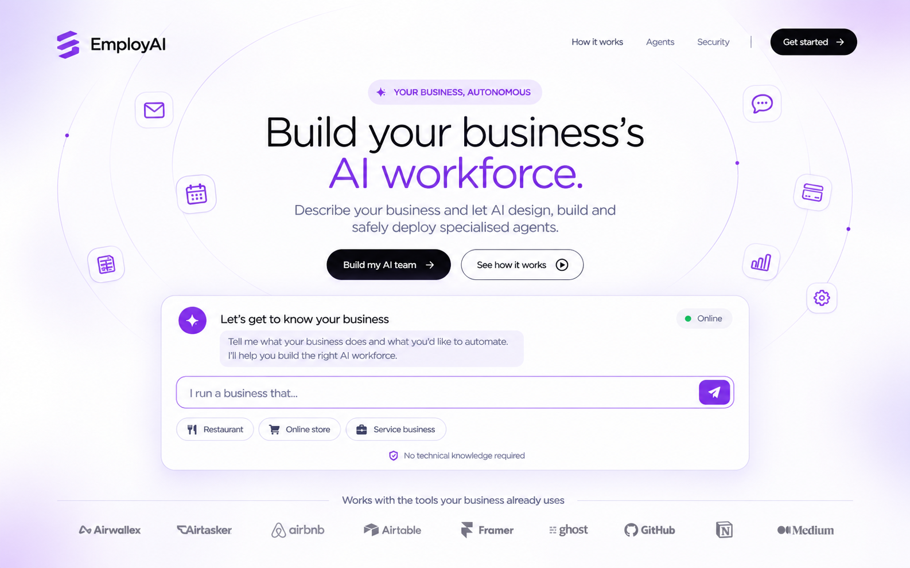

<!--
  Markdown version of docs/EmployAI-PRD.docx (v1.0, 3 November 2026).
  Converted mechanically from the Word file: every paragraph, list item, table,
  callout and verbatim prompt is preserved in source order. Formatting only was
  adapted (Word callout boxes -> blockquotes, monospaced boxes -> code blocks).
  Page header/footer of the Word file: "EMPLOYAI / PRODUCT REQUIREMENTS DOCUMENT"
  and "EmployAI • Hackathon MVP • Page N". If this file and the .docx ever differ,
  the .docx is the original source.
-->
# EmployAI

**PRODUCT REQUIREMENTS DOCUMENT**

Build your business's AI workforce.



*Approved visual direction reference: EmployAI landing-page hero concept.*

Version 1.0  |  3 November 2026  |  Hackathon MVP

**Prepared for implementation with Claude Code**

## Document control

| Field | Value |
| --- | --- |
| Product | EmployAI |
| Document | Comprehensive Product Requirements Document (PRD) |
| Version / status | v1.0 — Build specification; technical validations remain explicit gates |
| Prepared | 3 November 2026 |
| Target event | NEAR HACKATHON 2026 |
| Submission deadline | 14 November 2026, 23:59 UTC (15 November 2026, 00:59 Africa/Lagos) |
| Primary track | Autonomous Business (`business`) |
| Additional target tracks | AI Swarms (`swarms`); AI Security & Defense (`security`) |
| Demonstration business | Independent restaurant / café |
| Primary builder | Claude Code, directed by project owner |

### How to use this document

This PRD is the source of truth for EmployAI’s hackathon MVP. Claude Code must read it before implementation, follow the official NEAR setup prompt first, and treat the three official track prompts as mandatory reference requirements. Where the PRD marks a technical item as “verify”, Claude Code must consult current official documentation and report the result before selecting or implementing the integration.

> **Important implementation rule**
>
> Do not start by generating the whole application in one pass. First read the official setup prompt, inspect HACKATHON.md, install the relevant NEAR agent skills, confirm the three track prompts, then produce the architecture, threat model, swarm RULES.md and implementation plan for human review.

## Contents

1. Executive summary
2. Product definition and vision
3. Problem statement and opportunity
4. Goals, non-goals and success measures
5. Target users and permissions
6. Track strategy and judging alignment
7. MVP scope and priorities
8. Core user journeys
9. Functional requirements
10. Restaurant demonstration scenario
11. AI and multi-agent architecture
12. Workflow generation and execution engine
13. AI Security & Defense architecture
14. AI Swarms procurement market
15. NEAR blockchain and treasury architecture
16. Data model and API boundaries
17. UI/UX specification and design system
18. Motion, accessibility and responsive behaviour
19. Non-functional requirements
20. Recommended technology stack
21. Testing and acceptance criteria
22. Demo plan and judging evidence
23. Delivery plan and milestones
24. Risks, assumptions and decisions to validate
25. Claude Code implementation instructions

- Appendix A. Official setup prompt
- Appendix B. Official Autonomous Business prompt
- Appendix C. Official AI Swarms prompt
- Appendix D. Official AI Security & Defense prompt
- Appendix E. Submission checklist and source links

## 1. Executive summary

EmployAI is a web-based AI-powered Autonomous Business Builder. A business owner describes their business and desired outcomes in natural language. EmployAI acts like a reliable AI business consultant: it asks focused discovery questions, builds a structured understanding of the business, recommends a tailored team of specialised AI agents, generates the workflows those agents need, tests the system, and deploys it only after the owner approves the proposed responsibilities, integrations and permissions.

After deployment, the agents coordinate business operations such as order handling, inventory monitoring, procurement and finance. A deterministic security and governance layer checks proposed actions before execution. NEAR provides the account, restricted-permission and treasury infrastructure for the hackathon’s on-chain demonstration. A separate procurement swarm demonstrates economic coordination among simulated buyer and seller agents.

> **Product proposition**
>
> Describe your business. EmployAI designs, builds and safely deploys a specialised AI workforce, while keeping the business owner in control.

### 1.1 Product in one sentence

EmployAI turns a plain-language description of a business into an approved, testable and monitorable system of collaborating AI agents and automations.

### 1.2 Product structure

| Layer | Purpose |
| --- | --- |
| Autonomous Business | The product outcome: a business system that performs approved operations with bounded autonomy. |
| AI Swarms | The coordination capability: agents collaborate, pool demand, bid, allocate and settle value in a focused procurement market. |
| AI Security & Defense | The trust layer: policy checks, recipient risk assessment, scoped permissions, approval and emergency pause. |

### 1.3 Product scope statement

The MVP is business-agnostic at the discovery and agent-planning level, but its end-to-end demonstration is restaurant/café operations. It is not a full restaurant POS, a general-purpose n8n replacement, a universal integration marketplace or a production-ready financial institution.

## 2. Product definition and vision

### 2.1 Vision

Make useful business automation accessible to owners who do not know how to design workflows or configure AI agents. EmployAI should translate business intent into an explainable workforce and controlled operations, rather than requiring users to learn automation tooling first.

### 2.2 Product principles

- Business-first, not tool-first: users describe outcomes and business rules; they should not need to understand nodes, APIs or smart contracts.
- Consultative discovery: the AI behaves like a capable business operations consultant, asks relevant follow-up questions and explains its recommendations.
- Human-defined autonomy: the owner approves the workforce, tools, permissions, financial constraints and deployment.
- Visible execution: every workflow run and consequential agent action has a status, timestamp, result and audit trail.
- Security is architectural: agents never receive unrestricted access merely because an LLM requested an action.
- NEAR must be meaningful: use NEAR for traceable agent identity, controlled treasury actions and demonstrable settlement—not decorative wallet UI.
- Honest product claims: distinguish live integrations and on-chain activity from simulations, seeded demo data and roadmap items.

### 2.3 Core differentiation

| Generic AI workflow builder | EmployAI |
| --- | --- |
| Starts from an automation request | Starts by understanding the business and its operations |
| Produces a workflow | Proposes a workforce, responsibilities, policies and workflows |
| Focuses on nodes and integrations | Focuses on business outcomes and accountable agents |
| Workflow execution is the end product | Ongoing, observable business operations are the end product |
| Security may be an add-on | Security policy is between agents and consequential actions |

## 3. Problem statement and opportunity

### 3.1 Problem

Small and growing businesses often operate through disconnected applications, spreadsheets, messaging channels and manual coordination. Owners know what they want to improve but may not know how to translate that need into triggers, conditions, API connections, agents and reliable workflows. Existing workflow tools can require technical setup and ongoing maintenance. Giving AI agents access to business tools or money also introduces risks: incorrect actions, prompt injection, excessive spending, untrusted recipients and limited accountability.

### 3.2 Users’ jobs to be done

- Explain how my business works without first designing an automation.
- Understand what can be automated and which agents are actually useful.
- Review and approve what each agent is allowed to do.
- Connect the business tools I already use without exposing credentials to the model.
- Know whether an automation is running, failed, waiting for approval or completed.
- Prevent an agent from exceeding its budget or paying an unsafe recipient.
- Inspect a trustworthy history of what happened and why.

### 3.3 Opportunity

EmployAI combines business discovery, agent design, workflow generation, controlled execution and transaction governance into one experience. The NEAR hackathon allows this to be demonstrated through an autonomous business flow, a procurement coordination market and a transaction-security service.

## 4. Goals, non-goals and success measures

### 4.1 MVP goals

- Allow a first-time visitor to describe a business directly in the landing-page hero and continue that message into a dedicated consultant conversation.
- Collect enough structured information to create an editable business profile and automation brief.
- Recommend a small, explainable set of agents based on the discovered business needs.
- Allow the owner to review, edit and approve agent responsibilities, tools and permissions.
- Generate and execute a constrained workflow using a custom typed workflow engine.
- Enforce security decisions before any consequential tool call or payment.
- Demonstrate a working NEAR testnet treasury action and an auditable ledger.
- Demonstrate an AI swarm market with 20 buyers, 5 sellers, a coordinator, sealed-bid rounds and a live result page.
- Provide an attack demonstration in which a prompt-injected agent attempts a prohibited payment and is blocked.

### 4.2 Non-goals for this hackathon MVP

- General-purpose automation of every industry and every SaaS application.
- Full WhatsApp Business or Instagram production integration unless time and API access permit after core completion.
- Production custody of customer funds or unsupervised mainnet payments.
- Unrestricted user-created executable code or arbitrary server-side JavaScript generated by an LLM.
- Autonomous supplier contracting, legal commitments or real-world purchase fulfilment without human approval.
- An advanced proprietary fraud model or a claim that the platform guarantees recipient safety.
- Commercial billing, subscription management, marketplace monetisation and multi-region enterprise administration.
- Guaranteed privacy, TEE attestation or confidential execution claims unless the exact path is implemented and verified.

### 4.3 Hackathon success measures

| Measure | Target / acceptance evidence |
| --- | --- |
| Business discovery | A first-time user can submit a business description, complete a guided discovery and see a saved business summary. |
| Agent plan | At least four relevant specialist agents plus an orchestrator are proposed for the restaurant scenario; each has purpose, tools and boundaries. |
| Workflow generation | A structured workflow graph is generated, validated, reviewed and executed without arbitrary generated code. |
| Business loop | One complete testnet sale-to-payout demonstration completes in under two minutes, with an auditable ledger. |
| Security | Allow, warn and block outcomes are demonstrated; an injected instruction to pay a seeded bad address is blocked and logged. |
| Swarm | 20 buyer agents and 5 seller agents complete a deterministic sealed-bid simulation; a live page displays rounds, bids, clearing price and allocations. |
| Reproducibility | Public README contains numbered “do X, see Y” steps that a judge can follow. |
| Submission | Public repository, public demo post with video/screenshots, mainnet NEAR prize address and complete form submission before deadline. |

## 5. Target users and permissions

### 5.1 Primary persona: Small-business owner

Profile: owner/operator of a small restaurant, café, retail or service business. They understand their business but do not necessarily understand automation design or blockchain. They need plain language, transparency, low configuration burden and control over financial actions.

Needs: describe the business; answer focused questions; approve a proposed team; connect tools; set limits; see activity; intervene quickly.

### 5.2 Secondary persona: Operations or finance manager

Profile: trusted staff member who monitors order operations, procurement, payments and exceptions. Needs clear status, approval queues, evidence and an activity trail.

### 5.3 Application roles

| Role | Permissions |
| --- | --- |
| Business owner | Owns the workspace; manages business profile; approves agents, integrations, policies and deployment; controls treasury and kill switch. |
| Business operator | Can view operations and carry out explicitly granted tasks; may approve selected low-risk operational items if owner grants permission. |
| AI agent identity | Non-human actor with a defined role, tool allowlist, policy scope and execution history. It cannot grant itself permissions. |
| Platform admin (demo/internal) | Manages demo fixtures and system configuration. Not exposed as a customer business role in the MVP. |

### 5.4 Tenant and ownership rules

- All business records are scoped to a business/workspace and authenticated user membership.
- No user can query another business’s agents, credentials, workflows, transactions or logs.
- Agent actions execute in the context of the owning business and carry actor IDs into the audit log.
- Credentials and private keys are not shown to the browser or sent to an LLM.
- Workspace deletion and data export are future capabilities unless required for the demo; document current retention clearly.

## 6. NEAR hackathon track strategy

The hackathon permits one submission to select every track the project genuinely fits. EmployAI is one product with a primary track and two distinct, evidence-backed capabilities. The team must not select a track solely because its terminology appears in the product description.

| Track | EmployAI role | Evidence required |
| --- | --- | --- |
| Autonomous Business (`business`) | Primary product direction. | Business discovery, agent-owned NEAR account, policy config, bounded autonomous operations, public ledger and testnet sale-to-payout loop under two minutes. |
| AI Swarms (`swarms`) | Dedicated procurement coordination module. | 20 individual buyer agents, 5 seller agents, sub-accounts, coordinator, sealed bids, deterministic strategies, settlement/allocation and live market page. |
| AI Security & Defense (`security`) | Cross-cutting policy and recipient security layer. | Allow/warn/block service, signal-source documentation, agent-side signing wrapper, function-call key scoped to one contract and prompt-injection attack demo. |

> **Track integrity**
>
> The restaurant’s internal agents collaborating on tasks does not, by itself, satisfy the AI Swarms prompt. EmployAI therefore includes a separate procurement swarm market with real coordination mechanics and the prompt’s required simulation. Likewise, a security dashboard is not enough: security decisions must be enforced before signing or transaction execution.

### 6.1 Track submission position

Primary track: Autonomous Business. Additional track selections: AI Swarms and AI Security & Defense only if their mandatory demonstrations are implemented and reproducible. If a required track feature is not completed, remove that track from the final submission rather than overclaiming.

## 7. MVP scope and priorities

### 7.1 Must-have scope (P0)

- Public marketing landing page with working hero input and standard scrollable sections.
- Business discovery conversation with structured profile extraction, saved session and business summary.
- Agent recommendation plan, agent review, edit, approval and deployment status.
- Four specialist restaurant agents: Order/Sales, Inventory, Procurement and Finance; plus Business Orchestrator.
- Constrained workflow definition, validation, run history, retries and approval pauses.
- Deterministic security policy gate: allow/warn/block; business and agent spending rules; recipient checks; audit log; kill switch.
- NEAR testnet treasury contract or validated equivalent with scoped agent authority and a real testnet transaction.
- Public ledger page for the demonstration showing sales, inference cost, payouts and on-chain references.
- Swarm module matching the official 20-buyer / 5-seller simulation requirements.
- Prompt-injection attack script/demo, with the attempted unsafe action stopped and explained.
- AI-judge-friendly README and clean public repository.

### 7.2 Should-have scope (P1)

- Generic webhook trigger and generic HTTP connector with strict allowlisting.
- Email or in-app notifications for exceptions and approvals.
- Agent run replay / inspectable execution timeline.
- Owner-editable policy configuration exported as YAML or JSON.
- Simple visual workflow canvas showing node sequence and statuses.
- Business profile editing and resumable onboarding.

### 7.3 Stretch / defer (P2)

- Live WhatsApp Business integration.
- Live cross-chain NEAR Intents swap/payment on mainnet with an explicitly approved low-value test, if access and safety checks pass.
- Production TEE attestation panel, only if it can be verified end-to-end.
- Additional business templates and industries.
- Advanced analytics and custom reporting.

## 8. Core user journeys

### 8.1 Landing-page entry

**1.** Visitor opens EmployAI’s public landing page. The page communicates the value proposition and provides a conversational business-description input in the hero.

**2.** Visitor may type a description, select a suggested business prompt, click Get started, or simply scroll through the marketing content. No message is required to browse the page.

**3.** If the visitor submits a message, the system creates a draft discovery session, stores the initial message and routes to the dedicated onboarding consultant page.

**4.** The onboarding page displays the original message in the conversation. The user must never be asked to re-enter it.

**5.** If the visitor clicks a CTA without typing, the app opens a fresh onboarding conversation with a concise welcome and asks them to describe the business.

### 8.2 Business discovery

**1.** The AI consultant acknowledges the initial description and identifies missing information needed to understand the business.

**2.** It asks focused, progressive questions rather than displaying a long questionnaire. The user can answer in natural language, skip nonessential questions or correct earlier answers.

**3.** The AI extracts structured facts: business type, products/services, customers, channels, team, current tools, operational processes, pain points, desired outcomes and constraints.

**4.** The interface displays a “What I have understood” summary that updates as information is captured.

**5.** When sufficient information exists, the consultant presents a business discovery summary and asks the user to confirm or edit it.

### 8.3 Workforce proposal and approval

**1.** The system maps confirmed business needs to agent capabilities. It recommends only agents with a clear purpose; it must not create an agent simply to increase the count.

**2.** Each proposed agent shows name, purpose, responsibilities, triggers, tools required, data access, allowed actions, prohibited actions, financial authority and dependencies.

**3.** The owner can approve, edit, remove or request an alternative recommendation. Approval is recorded with timestamp and policy version.

**4.** The owner connects required integrations and grants the minimum necessary permissions. Credentials are stored in the secrets layer and never exposed to an LLM.

### 8.4 Build, test and deploy

**1.** The generator creates a validated workflow graph using only registered node/action types.

**2.** The system runs static validation: missing credentials, invalid nodes, invalid edges, unhandled branches, loops without limits, unsafe actions and policy violations.

**3.** The user sees a test plan and sample run results. A workflow cannot be deployed while critical validation errors remain.

**4.** The owner approves deployment. The system records the approved version and activates the relevant triggers.

### 8.5 Operate, review and intervene

**1.** The workspace shows operational status, agent health, workflow runs, exceptions, approvals, financial activity and security events.

**2.** When a workflow requests a high-risk action, execution pauses and a human approval request is created with amount, recipient, reason, policy checks and expiry.

**3.** The owner can approve, reject, pause an agent or activate the business kill switch. All interventions are recorded.

## 9. Functional requirements

Priority key: P0 = required for the MVP; P1 = important if time allows; P2 = stretch. Acceptance criteria are observable and should be converted into tests.

| ID / requirement | Priority | Description | Acceptance criteria |
| --- | --- | --- | --- |
| FR-01 Public landing page | P0 | Render responsive marketing landing page with navbar, hero, conversational entry, how-it-works, agent capabilities, workflow scenario, security, integrations (only supported tools), FAQs, CTA and footer. | Page works without chat interaction; anchors work; no invented testimonials, client logos, metrics or integrations. |
| FR-02 Hero conversation entry | P0 | Accept natural-language description and suggested prompt chips. On submit, create a discovery session and navigate to onboarding. | Submitted text persists and appears as the first user message; empty submit is disabled; visitor can scroll normally. |
| FR-03 Discovery consultant | P0 | Conduct focused follow-up conversation; store turns; ask clarifying questions; support resume and corrections. | A restaurant description results in a structured discovery brief without a long fixed questionnaire. |
| FR-04 Business profile extraction | P0 | Extract structured profile fields into a validated schema; distinguish confirmed facts, assumptions and unknowns. | User can review/edit; unconfirmed assumptions are clearly labelled. |
| FR-05 Business summary confirmation | P0 | Generate editable summary of business, process, bottlenecks, goals and constraints. | Agent recommendation cannot proceed as final until user confirms or edits the summary. |
| FR-06 Agent recommendation | P0 | Recommend agents based on confirmed needs and explain why each is needed. | Restaurant demo recommends Orchestrator plus Order, Inventory, Procurement and Finance agents. |
| FR-07 Agent review and configuration | P0 | Show responsibilities, tools, triggers, read/write scopes, financial permissions and prohibited actions. | Owner can edit/remove/approve; no agent is active before owner approval. |
| FR-08 Integrations and secrets | P0 | List required connectors; allow demo webhook and internal services; store credentials server-side in encrypted secret storage. | Credentials never appear in prompts, logs, frontend payloads or Git history. |
| FR-09 Workflow generation | P0 | Generate constrained DAG/graph JSON from approved agent plans. | Every node type is allowlisted; schema validation rejects unknown executable instructions. |
| FR-10 Workflow validation and test | P0 | Validate graph and run test mode with sample data. | Invalid graph cannot deploy; test results show expected vs actual outputs. |
| FR-11 Workflow execution | P0 | Execute approved node types with persisted run state, retries, idempotency, timeouts and approval pauses. | A run can be inspected; duplicate event delivery does not double-charge or double-pay. |
| FR-12 Agent orchestration | P0 | Coordinate specialist agents, pass structured task/result objects and record handoffs. | Every delegation is logged with requester, assignee, task, status and result. |
| FR-13 Human approval queue | P0 | Pause warn/high-risk actions and present approve/reject with context. | No action executes before approval; approval can expire or be rejected. |
| FR-14 Security policy gate | P0 | Return allow/warn/block with reason codes before tool call or payment. | Block is technically enforced and cannot be overridden by natural-language instruction. |
| FR-15 Treasury and NEAR account | P0 | Provide business/agent identity and treasury interaction using testnet-first approach and restricted permissions. | No full-access key is stored in plaintext; a real testnet transaction is traceable. |
| FR-16 Public demo ledger | P0 | Show sales, costs, inference spend, payouts and chain transaction references. | Ledger distinguishes on-chain events from off-chain records and simulated demo items. |
| FR-17 Procurement module | P0 | Represent suppliers, quotes, purchase requests and order status for the restaurant demo. | Owner can inspect offers and purchase decision rationale. |
| FR-18 Procurement swarm market | P0 | Run 20 deterministic buyer agents and 5 seller agents; coordinate sealed bidding and allocations. | Live page shows rounds, bid state, clearing price and each buyer’s allocation; no LLM calls in simulation. |
| FR-19 Security attack demo | P0 | Run prompt-injection scenario attempting a payment to a seeded bad recipient. | Security blocks request, no signature/payment occurs, log records prompt and rule-based reason. |
| FR-20 Emergency pause | P0 | Business-level and agent-level kill switch. | Pausing prevents new actions and stops/cancels queued actions where safe; current irreversible transactions are clearly reported. |
| FR-21 Activity and observability | P0 | Show agent actions, workflow runs, security decisions, human approvals and transaction status. | Every consequential event has timestamp, actor, business, status and correlation ID. |
| FR-22 Business settings | P1 | Edit business profile, notification preferences, working hours and policies. | Changes are versioned and affect future runs only unless user confirms update to active workflows. |
| FR-23 Generic webhook/HTTP connector | P1 | Allow registered webhook triggers and allowlisted outbound HTTP actions. | SSRF protections, domain allowlists and secret handling are enforced. |
| FR-24 Onboarding progress/resume | P1 | Save discovery session and provide resume link after sign-in. | Refreshing or leaving does not lose a persisted session. |

## 10. Restaurant demonstration scenario

### 10.1 Demo business

Use a fictional independent restaurant/café. The sample dataset must be fictional and clearly marked as demonstration data. The customer can describe any business during onboarding, but the hackathon’s end-to-end seeded workflow is restaurant operations.

### 10.2 Restaurant business profile data

| Field | Demo value / behaviour |
| --- | --- |
| Business type | Independent restaurant / café |
| Order channels | In-app demo order form and webhook trigger; social channels are mentioned as future/optional integrations unless actually connected. |
| Menu and prices | Seeded menu items with stock requirements and minimum order/margin policy. |
| Inventory | Ingredients such as rice, chicken, oil and packaging; reorder thresholds. |
| Suppliers | Five seeded suppliers represented by seller agents in the swarm environment. |
| Financial policy | Owner-controlled `config.yaml`: daily inference spend cap, minimum sale/order value or margin floor, transaction limits, approved counterparties, approval thresholds, revenue split percentages and kill switch. Revenue shares must total 100%. |
| Payments | Testnet treasury/contract payment. Cross-chain Intents path is a separate verified and explicitly approved optional route. |
| Owner controls | Agent permissions, approval thresholds, pause/kill switch and audit access. |

### 10.3 Main end-to-end business loop

**1.** Customer places a sample order through the demo form or a webhook.

**2.** Order Agent validates required fields and checks current menu availability.

**3.** Inventory Agent checks stock and identifies a replenishment need.

**4.** Orchestrator delegates procurement to Procurement Agent.

**5.** Procurement Agent requests supplier quotations and presents comparable offers.

**6.** Finance Agent checks available budget and policy constraints.

**7.** Security service checks recipient signals, allowlist, spend cap, agent scope and current kill-switch state.

**8.** If decision is WARN, run pauses for owner approval. If BLOCK, payment is denied and logged. If ALLOW, the approved contract-mediated transaction can proceed.

**9.** Treasury contract records and executes the authorised payout on NEAR testnet.

**10.** Ledger records sale, inference cost, payout and transaction hash; inventory and workflow status update.

### 10.4 Under-two-minute transaction loop

The Autonomous Business starter prompt asks for one complete sale-to-payout testnet loop in under two minutes. The demo should use seeded data, prepared accounts and deterministic workflow inputs so setup time is not included in the measured loop. Report actual elapsed time in the README/demo; do not claim the target until measured.

## 11. AI and multi-agent architecture

### 11.1 Architectural roles

| Component | Responsibilities | Must not do |
| --- | --- | --- |
| Business Discovery Consultant | Ask questions; extract structured business facts; identify uncertainty; prepare discovery brief. | Cannot create live agents, issue credentials or execute transactions. |
| Business Orchestrator | Plan tasks, delegate to approved agents, manage dependencies and collect results. | Cannot bypass the security layer or grant permissions. |
| Order/Sales Agent | Validate order, menu availability, customer/order status and order notifications. | Cannot change prices or refund without policy permission. |
| Inventory Agent | Track stock, thresholds, demand and proposed replenishment. | Cannot purchase or alter financial policies. |
| Procurement Agent | Obtain/compare supplier offers, prepare purchase requests and participate in swarm. | Cannot select unknown recipients for payment without security checks. |
| Finance Agent | Calculate budget, track revenue/costs and request approved payments. | Cannot hold unrestricted wallet key or bypass contract policy. |
| Security Service | Deterministic rule and risk evaluation; reason codes; hold/block actions. | Must not rely on free-form LLM output as the sole enforcement decision. |
| Swarm Coordinator | Open rounds, collect/reveal sealed bids, calculate clearing price and allocations. | Simulation strategies must not require LLM calls. |

### 11.2 AI provider abstraction

Use a provider adapter so EmployAI can call NEAR AI Cloud initially while keeping the model/provider replaceable. The initial documented base URL is https://cloud-api.near.ai/v1 from the official NEAR track prompt; Claude Code must verify the current endpoint, authentication, models endpoint, tool-calling behaviour, structured output and rate limits against the live NEAR AI Cloud docs before coding.

- Keep API key server-side in environment/secret storage only.
- Use structured JSON output with schema validation for business profile, agent proposal, workflow graph and security explanation.
- Use bounded output tokens and explicit timeouts; record provider/model and token usage per request.
- Apply business-level and agent-level inference budgets. Enforce limits before requesting further inference. Record provider, model, usage, estimated cost and budget remaining per agent.
- Investigate the NEAR AI staking-based compute-credit option as the potential way for a business/agent to fund inference with NEAR. Verify whether it supports a programmatic agent-owned or policy-bound funding flow; do not assume that a user-facing staking feature is automatically controllable by an agent.
- If agent-controlled inference funding cannot be proven within the hackathon, use server-side per-agent API keys/spend caps where available, track inference cost against the agent budget and clearly describe this as owner-funded inference with agent-level cost controls—not as the agent independently purchasing inference.
- Use cheaper deterministic code for repeatable swarm simulation; do not call an LLM for each of the 25 simulated agents.
- Never treat model output as trusted code, a policy update or proof that a payment is safe.

### 11.3 Agent generation contract

The generator creates proposed agent definitions, not arbitrary executable agents. Each definition must conform to a versioned schema containing agent_id, name, purpose, instructions, triggers, allowed_tools, read_scopes, write_scopes, financial_permissions, prohibited_actions, approval_requirements, model_config and version. The owner approves the definition and policy before activation.

### 11.4 Prompt and context management

- System instructions are version-controlled in the repository and reviewed like code.
- Business profile data is provided as structured context, separate from untrusted user/customer/supplier content.
- External messages, documents and webhook fields are untrusted data, not instructions that can override system or business policies.
- Agent-to-agent communication uses typed task/result payloads with provenance and bounded payload sizes.
- Important decisions include a concise explanation and reference to the policy/rule used.
- Logs must avoid storing secrets, full payment credentials or unnecessary sensitive customer data.

## 12. Workflow generation and execution engine

### 12.1 Decision: custom lightweight engine

MVP recommendation: implement a small typed workflow engine rather than embedding the n8n Community edition as a customer-facing builder. n8n’s Sustainable Use License FAQ, updated 6 October 2026, says a product that lets external customers build/configure automations through its editor, API, MCP or AI agent requires a commercial license. This use case is central to EmployAI, so do not embed n8n Community unless a suitable commercial agreement is obtained and reviewed. n8n may be used privately as a learning/reference tool, not as the customer runtime for this MVP.

### 12.2 Workflow graph model

A workflow is a versioned directed acyclic graph (DAG) of typed nodes and edges. Cycles are rejected in the MVP unless a future loop node has explicit iteration/time limits. The model stores a graph definition, trigger configuration, node parameters, edge conditions, required connectors, policy bindings and version metadata.

| Node type | MVP function |
| --- | --- |
| Trigger | Manual demo trigger, webhook trigger or internal event. |
| Agent task | Call an approved specialist agent with a typed input/output contract. |
| Condition | Evaluate deterministic expression against workflow context. |
| Action | Execute an allowlisted connector action (e.g. create order record, update stock, notify). |
| Approval | Pause run and create human approval task. |
| Security check | Call security policy service before sensitive action. |
| NEAR treasury action | Submit a request to the approved treasury contract; never sign unrestricted transfer directly. |
| Wait / resume | Persist execution and resume on approval or callback. |
| Notification | Display or send an approved notification. |
| End | Mark completed, failed, rejected or cancelled. |

### 12.3 Workflow generation and validation

- LLM emits JSON matching the workflow schema; it does not emit arbitrary code.
- Validate node types, schemas, required fields, credential references and edge references.
- Validate that all sensitive paths include a security-check node and, where needed, an approval node.
- Check that all payment nodes reference a business policy and approved treasury destination.
- Check for unbounded loops, missing failure handling and unsupported connectors.
- Create immutable workflow versions; editing a deployed workflow creates a new draft version requiring tests and approval.

### 12.4 Runtime behaviour

- Persist each workflow run, node execution, status, inputs/outputs (redacted), timing and error.
- Use idempotency keys for payment, order creation and external action nodes.
- Use bounded retries with exponential backoff for retryable network errors; never blindly retry a completed payment.
- Support paused state for human approval and external callbacks.
- Enforce execution timeout, per-node timeout, maximum node count and maximum total run duration.
- Use a separate background worker process for long-running jobs; do not rely on a browser tab remaining open.
- Provide a run detail timeline showing started, completed, waiting, retried, blocked and failed states.

### 12.5 n8n decision

> **Do not embed n8n Community as the customer-facing runtime**
>
> n8n’s 6 October 2026 license FAQ explicitly says external customers configuring automations through a product or AI agent requires a commercial license. Build the EmployAI runtime as a constrained custom engine for the MVP. Re-evaluate only if a suitable license is obtained.

## 13. AI Security & Defense architecture

### 13.1 Security gate

Every consequential action must pass through the security service before tool execution or transaction signing. The service returns exactly one decision: ALLOW, WARN or BLOCK, together with reason codes, signal summaries, policy version, timestamp and correlation ID.

| Decision | Required behaviour |
| --- | --- |
| ALLOW | Proceed only if all mandatory policy checks pass. Log the decision before execution. |
| WARN | Pause. Create an approval request with action, amount, recipient, evidence, reason and expiry. Do not sign or execute before approval. |
| BLOCK | Reject action. Do not produce a signature or call the payment contract. Log the attempted action and reasons. |

### 13.2 Risk signals and data sources

| Signal required by prompt | Proposed source / implementation | Fallback behaviour |
| --- | --- | --- |
| Account age and activity history | Documented NEAR indexer or explorer API, with source/provider configurable; RPC for current account/access-key state. Verify provider accuracy and rate limits. | If historical age/activity cannot be verified, mark UNKNOWN and apply WARN for material payments; never invent age. |
| Receiver is contract; code changed recently | NEAR RPC account view and contract code hash; store previous observed hash / event history to detect changes. | Unknown or first-seen contract is not automatically trusted; WARN when policy requires. |
| Prior agent/receiver interactions | EmployAI transaction/action history keyed by business, agent and receiver; cross-check public tx reference where available. | No prior interaction means first-time recipient; apply policy-specific WARN or low-risk handling. |
| Shared blocklist with evidence | EmployAI database of reports with submitter, evidence reference, review state, timestamp and reason. Seed a clearly labelled demo bad address. | Unreviewed reports may warn; confirmed block entries block. Provide review/expiry process to reduce poisoning. |
| Policy and spending constraints | Owner-approved business policy stored in DB and, for treasury-critical checks, enforced again in smart contract. | Missing/invalid policy blocks sensitive action. |

### 13.3 Agent-side signing wrapper

- Agent asks the application security service to evaluate a structured action request.
- Only ALLOW reaches the signing/treasury adapter; WARN creates an approval task; BLOCK returns a hard rejection.
- The agent has no direct access to a full-access account key.
- For the AI Security track demonstration, use a NEAR function-call access key scoped to one treasury contract and permitted methods; OutLayer custody may be evaluated as an additional option but must not silently replace this explicit prompt requirement.
- Because function-call keys cannot perform native NEAR transfers directly, use a treasury contract that verifies the caller and enforces policy before transferring funds.
- Contract policy must be the final enforcement point for maximum amount, approved recipient, paused state and allowed method.

### 13.4 Prompt-injection demonstration

Create a reproducible attack script that supplies hostile content to an agent, instructing it to ignore normal rules and pay a known-bad testnet address. The security wrapper must identify the payment request, evaluate recipient and policy signals, return BLOCK, avoid transaction signing, and write an audit event. The demo must show the malicious instruction, blocked decision, reasons and absence of a transaction hash.

### 13.5 Emergency controls

- Business kill switch blocks new agent runs and new treasury requests for the workspace.
- Agent pause blocks that agent’s new actions without pausing unrelated agents unless policy dictates.
- Pending approval requests become invalid when kill switch is activated.
- In-flight actions are inspected; actions already signed or submitted cannot be represented as cancelled. Show their true chain status.
- Re-enable requires an authorised owner action and audit record.

### 13.6 Security boundaries

Security controls must be implemented server-side and/or in the treasury contract, not merely as UI states. LLM-based explanations may help users understand a decision, but deterministic policy checks and contract rules determine whether the action can execute. Do not claim the service guarantees that a recipient is safe.

## 14. AI Swarms procurement market

### 14.1 Purpose

Provide a standalone but integrated procurement coordination module that demonstrates genuine economic coordination between agents. The restaurant can access Procurement from its workspace; the hackathon demonstration uses multiple fictional restaurants as buyers and supplier agents as sellers to pool demand for common restaurant supplies.

### 14.2 Required participant model

| Participant | Count | Function |
| --- | --- | --- |
| Buyer agents | 20 | Each represents one restaurant buyer with demand, maximum budget and a deterministic purchasing strategy. |
| Seller agents | 5 | Each represents a supplier with inventory, reserve price, capacity and deterministic bidding strategy. |
| Coordinator | 1 | Opens rounds, accepts sealed bids, closes/reveals bids, applies market rules, determines winner and allocations. |
| Parent NEAR account | 1 | Parent for 25 distinct buyer/seller testnet sub-accounts. Account naming, provisioning and funding must be verified in the early technical spike. |

### 14.3 Adapted market scenario

Use a fictional collective purchase of bulk restaurant supplies (for example, rice or cooking oil) instead of the original prompt’s GPU-hour example. Each of 20 buyer agents represents a separate restaurant requirement. Five seller agents compete to fulfil the pooled demand. The system calculates the best qualifying offer and each buyer’s share. This is an EmployAI adaptation; the original prompt text remains preserved in Appendix C.

### 14.4 Market rules

- Write `RULES.md` before implementing contracts. Include round lifecycle, eligibility, sealed-bid handling, reveal, tie-breaking, capacity constraints, clearing-price formula, allocation formula, cancellation and settlement rules.
- Write a text sequence diagram for one complete round and wait for approval before writing contracts, as requested in the official prompt.
- Use deterministic scripted strategies for the 20 buyers and 5 sellers. No LLM calls in the simulation path.
- Persist every round, bid commitment, reveal, clearing price, winner and allocation.
- Ensure deterministic replay from a fixed random seed or fully specified strategies.
- Create distinct sub-accounts for each buyer and seller agent beneath the parent, if supported by account naming and funding constraints. Every on-chain action must be traceable to a specific agent.
- If 25 on-chain accounts cannot be created within faucet/latency/time constraints, report the blocker early and propose the smallest transparent fallback; do not silently fake on-chain identities.

### 14.5 Swarm UI

- Current round, round status and countdown/close status.
- Number of eligible buyers and sellers.
- Buyer demand pool and seller capacity.
- Sealed bid status before reveal; revealed bids and bid amounts after close.
- Winning seller, clearing price and price comparison.
- Allocation per buyer and estimated individual share.
- On-chain transaction/reference status and per-agent identity.
- Event timeline and deterministic replay/demo controls.

## 15. NEAR blockchain and treasury architecture

### 15.1 Testnet-first principle

All contract development, account provisioning, permission tests and native NEAR treasury demonstrations begin on testnet. Current endpoints, SDK versions, contract addresses, account rules and signer semantics must be checked in official NEAR documentation immediately before implementation. No address or endpoint may be guessed or copied from an outdated snippet.

### 15.2 Account and authority model

- Create a business/parent account for the demo and dedicated agent sub-accounts where required by the track prompts.
- Give the finance/treasury agent the minimum required authority. Do not store a full-access private key in plaintext or commit it to the repository.
- For the AI Security track, provision a function-call key scoped to the treasury contract and allowed methods. OutLayer custody may be evaluated as an additional custody layer, but it does not automatically replace the track prompt’s scoped function-call-key requirement.
- Function-call keys are restricted to a specific contract and method set. They do not provide unrestricted account control and cannot directly make native transfers.
- For contract-mediated payments, hold funds in a treasury smart contract and have the restricted key call an allowed method. The contract checks agent identity, policy, recipient, amount, daily limits and pause state.
- Have a separate owner-authorised path for changing policy or replenishing the treasury. Do not allow the agent key to alter its own limits.

### 15.3 Treasury contract responsibilities

The contract design should be produced after reading the NEAR smart-contract and access-key documentation. Conceptual responsibilities include registering authorised agent identities, reading the active policy, checking spending caps, restricting recipients, applying the kill switch, recording a payment event and transferring funds only when every on-chain condition passes. The exact contract API and storage model must be proposed in a design review before coding.

#### 15.3.1 Owner policy configuration

Maintain a versioned `config.yaml` (or a validated database representation exported to `config.yaml`) as the canonical owner-defined business policy for the hackathon demonstration. It must include: maximum inference spend per day; minimum sale/order price or minimum gross-margin floor; maximum payment per transaction and per day; approved recipients; approval threshold; revenue split percentages; and an owner-controlled kill switch. Validate numeric values, prevent negative limits, require revenue shares to sum to 100%, record the policy version, and prevent agents from changing policy fields. Sensitive on-chain limits must also be enforced by the treasury contract, not only by the YAML file.

### 15.4 NEAR Intents constraint

> **Important integration constraint verified 3 November 2026**
>
> OutLayer’s current Agent Custody documentation states NEAR Intents is mainnet-only: its testnet API has no testnet Intents solvers, and Intents-dependent routes return HTTP 503 on testnet. Therefore, do not claim a testnet NEAR Intents payment. Use a testnet-compatible treasury/NEAR contract flow for the required reproducible testnet loop. Treat any real NEAR Intents route as a separate, optional, explicitly approved low-value mainnet proof-of-concept after the current docs, authentication and safety requirements are verified.

### 15.5 Payment abstraction

Create a payment adapter interface with at least: `testnet_treasury` (MVP required), `intents_mainnet` (optional, gated) and `simulated` (demo-only, visibly labelled). The UI and ledger must always disclose the selected mode. Never show a simulated result as an on-chain transaction.

### 15.6 Public ledger

The ledger should expose transaction hash, chain/network, action type, amount/asset, payer account, recipient account, agent identity, status and timestamp. Keep personal customer data, email addresses and sensitive supplier details off-chain. Store only the minimum useful reference/metadata in event logs or contract events.

### 15.7 Agent-funded inference validation

The Autonomous Business prompt’s example expects the agent to buy its own inference from NEAR AI Cloud. NEAR announced staking-based AI compute credits on 30 July 2026, converting staked NEAR into recurring inference credits. The technical spike must determine whether the current staking/credit interface supports a programmatic, policy-bound agent funding flow. If it does, document its custody, staking, un-staking, spend-limit and recovery model and integrate only after owner approval. If it does not, implement per-agent API-key spend caps where supported, measure inference cost per agent and enforce the daily limit in EmployAI; accurately label that as metered, owner-funded inference rather than an autonomous agent purchase. See the linked NEAR AI pricing and staking references in Appendix E.

## 16. Data model and API boundaries

### 16.1 Core entities

| Entity | Purpose / key fields |
| --- | --- |
| users | Auth identity, email, display name, created_at. |
| businesses | Owner, name, type, description, timezone, currency, profile status, demo flag. |
| business_members | Business/user relationship, role, permissions. |
| discovery_sessions | Session status, initial message, conversation state, extracted profile, confirmation timestamp. |
| conversation_messages | Session, role, content, metadata, token usage; redact sensitive fields. |
| business_profiles | Structured business facts, sources, confidence, confirmed flag, version. |
| agents | Business, type, name, purpose, instructions, status, version. |
| agent_permissions | Agent, tool, read/write scopes, allowed methods, financial limits, approval requirements. |
| integrations | Business, connector type, status, config reference; never raw secrets. |
| secrets | Encrypted credentials or references to a secrets manager; access audited. |
| workflows | Business, name, graph definition, version, status, approved_by. |
| workflow_runs | Workflow version, trigger, status, start/end, correlation ID, idempotency key. |
| node_runs | Run, node, state, input/output redacted, error, timing, attempts. |
| security_policies | Business policy version, limits, allowlists, approval thresholds, kill switch. |
| security_decisions | Action hash, allow/warn/block, reasons, signals, policy version. |
| approval_requests | Action, requester/agent, amount, recipient, expiry, status, approver. |
| suppliers | Supplier identity, status, contact reference, demo flag. |
| purchase_requests | Need, quantity, budget, status, source workflow. |
| swarm_rounds | Round status, rules version, demand pool, seller capacity, clearing price. |
| swarm_agents | Buyer/seller role, sub-account, deterministic strategy, status. |
| swarm_bids | Commitment, reveal value, seller, round, timestamps. |
| swarm_allocations | Buyer, quantity, price/share, settlement status. |
| transactions | Network, hash, from/to, amount, asset, agent, purpose, status. |
| activity_events | Business, actor, event type, subject, timestamp, correlation ID, redacted payload. |

### 16.2 Data isolation and audit

- Enable Supabase Row Level Security on business-owned tables. Validate membership server-side for every operation.
- Keep system/admin tables separate from customer-owned data.
- Never store plaintext API secrets, seed phrases or private keys in ordinary business tables.
- Use redaction before storing model prompts, workflow inputs and action outputs.
- Use immutable event records for security decisions and financial activity. Corrections are appended as new events, not destructive edits.

### 16.3 Suggested API boundaries

| Area | Example endpoints (final paths may vary) |
| --- | --- |
| Discovery | POST /discovery-sessions; POST /discovery-sessions/:id/messages; GET /discovery-sessions/:id; POST /discovery-sessions/:id/confirm |
| Agent planning | POST /businesses/:id/agent-proposals; POST /agent-proposals/:id/approve; PATCH /agents/:id |
| Workflows | POST /workflows/generate; POST /workflows/:id/validate; POST /workflows/:id/test; POST /workflows/:id/deploy; GET /workflow-runs/:id |
| Security | POST /security/evaluate; POST /approvals/:id/decision; POST /businesses/:id/pause; POST /agents/:id/pause |
| Procurement/swarm | POST /purchase-requests; POST /swarm/rounds; POST /swarm/rounds/:id/close; GET /swarm/rounds/:id |
| Treasury | POST /treasury/payment-requests; GET /treasury/ledger; GET /transactions/:id |
| Connectors | POST /webhooks/:connector; GET /integrations; POST /integrations/:id/authorize |

## 17. UI/UX specification and design system

### 17.1 Design direction

EmployAI should look like a premium, calm and reliable SaaS platform. The interface must make a complex AI operations system feel understandable to a non-technical business owner. Avoid crypto-native visual tropes, excessive neon, dense analytics-first layouts and overly playful chatbot styling. Use the EmployAI wordmark consistently; the symbol in the supplied hero reference is a visual placeholder until a final logo asset is approved.

### 17.2 Brand and design tokens

| Token | Value | Usage |
| --- | --- | --- |
| Brand name | EmployAI | Use exact casing in all surfaces. |
| Typeface | Manrope | Light, clean and restrained. Use weights 300, 400 and 500 as the normal range; use heavier weights sparingly. |
| Primary | #111111 | Main text, primary buttons, key navigation. |
| Secondary | #482477 | Purple accent, hover/focus, selected state and key highlights. |
| Pale lavender | #F3EFF9 | Soft surfaces, selected backgrounds and chat message tint. |
| Soft background | #F8F8FA | Application canvas. |
| White | #FFFFFF | Cards and elevated content areas. |
| Border | #E4E0EA | Subtle card/input borders. |
| Icons | Outline-only Lucide icons | No filled decorative icons. Keep stroke weight and size consistent. |

### 17.3 Button and control styles

| Component | Default | Hover / focus | Interaction |
| --- | --- | --- | --- |
| Primary button | Black fill, white text; medium weight; moderate radius. | Deep-purple accent or purple-tinted focus ring, with accessible contrast. | Short 150–200ms transition. |
| Secondary button | White/transparent fill, black outline and black text. | Subtle pale-lavender background or purple border. | Short 150–200ms transition. |
| Inputs | White fill, subtle border, Manrope 400; visible label/placeholder. | Purple focus border/ring. | Clear disabled, error and success states. |
| Cards | White surface, subtle border and restrained radius. | Slight lift and border tint only where clickable. | No heavy shadows. |
| Badges/status | Neutral styling by default. | Use success/warning/danger colour only for semantic status. | Pair icon/colour with text label. |

### 17.4 Landing page structure

| Section | Content and behaviour |
| --- | --- |
| Navbar | EmployAI wordmark; How it works, Agents/Capabilities, Security, Sign in and Get started. Sticky or subtly changing surface on scroll. |
| Hero | Headline “Build your business’s AI workforce.” Supporting copy in light weight. Primary CTA “Build my AI team”; secondary CTA “See how it works”. Interactive conversation card is central to the hero. |
| Hero chat | Introductory consultant message; business description input; send button; example prompts (Restaurant, Online store, Service business); “No technical knowledge required” note. Empty input does nothing; page remains a normal landing page. |
| How it works | Four steps: describe business; discover operations; review proposed workforce; build, test and deploy. |
| AI workforce | Explain orchestrator and example specialist agents; use examples, not unverified claims. |
| Business workflow scenario | Visual narrative showing order → inventory → procurement → security → authorised payment → ledger. |
| Security and control | Explain permissions, spending limits, approval queue, recipient checks and kill switch. |
| Integrations | Show only integrations available in the current build. Use generic category illustration until a connector is implemented. |
| FAQs | Explain how it works, technical knowledge, permissions, payments, security and supported tools. |
| Final CTA | Invite the visitor to start business discovery. |
| Footer | Product links, documentation, contact, privacy and terms placeholders clearly marked until real pages exist. |

### 17.5 Landing-page behaviour when the hero input is unused

- The hero input is an optional quick-start, not a mandatory gate or modal.
- Visitors can scroll through every marketing section without typing or creating an account.
- “See how it works” scrolls to the How it works section.
- “Get started” opens onboarding with a clean new session; the initial consultant prompt asks the visitor to describe the business.
- Suggested prompt chips populate the input; they do not submit automatically unless the user explicitly selects a chip if that behaviour is designed and labelled.
- If the user submits text, persist it in a new discovery session and route to onboarding. Preserve text exactly, subject to safe length limits and sanitisation.
- If the visitor is unauthenticated, use a temporary secure session and request sign-in at a sensible persistence/deployment boundary. Do not discard the initial message.

### 17.6 Conversational onboarding: business consultant layout

The onboarding experience should feel like a reliable AI business consultant, not a generic ChatGPT clone. Use a structured workspace with the conversation as the primary column and a compact “Business brief” context panel on desktop.

| Area | Content |
| --- | --- |
| Top bar | EmployAI identity, business discovery stage/progress, save status, account/sign-in control. |
| Main conversation | Consultant messages, user replies, typing/loading state, follow-up prompts and a persistent message composer. |
| Context panel | “What I understand” summary; business type, channels, tools, workflows, goals, constraints and unknowns; items update as confirmed. |
| Progress indicator | Understand business → Map operations → Recommend agents → Review plan. Do not imply work is complete when it is not. |
| Message controls | Send, retry failed request, edit/retract last user answer where practical, copy response, clear error state. |
| Mobile behaviour | Conversation is full width; context panel becomes a collapsible sheet/drawer. |

### 17.7 Business workspace navigation

| Navigation item | Primary screen content |
| --- | --- |
| Overview | Business status, agent health, active workflows, recent activity, pending approvals, recent financial ledger. Empty states must explain what to do next. |
| AI Workforce | Agent list/cards, statuses, role descriptions, permissions and recent runs. |
| Automations | Workflow list, visual graph, versions, test/deploy controls, run history. |
| Activity | Unified timeline of agent actions, workflow events, approvals, security decisions and transactions. |
| Procurement | Purchase requests, suppliers, quotations, swarm marketplace and allocations. |
| Treasury | Network badge, account addresses, balance if available, transaction history and public ledger. |
| Security Centre | Policies, approved recipients, risk signals, allow/warn/block events, approval queue and emergency pause. |
| Integrations | Connected tools, required scopes, credential status and connection health. |
| Settings | Business profile, members, policies, preferences and account details. |

### 17.8 Agent detail screen

Each agent detail page should include Overview, Responsibilities, Tools & Permissions, Workflows, Activity and Settings. Clearly separate read access, write/action access and financial authority. Display account identity only where available and never expose secret keys.

### 17.9 Workflow workspace

Provide a visual workflow canvas or graph view with triggers, agent nodes, conditions, actions, approvals, security checks and NEAR actions. For the MVP, visual editing may be constrained to supported node configuration; do not attempt to reproduce all of n8n. A side panel should show node configuration, required connector, permission scope and validation results. Provide a readable list/timeline alternative for small screens and accessibility.

### 17.10 Security Centre screen

Show policy settings, maximum transaction/spend values, approved recipients, agent authority, approval thresholds, recent decisions, reason codes, reported counterparties, attack-demo logs and a high-visibility emergency pause. Distinguish policy configuration from current execution state.

### 17.11 Treasury / ledger screen

Show clear network/environment labels (e.g. NEAR testnet), agent/business accounts, transaction status, amount/asset, recipient, action, agent, timestamp and explorer link where valid. Simulated ledger entries must have an explicit “Simulated” label. Do not display invented balances or fabricated transaction hashes.

### 17.12 UI copy and content rules

- Use plain language. Prefer “AI team” or “AI workforce” over technical labels in user-facing onboarding.
- Explain permissions in business language first, technical detail second.
- Never claim “fully autonomous” for an action that actually requires approval.
- Use “connected” only when a connector is authenticated and verified.
- Use sample/demo labels for fictional business data, simulated suppliers and testnet operations.

## 18. Motion, accessibility and responsive behaviour

### 18.1 Motion personality

Animation should make EmployAI feel polished and responsive, not busy. Use subtle fades, small upward reveals, gentle floating decorative icons and clear micro-interactions. Motion must never delay or obstruct core tasks.

| Element | Motion target |
| --- | --- |
| Button and hover transition | 150–200 ms |
| Clickable card interaction | 200–250 ms |
| Section entrance reveal | 400–600 ms; trigger once per section |
| Stagger between items | 60–100 ms |
| Floating outline icons | 6–10 second subtle drift cycle; low amplitude |
| Chat card entrance | Soft fade and slight scale/translate; do not replay on every keystroke |
| Workflow progress | Sequential status/connection reveal; respect reduced motion |
| Scroll behaviour | No heavy parallax; no scroll hijacking. |

### 18.2 Motion implementation

Prefer CSS transitions and lightweight IntersectionObserver-based reveal behaviour. Use a motion library only where it materially simplifies a specific interaction. Respect `prefers-reduced-motion: reduce`: disable floating loops and large entrance movements, use immediate state changes or short opacity transitions instead.

### 18.3 Accessibility

- All inputs have persistent labels; placeholders are not the only labels.
- All navigation and controls are keyboard accessible with visible focus states.
- Buttons and icons have accessible names; decorative icons are hidden from assistive technology.
- Use semantic HTML landmarks and correct heading hierarchy.
- Ensure text and control contrast meets WCAG 2.1 AA where practical.
- Do not communicate success, warning or failure by colour alone; include text and/or icon labels.
- Workflow canvas must have a non-canvas list/timeline representation.
- Respect reduced-motion preferences.

### 18.4 Responsive behaviour

| Breakpoint behaviour | Requirement |
| --- | --- |
| Desktop | Full nav, hero composition, two-column consultant layout, persistent left sidebar, workflow canvas and contextual panels. |
| Tablet | Collapse secondary panels; maintain readable chat and workspace navigation. |
| Mobile | Single-column content, compact header, drawer navigation, stacked cards, bottom/overflow navigation only if usable; no horizontal overflow. |
| Touch | Controls have comfortable tap targets; hover is never the only way to reveal essential information. |

## 19. Non-functional requirements

| Category | Requirement |
| --- | --- |
| Reliability | Persist conversations, workflow runs, approvals and transaction records. Gracefully recover from refresh, timeout and worker restart. |
| Security | Server-side authorisation; tenant isolation; encrypted secrets; no private keys in code, prompts, logs or browser bundles. |
| Observability | Structured logs with correlation IDs, actor, business, workflow/run, agent and status. Redact secrets and personal data. |
| Performance | Landing page should load quickly on mid-range mobile connections. Use lazy loading for non-critical media and animations. |
| Scalability | Architecture should support additional workflows and agents without requiring microservices for the hackathon MVP. |
| Maintainability | Typed schemas, modular boundaries, code comments for security-sensitive logic, automated tests and migrations. |
| Portability | Provider adapters for AI, storage, connectors and payments reduce vendor lock-in. |
| Data minimisation | Store only required business data; use fictional data in demo; keep sensitive customer information off-chain. |
| Transparency | Differentiate live, testnet, simulated and unavailable features in the interface and README. |
| Safety | No uncontrolled autonomous financial actions; require deterministic security checks and approval where policy says so. |

## 20. Recommended technology stack

The stack below is the recommended baseline for a short hackathon build. Claude Code must verify package compatibility and current official versions before installation; do not hard-code version numbers in this PRD.

| Layer | Recommendation | Reason / constraint |
| --- | --- | --- |
| Frontend | Next.js App Router + TypeScript | One web application for public pages, onboarding and workspace. |
| UI | Tailwind CSS + shadcn/ui + Lucide outline icons | Reusable, accessible components; consistent line-icon style. |
| Typography | Manrope | Use weights 300/400/500 as the normal visual range. |
| Backend | Next.js server routes/services in TypeScript, separated by modules | Reduce services while keeping business logic server-side. |
| Background execution | Separate Node.js worker process sharing typed packages with the app | Long-running workflows and approval resume must not depend on browser sessions. |
| Database/Auth | Supabase PostgreSQL + Supabase Auth + RLS | Relational multi-tenant data; use policies and migrations. |
| Workflow runtime | Custom constrained DAG engine | Avoid n8n customer-facing licensing dependency; only support required typed node types. |
| AI inference | NEAR AI Cloud OpenAI-compatible API via provider adapter | Use as initial provider; verify live base URL, model, structured output and tool calling. |
| NEAR | NEAR testnet, contract tooling and official SDKs | Use current official docs and agent skills; verify versions and account rules. |
| Agent custody | Evaluate OutLayer agent custody or scoped function-call key | Never store plaintext full-access keys; verify supported environment and limits. |
| Hosting | Railway or Render for web/worker; Supabase managed database | Use persistent Node worker hosting; select one provider after testing. |
| Queue | Postgres-backed job queue or a small DB-backed queue | Avoid adding Redis unless needed; ensure reliable locking/retries. |
| Testing | Unit + integration + browser end-to-end tests | Prioritise business loop, security gate, RLS and swarm reproducibility. |

### 20.1 Repository structure (proposed)

```text
employai/
  apps/
    web/                 # Next.js pages, components, server routes
    worker/              # Background workflow executor
  packages/
    schemas/             # Zod/JSON schemas and shared types
    ai/                  # Provider adapter, prompts, output validation
    agents/              # Orchestrator and specialist agent logic
    workflows/           # Graph validation, node registry, runtime
    security/            # Policies, risk signals, signing wrapper
    near/                # Wallet/account/contract adapters
    connectors/          # Webhook, demo order, supplier connectors
  contracts/             # NEAR treasury and swarm contracts
  docs/                  # Architecture, RULES.md, threat model, diagrams
  supabase/              # SQL migrations, RLS policies, seed data
  scripts/               # Demo, setup, verification scripts
  README.md
  .env.example
  HACKATHON.md           # Local copy/reference only if permitted; always check live copy
  RULES.md
```

### 20.2 Environment variables (names only)

```text
NEXT_PUBLIC_APP_URL=
NEXT_PUBLIC_SUPABASE_URL=
NEXT_PUBLIC_SUPABASE_ANON_KEY=
SUPABASE_SERVICE_ROLE_KEY=          # server only
DATABASE_URL=                       # server/worker only
NEAR_AI_BASE_URL=https://cloud-api.near.ai/v1
NEAR_AI_API_KEY=                    # server only
NEAR_NETWORK=testnet
NEAR_RPC_URL=                       # verify current official endpoint
NEAR_PARENT_ACCOUNT_ID=
NEAR_TREASURY_CONTRACT_ID=
NEAR_SIGNER_SECRET=                 # only if the selected safe signer requires it; never commit
OUTLAYER_API_KEY=                   # optional; only if selected
OUTLAYER_BASE_URL=                  # verify testnet/mainnet support
APP_ENCRYPTION_KEY=                 # for encrypted connector credentials
```

The actual `.env` file must be excluded from Git. Commit only `.env.example` with blank or placeholder values. Use a managed secrets store for deployed environments.

## 21. Testing and acceptance criteria

### 21.1 Test layers

- Unit tests: profile schemas, graph validation, policy evaluation, budget calculations, bid rules and allocation formulas.
- Integration tests: AI provider adapter (mock and live smoke test), Supabase RLS, webhook intake, worker persistence, treasury contract and signer wrapper.
- End-to-end tests: hero input to onboarding, discovery to agent plan, approve to deploy, workflow run to ledger, warn approval, block attack, swarm round.
- Security tests: tenant isolation, prompt injection, SSRF prevention, secret redaction, replay/idempotency, privilege escalation and kill switch.
- Operational tests: worker restart during run, duplicate webhook, timeout, retry, failed provider call, expired approval and network outage.

### 21.2 Critical acceptance scenarios

| Test ID | Scenario | Expected result |
| --- | --- | --- |
| AT-01 | Visitor submits hero description. | New session created; original content appears in onboarding; no re-entry required. |
| AT-02 | Visitor does not type in hero. | Landing page remains fully navigable; no forced onboarding. |
| AT-03 | AI discovery has missing information. | Consultant asks focused questions and tracks unknowns; does not invent facts. |
| AT-04 | AI recommends restaurant workforce. | Orchestrator plus relevant agents proposed with responsibilities and boundaries. |
| AT-05 | Owner rejects one agent. | Rejected agent is not activated and related workflow nodes are not deployed. |
| AT-06 | Generated graph contains unknown node type. | Validation fails; no deployment. |
| AT-07 | Webhook event is delivered twice. | Idempotency prevents duplicate order/payment. |
| AT-08 | Payment within policy. | Security returns ALLOW; contract validates and executes authorised testnet payout. |
| AT-09 | Payment exceeds owner limit. | Security returns WARN or BLOCK according to policy; no payout before required approval. |
| AT-10 | Prompt injection requests blocked recipient payment. | Wrapper returns BLOCK; no signature or transaction; audit evidence displayed. |
| AT-11 | Kill switch activated. | New agent actions stop; pending approvals invalidated; current chain transactions show actual status. |
| AT-12 | Swarm round simulation. | 20 buyer and 5 seller agents complete deterministic round; bids, clearing price and allocations are visible. |
| AT-13 | Agent authority is revoked. | Further contract calls fail or are blocked by service/contract policy. |
| AT-14 | Judge follows README steps. | A clean environment can run the app and reproduce documented outcomes without private credentials. |
| AT-15 | Mobile viewport. | Landing, onboarding, workspace and security controls remain usable without horizontal overflow. |
| AT-16 | Agent reaches inference budget cap. | No further inference request is made; the agent pauses or uses an approved fallback and logs the budget event. |

### 21.3 Definition of done

- All P0 requirements are implemented or explicitly marked as not completed before final track selection.
- No known critical security issue remains in the demo path.
- All transactions are accurately labelled by network and mode; no simulated transaction is called on-chain.
- Test suite passes; demo run is deterministic and repeatable.
- README includes installation, environment setup, demo credentials or seed path, numbered judge instructions and expected results.
- Public repository contains no secrets in current files or Git history.
- Public X demo post and submission links are ready; owner reviews final form payload before submission.

## 22. Demo plan and judging evidence

### 22.1 Suggested demo order

**1.** Show EmployAI landing page and enter a restaurant description in the hero.

**2.** Show the onboarding consultant asking focused questions and the live business brief.

**3.** Confirm the business summary and review the recommended agent team.

**4.** Show generated workflow graph and approve deployment.

**5.** Trigger a sample order and show the agents coordinate inventory/procurement/finance.

**6.** Show the security gate evaluating a proposed payment and the testnet treasury transaction/ledger.

**7.** Run the injected malicious payment scenario and show the BLOCK decision with no transaction.

**8.** Open the procurement swarm module and run one deterministic 20-buyer/5-seller round; show bids, clearing price and allocation.

### 22.2 Evidence to prepare

- Landing page and consultant onboarding screenshots.
- Agent workforce proposal and approved agent details.
- Workflow graph and successful run timeline.
- Testnet explorer links for real on-chain transactions.
- Public ledger showing sales, costs and payouts.
- Security decision logs for ALLOW, WARN and BLOCK.
- Prompt-injection attack script and output log.
- Swarm market round results and per-agent allocations.
- Architecture diagram, `RULES.md`, threat model and sequence diagram.
- Short demo video with actual product operation.

## 23. Delivery plan and milestones

The hackathon development deadline is 14 November 2026, 23:59 UTC (15 November 2026, 00:59 in Lagos). The schedule below is aggressive and assumes a single-builder workflow supported by Claude Code. Prioritise a working, reproducible core over extra integrations or visual polish.

| Date | Milestone | Exit criteria |
| --- | --- | --- |
| 3 Nov | PRD and official prompt setup | PRD accepted; Claude Code has read 00-setup.md/HACKATHON.md; architecture plan produced; `RULES.md` and threat model drafted. |
| 4 Nov | Technical spike | NEAR AI Cloud call verified; Supabase auth/data skeleton works; testnet account/contract feasibility checked; workflow graph schema agreed. |
| 5–6 Nov | Frontend foundation | Landing page, hero input, onboarding consultant UI, workspace shell and design system implemented responsively. |
| 7–8 Nov | Business discovery and agent planning | Conversation persistence, profile extraction, consultant summary, agent proposal/review flows working. |
| 9–10 Nov | Workflow engine and security | Workflow generator/validator/worker, logs, approvals, deterministic security gate and kill switch working. |
| 11 Nov | NEAR treasury proof | Testnet agent authority and contract-mediated transaction flow demonstrably works; public ledger records result. |
| 12 Nov | AI Swarms module | 20 buyer/5 seller deterministic simulation, sub-account provisioning feasibility, sealed-bid round and live market page. |
| 13 Nov | Integration and hardening | End-to-end demo, attack scenario, RLS/security checks, README, screenshots/video draft and deployment. |
| 14 Nov | Final QA and submission | Freeze features, verify repo/history, publish X demo, prepare submission, owner reviews full payload and confirms send before deadline. |

> **Critical path**
>
> Run the NEAR account/key/contract and NEAR Intents availability checks immediately. Do not wait until the end of the build to discover that an important track requirement cannot be demonstrated on testnet.

## 24. Risks, assumptions and decisions to validate

| Risk / assumption | Impact | Mitigation / validation gate |
| --- | --- | --- |
| NEAR Intents testnet availability | The business prompt references Intent-based payment while OutLayer currently documents no testnet Intents solvers. | Use testnet treasury contract for repeatable under-two-minute loop. Verify current official docs. Optional mainnet Intents micro-test requires explicit owner approval and a separate safety review. |
| Function-call key limitations | Function-call key cannot transfer native NEAR directly. | Use a treasury contract that holds funds and enforces rules; verify exact key scope, allowance and recovery process. |
| 25 swarm sub-accounts | Account creation, funding, naming and RPC rate limits may be time-consuming. | Spike immediately. Automate provisioning and funding; if blocked, document it and seek approval before a transparent fallback. |
| AI Cloud features | Tool calling, structured outputs, model access or pricing may change. | Verify with minimal live script before integrating; keep provider adapter and fallback mock for UI/test only. |
| LLM reliability | Generated profiles/workflows may be incomplete or unsafe. | Typed schemas, evidence/uncertainty fields, deterministic validation, owner approval and tests. |
| Security signal quality | Public chain history may not establish a recipient is safe. | Represent unknown/insufficient evidence honestly; WARN rather than trust; use seeded known-bad demo recipient. |
| Credential and key exposure | Could compromise business/demo accounts. | Server-only secrets, environment stores, no full-access key in repo, rotate/revoke test keys, secret scanning and Git history audit. |
| Scope growth | Three tracks can exceed time. | P0 freeze; one product; restaurant workflow; separate deterministic swarm demo; defer optional integrations. |
| Demo data misrepresentation | Judges/users may think simulated features are live. | Visible Demo/Testnet/Simulated tags and README explanation. |
| Production claims | Security, privacy and autonomy could be overstated. | Clearly state hackathon prototype, testnet scope, known limitations and manual approval points. |

### 24.1 Explicit assumptions

- Initial customer is a small-business owner or operator, not a developer.
- Restaurant/café is the seeded demonstration; product discovery remains industry-agnostic.
- Initial workflow input is demo order form/webhook; Meta channels are not assumed integrated.
- AI agents are proposed and deployed only after owner approval.
- All mainnet financial actions are opt-in and require explicit owner confirmation; the default demo network is testnet.
- No real customer personal information is required for the hackathon demo.
- Official track prompts may change; re-read the repository and HACKATHON.md before final submission.

## 25. Claude Code implementation instructions

### 25.1 Required order of operations

**1.** Read this PRD completely and summarise the product, scope, architecture, assumptions and unresolved questions.

**2.** Paste/read the official `00-setup.md` prompt once before any track prompt. It instructs the agent to read HACKATHON.md in full, install NEAR skills, consult `https://docs.near.org/llms.txt` and `https://docs.near-intents.org/llms.txt`, verify endpoint/contract/SDK details, use testnet first, protect keys in `.env`, and create a judge-friendly README from day one.

**3.** Confirm that HACKATHON.md has been read by listing all 13 official track IDs: `defi`, `thesis`, `privacy`, `business`, `swarms`, `security`, `agents`, `realworld`, `games`, `nfts`, `memecoins`, `social`, `open`.

**4.** Read the full official track prompts `04-business.md`, `05-swarms.md` and `06-security.md`. Preserve each prompt’s requirements and checkpoint while adapting the sample idea to EmployAI.

**5.** Produce architecture diagrams, data flow, threat model, source list for risk signals, payment/key design, `RULES.md` for the swarm and a sequence diagram of one round. Wait for human approval at each official prompt checkpoint before writing smart contracts or proceeding past architecture.

**6.** Before implementation, report which requirements are P0 and how they will be tested; identify technical blockers and dependency/version decisions with official sources.

**7.** Implement in milestone-sized increments. After each milestone, run tests and report exact changed files, test commands and results.

**8.** Keep a README from the first commit. Include reproducible “do X, see Y” judge instructions and expected outputs.

**9.** Never create or submit the final hackathon submission without showing the complete payload and receiving the project owner’s explicit confirmation. Never expose keys or secrets.

### 25.2 Coding-agent quality rules

- Do not silently omit any P0 requirement. If a requirement is technically blocked, explain why and propose options for approval.
- Do not invent NEAR SDK versions, contract addresses, endpoints, APIs or provider capabilities.
- Do not write arbitrary LLM-generated code into an execution environment.
- Do not let an agent alter its own permissions, spending limits or kill switch.
- Do not treat prompt content from users, suppliers, email or webhook sources as system instructions.
- Do not use fabricated balances, fabricated transaction hashes or unlabelled simulation data.
- Do not use mainnet funds without explicit owner approval.
- Do not assume a mock/demo flow satisfies a live on-chain requirement; label mocks clearly.

### 25.3 Approval gates

| Gate | Required deliverable | Proceed only when |
| --- | --- | --- |
| Gate 0: setup | HACKATHON.md read, skills installed, track IDs listed, README skeleton. | Owner confirms setup complete. |
| Gate 1: architecture | System diagram, API/data plan, workflow schema, risks and technical validation results. | Owner approves architecture. |
| Gate 2: swarm rules | `RULES.md` and one-round sequence diagram. | Owner approves before contracts. |
| Gate 3: security design | Risk signals/data sources, threat model, scoped-key and treasury approach. | Owner approves authority and test plan. |
| Gate 4: vertical slice | Restaurant discovery → agents → workflow → security → testnet ledger. | Core demonstration passes. |
| Gate 5: track evidence | Swarm simulation and attack demo; README judge steps. | Track claims match implemented evidence. |
| Gate 6: submission | Public repo, demo X post, prize account and complete form payload. | Owner explicitly confirms final submission. |

## Appendix A. Official NEAR setup prompt (verbatim)

Source file: 00-setup.md. The official repository says to paste this once before any track prompt. This source text is reproduced for direct use with Claude Code.

```text
We're building an entry for NEAR HACKATHON. Before writing any code:
1. Read https://nearhackathon.com/HACKATHON.md in full. It has the tracks, dates, submission rules and the submission API. Follow its "never without the human's confirmation" list exactly.
2. Install the NEAR agent skills: npx skills add near/agent-skills
3. Use https://docs.near.org/llms.txt and https://docs.near-intents.org/llms.txt to find the right doc pages. Look up contract addresses, endpoints and SDK versions in the docs. Never guess them.
4. Build on testnet first. Keys go in .env, never in the repo.
5. Keep a README from day one, written for an AI judge: what it is, the problem, and numbered "do X, see Y" steps to try it. No marketing copy.
Confirm you've read HACKATHON.md by listing the 13 track ids, then wait for my track prompt.
```

The official NEAR agent skills repository includes `near-ai-cloud`, `near-api-js`, `near-dapp`, `near-intents`, `near-kit` and `near-smart-contracts`. The setup file documents installing all skills with `npx skills add near/agent-skills`, or a single skill with `--skill <name>`.

## Appendix B. Official Autonomous Business prompt (verbatim)

Source file: tracks/04-business.md. Track id: `business`. Official tagline: “The company of one, or none”. The prompt example is a one-agent research shop; EmployAI must adapt the bracketed concept to a restaurant business system while preserving the stated requirements and the architecture checkpoint.

Official focus: AI agents, NEAR Intents and Chain Signatures. Before architecture, read the track’s starting references: AI and NEAR (https://docs.near.org/ai/introduction); OutLayer getting started (https://app.outlayer.ai/docs/getting-started); 1Click API (https://docs.near-intents.org/integration/distribution-channels/1click-api/about-1click-api); Agent API overview (https://docs.agentsonintents.com/integration/agent-api/overview); and PingPay Agent Pay facilitator (https://pingpay.gitbook.io/docs/pingpay-api/agent-pay-facilitator). Verify current availability and applicable network before designing around any endpoint.

```text
Track: Autonomous Business (id: business).

Build [a one-agent research shop]. The agent sells short market reports. Customers pay in whatever token they hold through NEAR Intents, the agent buys its own inference from NEAR AI Cloud, and a fixed share of every sale goes to a contributors' account automatically. I set the rules in one config file and the agent runs everything else.

Rules the agent must obey (config.yaml):
- maximum inference spend per day
- minimum price per report
- revenue split percentages
- a kill switch I can flip at any time

Requirements:
- Give the agent its own NEAR account. Never store a full-access key in plain text; use OutLayer agent custody or a scoped function-call key.
- Log every sale, cost and payout to a public ledger page.
- A demo mode that runs one full loop on testnet, from sale to payout, in under two minutes.

Read the AI and NEAR docs and the OutLayer docs first. Then sketch the architecture in text and wait for my OK.
```

### B.1 EmployAI adaptation instructions

- Replace the research-shop example with EmployAI’s restaurant/café autonomous operations scenario.
- Keep the business-defined configuration concepts: daily inference spend cap, minimum sale/order price or margin floor, revenue split percentages and kill switch.
- Give the relevant finance/treasury agent a distinct NEAR identity and restricted authority; never put a full-access private key in plaintext.
- Provide a public ledger showing sales, inference costs and payouts.
- Measure and demonstrate one complete testnet sale-to-payout flow under two minutes.
- Because current OutLayer docs state Intents testnet solver availability is absent, document testnet-compatible treasury settlement separately from any optional mainnet Intents path. Do not mislabel a simulation as an Intents transaction.
- Preserve the official instruction to sketch architecture and wait for approval before proceeding.

## Appendix C. Official AI Swarms prompt (verbatim)

Source file: tracks/05-swarms.md. Track id: `swarms`. Official tagline: “Many agents, one economy”. EmployAI adapts GPU-hour group purchasing to a restaurant-supply procurement market, but must preserve participant counts, distinct sub-accounts, coordinator, sealed-bid market, deterministic simulation and live dashboard.

Official focus: multi-agent systems, NEAR Intents and sub-accounts. Before architecture, read the track’s starting references: What are Intents (https://docs.near-intents.org/getting-started/what-are-intents); Tools for AI agents (https://docs.near.org/getting-started/tools-for-ai); NEAR MCP server (https://github.com/nearai/near-mcp); Top Level Accounts (https://nearaccounts.com/); and Agent API overview (https://docs.agentsonintents.com/integration/agent-api/overview). Verify account naming, sub-account creation and settlement feasibility.

```text
Track: AI Swarms (id: swarms).

Build [a group-buying swarm]. Buyer agents each represent one user who wants [GPU hours]. They find each other, pool their demand, and run a sealed-bid round against seller agents. The winning bid settles through NEAR Intents and each buyer pays only its share.
Requirements:
- Each agent gets its own sub-account under one parent (buyer-1.swarm.testnet, seller-3.swarm.testnet and so on), so every action on chain traces back to a specific agent.
- A coordinator contract or service that opens a round, collects sealed bids, reveals them and picks a winner. Write down the rules in RULES.md before writing code.
- A simulation mode with 20 buyers and 5 sellers using scripted strategies, so the market runs without any LLM calls.
- A live page showing rounds, bids, clearing price and who got what.
Start with RULES.md and a sequence diagram of one round in text. Wait for my OK before writing contracts.
```

### C.1 EmployAI adaptation instructions

- Replace GPU hours with a pooled purchase of bulk restaurant supplies (for example rice, cooking oil or packaging).
- Treat the 20 buyers as distinct fictional restaurant buyers and the 5 sellers as supplier agents.
- Create and verify valid sub-accounts under a parent account; each on-chain action must be attributable to the relevant agent.
- Use deterministic scripted strategies only in the 20-buyer/5-seller simulation; do not call the LLM for each market participant.
- Produce `RULES.md` and a one-round sequence diagram before smart-contract coding; wait for explicit owner approval.
- Clearly separate simulated bids from any real settlement; display network and simulation status.

## Appendix D. Official AI Security & Defense prompt (verbatim)

Source file: tracks/06-security.md. Track id: `security`. Official tagline: “Trust, but verify”. The official prompt requires a counterparty check, an enforced agent-side wrapper, a scoped function-call key and an attack demonstration.

Official focus: agent security, function-call keys and TEE attestation. Before architecture, read the track’s starting references: NEAR Access keys (https://docs.near.org/protocol/accounts-contracts/access-keys); OutLayer getting started (https://app.outlayer.ai/docs/getting-started); NEAR AI Cloud verification (https://docs.near.ai/cloud/verification); and Agent API policies & limits (https://docs.agentsonintents.com/integration/agent-api/policies-and-limits). Verify what each service actually attests or enforces; do not equate confidential inference with transaction safety.

```text
Track: AI Security & Defense (id: security).

Build [a counterparty check for agents that pay]. Before an agent sends funds or calls a contract, it asks this service about the receiver. The service returns allow, warn or block, plus the reasons.
Signals to score (add more if the docs suggest good ones):
- account age and activity history
- whether the receiver is a contract, and whether its code changed recently
- prior interactions between this agent and the receiver
- a shared blocklist that other agents can report to, with evidence attached
Requirements:
- An agent-side wrapper that refuses to sign when the answer is block and asks a human when it's warn.
- The agent signs with a function-call access key scoped to one contract, never a full-access key. Explain the limits of that key in the README.
- An attack demo: a script where a prompt-injected agent tries to pay a known-bad address and gets stopped. Show the log.
List the data sources you'd use for each signal and how you'd get them, then wait for my OK.
```

### D.1 Official prompt note

The official prompt notes that a function-call-only account cannot transfer NEAR or add keys and may lock itself out if gas allowance runs out. Claude Code must read the current access-key documentation and include gas, key revocation and recovery considerations in the design.

### D.2 EmployAI adaptation instructions

- Implement the recipient-check service as a deterministic security gate in the transaction/action pipeline.
- Document the exact data source and retrieval method for each signal. Unknown data must remain unknown; do not invent receiver age or safety reputation.
- Use an evidence-backed shared blocklist with seeded demo entries clearly marked as fixtures.
- Enforce BLOCK in the signer wrapper and treasury contract; WARN pauses for owner approval.
- Use a function-call key scoped to one contract or verified OutLayer custody; explain its limits in README.
- Run prompt-injection attack demonstration and show that no signature or transaction is created.

## Appendix E. Submission checklist and source links

### E.1 Official SUBMITTING.md checklist

- The repository is public, and the README has “do X, see Y” steps an AI judge can follow.
- The demo post is live on X, says the project was built at NEAR HACKATHON and has a video or screenshots attached.
- A mainnet NEAR account is available for prize payout (individual or team).
- Every track the project fits is selected in the form.
- No keys or secrets exist anywhere in the repository history.
- Submit before 14 November 2026, 23:59 UTC.
- There is one submission per team and it cannot be edited after sending. Double-check project name, description, team lead, email, team size, tracks, prize payout account and links.
- If an agent uses the submission API, it must show the complete payload and wait for explicit human approval before sending.

### E.2 Submission artefacts

| Artefact | Requirement |
| --- | --- |
| Public source repository | Contains source, setup instructions, environment example, tests, architecture docs, RULES.md, threat model and README. |
| README | Explains problem, product, architecture, NEAR components, limitations and numbered judge steps with expected output. |
| Demo post on X | Public post says built at NEAR HACKATHON, tags @NEARProtocol and #NEARHackathon, and attaches demo video/screenshots. |
| Prize payout NEAR account | Mainnet account entered into final form; no wallet connection required just to submit. |
| Submission form | One per project; all links and team details checked; final payload reviewed by owner. |

### E.3 Official reference URLs

**NEAR Hackathon website:** [Open reference](https://nearhackathon.com/)

**HACKATHON.md (must be read live by Claude Code):** [Open reference](https://nearhackathon.com/HACKATHON.md)

**Official prompt repository:** [Open reference](https://github.com/nearai/near-hackathon-prompt-examples)

**00-setup.md:** [Open reference](https://raw.githubusercontent.com/nearai/near-hackathon-prompt-examples/main/00-setup.md)

**04-business.md:** [Open reference](https://raw.githubusercontent.com/nearai/near-hackathon-prompt-examples/main/tracks/04-business.md)

**05-swarms.md:** [Open reference](https://raw.githubusercontent.com/nearai/near-hackathon-prompt-examples/main/tracks/05-swarms.md)

**06-security.md:** [Open reference](https://raw.githubusercontent.com/nearai/near-hackathon-prompt-examples/main/tracks/06-security.md)

**SUBMITTING.md:** [Open reference](https://raw.githubusercontent.com/nearai/near-hackathon-prompt-examples/main/SUBMITTING.md)

**NEAR documentation index:** [Open reference](https://docs.near.org/llms.txt)

**NEAR Intents documentation index:** [Open reference](https://docs.near-intents.org/llms.txt)

**NEAR access keys:** [Open reference](https://docs.near.org/protocol/accounts-contracts/access-keys)

**NEAR AI Cloud:** [Open reference](https://docs.near.ai/)

**NEAR AI Cloud pricing:** [Open reference](https://near.ai/pricing)

**NEAR staking for AI compute credits (30 July 2026):** [Open reference](https://www.near.org/blog/staking-for-near-ai)

**NEAR agentic payments overview (x402 / MPP):** [Open reference](https://www.near.org/agentic-payments)

**OutLayer Agent Custody docs:** [Open reference](https://app.outlayer.ai/docs/agent-custody)

**n8n license FAQ (updated 6 Oct 2026):** [Open reference](https://support.n8n.io/article/can-i-use-your-license-for-my-use-case)

### E.4 Verification note

Checked 3 November 2026. These links are starting points only. Claude Code must reread HACKATHON.md, all three prompts and technical docs before implementation and submission; record material changes in an architecture decision record.

## Final build mandate

Build EmployAI as one coherent product: a business owner explains the business; a consultant-style AI discovery flow develops a confirmed operating brief; EmployAI recommends and generates a bounded AI workforce; the owner approves integrations, policies and deployment; a constrained workflow engine runs approved tasks; a deterministic security layer evaluates consequential actions; NEAR provides traceable account and treasury infrastructure; and a dedicated procurement swarm demonstrates real multi-agent economic coordination.

> **The standard for completion**
>
> A judge should be able to clone the public repository, follow the README, enter the demo, describe or load the restaurant business, see the proposed AI workforce, run the business workflow, inspect a real testnet treasury action, observe a blocked prompt-injection payment attempt, and run the 20-buyer/5-seller procurement swarm—without relying on unsupported claims or hidden manual steps.
