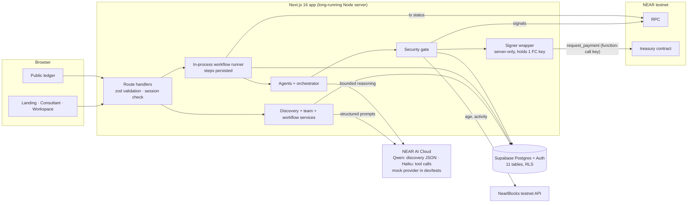
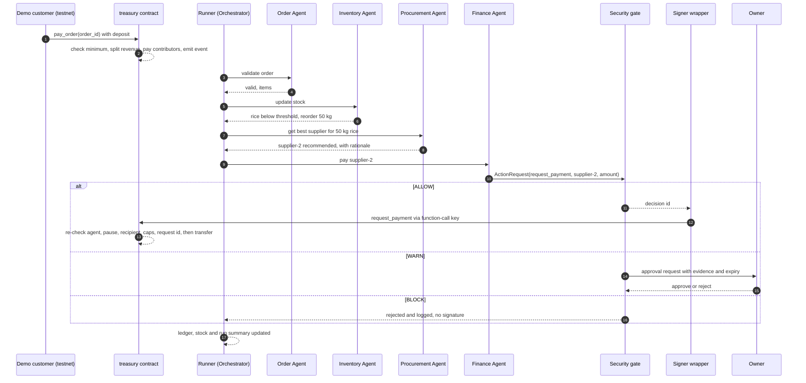
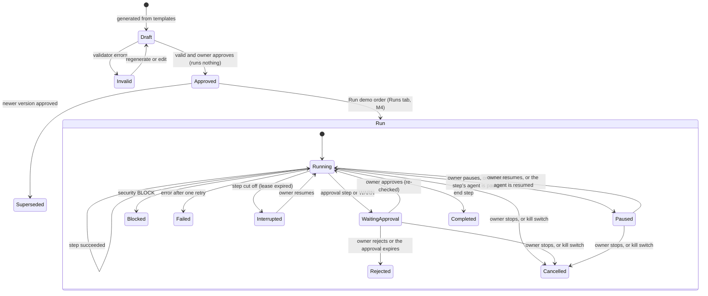
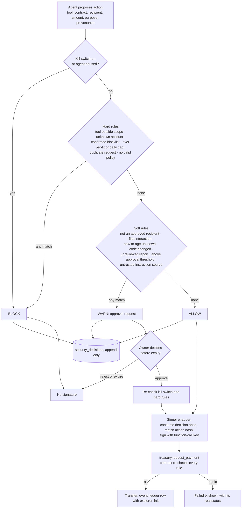
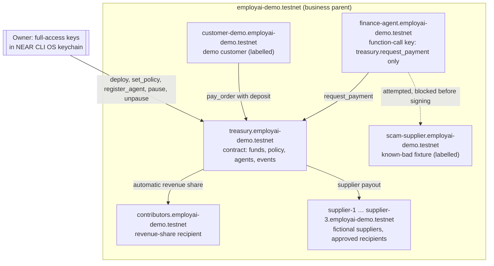

# 02 · Technical architecture (simplified)

Status: **Revised 2026-11-05 to match [00-mvp-scope.md](00-mvp-scope.md). Awaiting approval.** Diagrams use Mermaid, which GitHub renders.

## Design principles

1. **Small and complete beats large and partial.** One app, one database, one contract.
2. **LLMs propose, deterministic code decides.** The LLM drives discovery, extraction, agent proposals, workflow parameters, supplier reasoning and explanations. Validation, the security gate, payments and policy are plain code, and the contract enforces policy again.
3. **Money is protected twice:** the security gate plus signer wrapper off-chain, and the treasury contract on-chain.
4. **Honest labels.** Every money row is `testnet` or `off_chain`. Nothing simulated is shown as an on-chain transaction.
5. **Industry-agnostic core, restaurant scenario on top.** The capability catalogue and workflow templates are data, so a new business type means new catalogue entries, not new architecture.

## Repository layout

```text
src/
  app/
    (marketing)/          landing page
    (onboarding)/start/   consultant conversation
    (workspace)/w/[id]/   overview · team · workflows · security · ledger
    ledger/[slug]/        public ledger
    api/                  route handlers (see 04)
  components/             UI: icons/ (Phosphor registry + Icon), ui/, landing/, onboarding/, motion/
  lib/
    ai/                   provider interface + mock (rules/fixtures) · nearai · ollama; prompts/*.md; budget guard
    rules/                rule-based discovery extraction + question banks per business type (offline consultant)
    catalogue/            capability catalogue + workflow templates (data, industry-agnostic)
    agents/               Order · Inventory · Procurement · Finance handlers + orchestrator
    workflows/            schema, validator, in-process runner
    security/             gate, signals (RPC, NearBlocks, DB), blocklist, approvals
    near/                 RPC client, signer wrapper (only code that touches the key), treasury client
    ledger/               ledger writes and reads
    db/                   Supabase clients + typed queries
contracts/treasury/       Rust, near-sdk 5.x
supabase/migrations/      SQL (11 tables + RLS)
supabase/seed.sql         demo restaurant data (fictional, labelled)
scripts/                  provision-testnet, demo-attack, treasury-pause/unpause, set-policy
config.yaml               owner policy for the demo business
```

---

## Diagram 1 — System architecture



**Why a long-running Node server:** the demo run takes tens of seconds and pauses for approvals, so the runner lives in the server process and persists every step. It needs a process that stays alive: `next start` locally (the default under the zero-spend plan), or a free long-running host if one is approved. It can't be a serverless function with a short timeout. If the server restarts mid-run, the run is shown as `interrupted` with a **Resume** button. Nothing is silently lost, and payments are never repeated (request IDs are deduplicated on-chain).

> **M4 correction (as built).** Test runs don't need a background process: the page asks the server to **advance** a run one bounded batch at a time (at most 5 steps or about 1.5 s per request, D11), and every step is persisted before the next request. A step cut off mid-execution is detected by its expired 15-second lease and shown as `interrupted`. The runner and the local JSON store are **single-process only**: one shared per-business lock plus the store's serialised write queue. This is not production or multi-instance concurrency safety ([m4-proposal.md](m4-proposal.md) §5).

---

## Component design

### Frontend

- Next.js 16 App Router (Cache Components on), Tailwind CSS 4 (via `@tailwindcss/turbopack`), **Phosphor icons** (Regular → Fill swap through one shared `Icon` component), Manrope 300–700. Tokens are defined in `globals.css` per the owner design system of 2026-11-05. No component library (shadcn) is used; the UI primitives are small and local. Motion follows PRD §18 using CSS and IntersectionObserver, and respects reduced motion.
- **Workspace screens (5):** Overview · AI Team · Workflows (graph + run timeline) · Security (policy, decisions, approvals, kill switch, blocklist) · Ledger.
- **Run timeline:** polls `GET /api/runs/:id` every 1.5 s and shows each agent handoff as a card (agent, task, result, reasoning excerpt, status), which makes the collaboration visible.
- **Workflow graph:** a small custom read-only SVG of the step list (no canvas library), plus a list view for mobile and accessibility.

### Discovery (steps 1–2)

- The hero message is stored verbatim as the first message, and a business row is created in `discovering` status. **The business row doubles as the discovery session** (no separate session table).
- Each turn calls `ai.structured('discovery_turn', …)`, which returns `{ reply, facts[], unknowns[], ready_for_summary }`, validated with zod, with one repair retry. In `mock` mode the rule-based extractor and question bank produce the same shape. Facts merge into `businesses.profile` (each field is `confirmed` / `assumed` / `unknown`).
- **Summary → the user confirms or edits** → `profile_confirmed_at` is set. The team proposal is blocked until then (FR-05).

### Capability catalogue and agent team (steps 3–4)

- `lib/catalogue` is **data**: about 10 capabilities, for example `order_intake`, `inventory_monitoring`, `supplier_procurement`, `payments_finance`, `bookings_scheduling`, `customer_messaging`, `invoicing`, `lead_follow_up`. Each one has a description, tools, default limits, "never does", and `executable: true|false` in this prototype.
- Deterministic rules map the confirmed profile to capabilities and build agent definitions (PRD §11.3 fields) from templates. When an LLM provider is enabled, it refines the wording and rationale only. The validator rejects any tool outside the chosen capability. The orchestrator is always added. For a restaurant this must give Order, Inventory, Procurement and Finance (FR-06).
- The owner edits, removes or approves each agent. Agents stay `proposed` until approved (FR-07).

### Workflow generation and runner (steps 5–6)

- **Templates, not free-form graphs.** Each executable capability brings a step template. The generator orders templates for the approved agents and fills in parameters (reorder threshold, quantities, approval threshold) from the profile and policy, or from an LLM suggestion when one is enabled. The output must match the workflow schema of 8 step types.
- **Validator:** known step types only, references to approved agents only, no cycles, every `payment` preceded by a `security_check`, policy-required `approval` present, and step and run limits. Payment safety is checked on **every execution path**: each path to a `payment` must pass that payment's `security_check` (ALLOW or WARN) and then its `approval` check (approved), after the supplier is chosen. The payment's **beneficiary** (an approved supplier chosen by Procurement) is kept separate from its **channel** (the treasury contract, `request_payment`). An invalid workflow can't be approved (AT-06).
- **Approve** (M3) records the owner's approval of a valid version and locks it; changing an approved version creates a new draft version, and approving it supersedes the old one. Approving runs nothing. From M4 the approval also records a **fingerprint** (`sha256-canonical-json-v1` over the workflow id, version and steps), and only the current approved, fingerprinted version can run. Versions approved before M4 are kept unchanged but need re-approval (rebuild as a new draft, then approve). The restaurant demo is the only runnable scenario; other industries keep discovery and the proposed team, labelled Preview.
- **Runner (M4, as built):**
  - `startRun` only creates the run (with an `Idempotency-Key`). `advanceRun` is the **only** operation that executes steps: one bounded batch under the shared business lock.
  - Each step is inserted as `running` with a lease. Its handler is pure and works on a copy, and the result commits in one atomic transaction. That commit re-checks the kill switch and stop (refused), pause (allowed, then paused) and the approval fingerprint.
  - On WARN or above the threshold, the run waits for the owner (`waiting_approval`). The approval route records the decision, and the next advance re-checks and uses it.
  - A payment is **never retried**: it is reconciled by `request_id`, and the outcome is a simulated, labelled ledger row with `tx_hash: null`.
  - GET routes never execute or persist anything.
  - Run statuses: `running`, `waiting_approval`, `paused`, `completed`, `blocked`, `rejected`, `failed`, `interrupted`, `cancelled`.

### Agents in the restaurant scenario

| Agent | Deterministic (always on, zero cost) | LLM enhancement (only when a provider is enabled) |
|---|---|---|
| Order | validate items and prices against the menu, minimum order value | — |
| Inventory | decrement stock, detect items below threshold, compute the reorder quantity | — |
| Procurement | load 3 seeded supplier quotes, filter by approved suppliers, **score them** (price, delivery, approval status), recommend the best, with a templated rationale | A free-text rationale (structured output). **The attack demo injects here** (Part A). |
| Finance | check the budget and policy, create the payment request, templated explanation | A one-sentence explanation |
| Orchestrator | the runner itself, which records every handoff and writes a templated run summary | A natural-language summary |

> **M4 (as built):** all five agents run as **rule-based agents (offline)**, with no AI provider calls. Every tool call goes through a broker that checks the agent's definition, the step's data scopes and the gate (rules 1–3). Simulated tools are labelled in the run view: "Demo confirmation (not sent)", "Simulated quote from demo data (no supplier contacted)", "Shown in EmployAI (no message sent)". The LLM enhancements above are not part of M4.

### Security layer (step 7)

Diagram 4 and [05-threat-model.md](05-threat-model.md). In short: `evaluate(action) → ALLOW | WARN | BLOCK` with reason codes. The kill switch is checked first, then hard rules (blocklist, caps, unknown account, scope), then soft rules (not approved, first interaction, new or unknown age, code changed, untrusted provenance, above the approval threshold). The decision is written once, and the signer wrapper consumes it once.

> **M4 (as built):** test runs use the same `evaluate` with the doc 05 rule order, on fictional demo data. Decisions are stamped `chain_checks: "not_run_in_test_mode"`. The only trust signal is the demo registry's `prior_payments`, and simulated outcomes never count as prior payments. An authorisation is used once and bound to an action hash (business, run, request id, beneficiary, amount, method). There is no signer, NEAR call or contract in M4; those start in M5.

### NEAR (step 8)

Diagram 5. **One contract** (`treasury`), **one signing key at run time** (the Finance Agent's function-call key), and about 9 testnet accounts. The owner's full-access keys stay in the owner's NEAR CLI keychain and are used only by setup and owner scripts.

### AI provider (NEAR AI Cloud for the product; offline mode for development)

Validated offline in PoC-A0 (`spikes/poc-a0`, 42 tests) and live in PoC-A. Details are in [09-zero-spend-plan.md](09-zero-spend-plan.md). `lib/ai/provider.ts` defines one interface (`structured`, `toolCall`) with three implementations, selected by `AI_PROVIDER`, which **must be set explicitly (no default)**:

- **`nearai` (the real product AI and final demo):** the `openai` SDK with `baseURL https://cloud-api.near.ai/v1`, `maxRetries: 0`, and a timeout. Task routing from PoC-A:

  | Task | Model | Mechanism |
  |---|---|---|
  | Discovery extraction and next question | `Qwen/Qwen3.8-27B` | strict `json_schema` structured output, reasoning off |
  | Procurement recommendation | `anthropic/claude-haiku-5-5` | forced tool call (`tool_choice: required`) |
  | Agent selection | — | **deterministic rules** (capability catalogue) |
  | Security decisions, transaction validation | — | **deterministic code** and the treasury contract |

  It refuses to start unless approved (`NEAR_AI_CALLS_APPROVED=true`, call ceiling and daily USD cap set), and checks the live catalogue for both models and their prices at start-up.
- **`mock` (development, tests, labelled offline mode):** deterministic rules, $0, no network.
- **`ollama` (optional):** a local model; needs `OLLAMA_MODEL`, and nothing is downloaded automatically.

**No silent fallback.** A NEAR AI failure raises a typed error and the UI shows "AI unavailable" with the reason. The app never quietly switches to `mock`. The spending guard checks the worst case before every call and records real usage after it. Billed costs are reconciled through the billing API. **No model is described as TEE-protected**; that would require verifying its inference environment first.

---

## Diagram 2 — Agent collaboration (restaurant demo order)



---

## Diagram 3 — Workflow lifecycle and run states



---

## Diagram 4 — Security decision and transaction flow



---

## Diagram 5 — NEAR testnet transaction architecture



**Accounts (9):** the parent, `treasury`, `finance-agent`, `contributors`, `customer-demo`, `supplier-1..3`, `scam-supplier`. They're created by `scripts/provision-testnet`, run by the owner with the NEAR CLI (PoC-B). The customer's payment in the demo is signed by the server with the demo customer's key (a labelled simulation of a customer, with real testnet funds). It is the **only** other key the server holds, and it's limited to the customer's small demo balance.

**Facts from NEAR docs this relies on (read 2026-11-04):** a function-call key can call one contract, optionally limited to listed methods, and can't attach NEAR, which is why the contract does the transfer. An allowance that runs out makes a key unusable, so the allowance is left unset and the agent account's small balance bounds its gas. The owner keeps a full-access recovery key. Only an account can create its own sub-accounts.

### Payment modes

| Mode | Used for | Label shown |
|---|---|---|
| `testnet` | the order payment and revenue share, supplier payouts | "NEAR testnet" + explorer link |
| `off_chain` | inference cost rows, blocked or rejected attempts (no transaction) | "Off-chain record" |
| `test_run` | payment steps in workflow test runs, before the treasury is live (no transaction) | "Test run — no transaction" |
