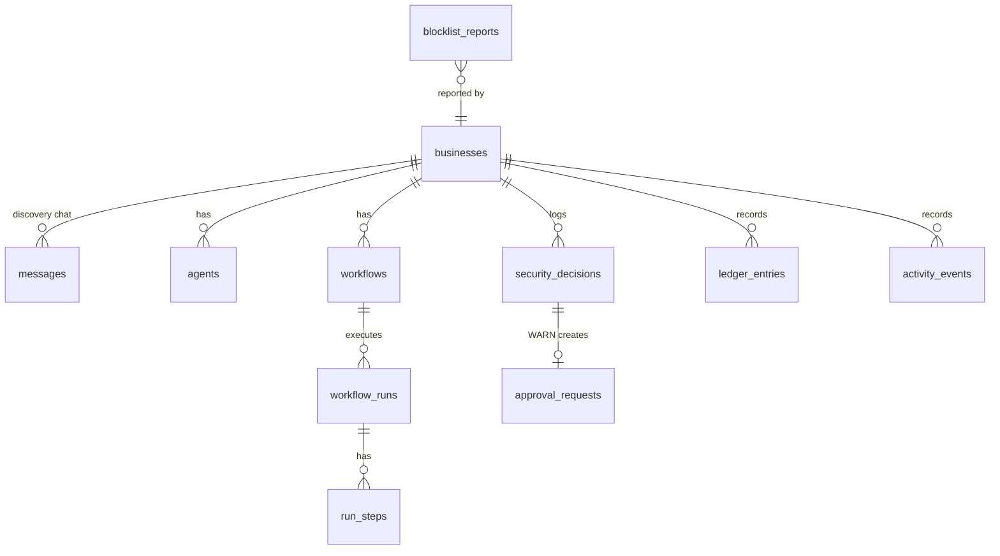

# 03 · Database design (simplified: 11 tables)

Status: **Revised 2026-11-05 to match [00-mvp-scope.md](00-mvp-scope.md). Awaiting approval.** This is a design; the SQL is written in M1.

## Conventions

- `uuid` primary keys, `timestamptz` defaulting to `now()`.
- **One owner per workspace.** `businesses.owner_id = auth.uid()` (a Supabase user, which can be anonymous and upgraded later). There's no membership table.
- Money: `amount_yocto numeric(40,0)` for NEAR, `amount_nano_usd bigint` for inference. No floats.
- `mode text check (mode in ('testnet','off_chain','test_run'))` on money rows.
- 🔒 = append-only (a trigger rejects `UPDATE`/`DELETE`).
- Profile, agent definitions and workflow steps are **`jsonb` validated by zod** in the app. That's the main reason the table count stays small.

## Entities



| # | Table | Key columns | Notes |
|---|---|---|---|
| 1 | `businesses` | `id`, `owner_id`, `slug` (unique), `name`, `business_type`, `status` (`discovering`/`team_proposed`/`active`), `profile jsonb` (fields with `value`, `status: confirmed\|assumed\|unknown`, `source_message_id`; since M3.5 also an optional `case_file`: facts with history, the owner's stated claims, problems with possible causes, the question agenda, contradictions and the question budget, from which the ten fields are derived. Additive and reversible: removing `case_file` restores the M2 profile), `summary`, `profile_confirmed_at`, `policy jsonb` + `policy_version` (from `config.yaml`, validated), `kill_switch bool`, `ledger_public bool`, `demo bool`, `scenario_data jsonb` (fictional menu, stock and suppliers for the restaurant demo: always labelled demo data, illustrative NGN, never mixed into `profile`) | Also serves as the discovery session. Seeded scenario data lives here instead of separate menu, inventory and supplier tables. |
| 2 | `messages` | `id`, `business_id`, `role` (`user`/`assistant`), `content`, `meta jsonb` (model, tokens), `created_at` | The first `user` row is the hero message, stored verbatim (AT-01). |
| 3 | `agents` | `id`, `business_id`, `key` (for example `finance`), `name`, `capability`, `definition jsonb` (PRD §11.3 fields), `executable bool`, `status` (`proposed`/`approved`/`removed`/`paused`), `approved_at`, `near_account_id` (Finance Agent only) | |
| 4 | `workflows` | `id`, `business_id`, `name`, `version`, `steps jsonb`, `validation jsonb`, `status` (`draft`/`approved`/`superseded`), `approved_at` | A new version is a new row. `steps` is frozen once approved (trigger); changing an approved version creates a new draft version. Only one version is `approved` at a time. Approving runs nothing. |
| 5 | `workflow_runs` | `id`, `business_id`, `workflow_id`, `status` (`running`/`waiting_approval`/`completed`/`blocked`/`rejected`/`failed`/`interrupted`), `trigger jsonb`, `idempotency_key` (unique per business), `started_at`, `ended_at`, `elapsed_ms`, `summary` | `elapsed_ms` is the measured sale-to-payout time. |
| 6 | `run_steps` | `id`, `run_id`, `step_id`, `agent_key`, `status`, `input jsonb`, `output jsonb` (redacted), `reasoning text`, `attempt`, `started_at`, `ended_at`, `error` | Drives the collaboration timeline (FR-12). |
| 7 | `security_decisions` 🔒 | `id`, `business_id`, `run_id`, `agent_key`, `action jsonb`, `action_hash`, `decision` (`ALLOW`/`WARN`/`BLOCK`), `reason_codes text[]`, `signals jsonb`, `policy_version`, `provenance jsonb`, `created_at` | Immutable. |
| 8 | `approval_requests` | `id`, `business_id`, `decision_id` (unique), `status` (`pending`/`approved`/`rejected`/`expired`/`invalidated`), `auto_approved bool`, `expires_at`, `decided_at`, `consumed_at` | The **single authorisation record the signer accepts**. An ALLOW creates the row already `approved` (`auto_approved = true`). A WARN creates it `pending` for the owner. A BLOCK creates none. |
| 9 | `ledger_entries` 🔒 | `id`, `business_id`, `type` (`sale`/`revenue_share`/`supplier_payout`/`inference_cost`), `mode`, `amount`, `unit` (`yoctoNEAR`/`nanoUSD`), `counterparty`, `agent_key`, `tx_hash` (null unless real), `tx_status`, `run_id`, `occurred_at` | Public ledger source. A `tx_hash` is only ever written from a real RPC response. |
| 10 | `activity_events` 🔒 | `id`, `business_id`, `actor` (`owner`/`agent:<key>`/`system`), `type`, `subject`, `correlation_id`, `payload jsonb` (redacted), `created_at` | Overview feed and audit (FR-21). |
| 11 | `blocklist_reports` | `id`, `account_id`, `network`, `status` (`reported`/`confirmed`/`rejected`/`expired`), `reason`, `evidence_type`, `evidence_ref`, `evidence_sha256`, `reported_by_business_id`, `demo bool`, `created_at`, `reviewed_at` | **Shared across all workspaces** (security track: "a shared blocklist that other agents can report to, with evidence attached"). Confirmed means BLOCK; reported means WARN. |

**How "sign once, only if authorised" works:** the signer wrapper runs one atomic statement, `UPDATE approval_requests SET consumed_at = now() WHERE id = $1 AND status = 'approved' AND consumed_at IS NULL AND expires_at > now() RETURNING decision_id`. It then checks that the decision's `action_hash` equals the hash of the transaction it's about to sign. No row returned, or a hash mismatch, means no signature. The same path covers both ALLOW and owner-approved WARN. The kill switch invalidates every `pending` row, and the signer re-reads `businesses.kill_switch` immediately before signing.

**Also not stored:** inference usage is a `ledger_entries` row (`inference_cost`, `off_chain`), and the daily cap sums today's rows. Risk-signal caching is in memory (10-minute TTL); the signals actually used are kept in `security_decisions.signals`. Prior interactions are queried from `ledger_entries` where `type='supplier_payout'` and `counterparty = recipient`.

## Indexes

`messages (business_id, created_at)` · `agents (business_id, status)` · `workflows (business_id, status)` · `workflow_runs (business_id, started_at desc)` · unique `workflow_runs (business_id, idempotency_key)` · `run_steps (run_id, started_at)` · `security_decisions (business_id, created_at desc)` · `approval_requests (business_id, status, expires_at)` · `ledger_entries (business_id, occurred_at desc)` · `ledger_entries (business_id, counterparty)` · `activity_events (business_id, created_at desc)` · unique `blocklist_reports (network, account_id) where status in ('reported','confirmed')`.

## Access policies (RLS)

| Tables | Read | Write |
|---|---|---|
| `businesses` | `owner_id = auth.uid()` | owner, via server routes |
| `messages`, `agents`, `workflows`, `workflow_runs`, `run_steps`, `approval_requests` | owner of the business (`exists (select 1 from businesses b where b.id = business_id and b.owner_id = auth.uid())`) | server routes (owner session) |
| `security_decisions`, `ledger_entries`, `activity_events` 🔒 | owner of the business | **service role only** (server code), never from the browser |
| `ledger_entries` (public) | view `public_ledger`: rows of businesses with `ledger_public = true`, selected columns only | — |
| `blocklist_reports` | any signed-in user (shared by design) | insert through `POST /api/blocklist` (server sets `reported_by_business_id`); status changes by the platform reviewer only |

Server code that uses the service role filters by `business_id` explicitly. A small tenant-isolation test (two anonymous users, two businesses) runs in CI.

## Migrations

```text
supabase/migrations/
  0001_core.sql        tables 1–6, append-only trigger function, freeze-steps trigger
  0002_security.sql    tables 7–8, 11
  0003_ledger.sql      tables 9–10, public_ledger view
  0004_rls.sql         enable RLS + policies
supabase/seed.sql      demo restaurant (demo = true), scenario_data, demo policy, blocklist fixture
```
