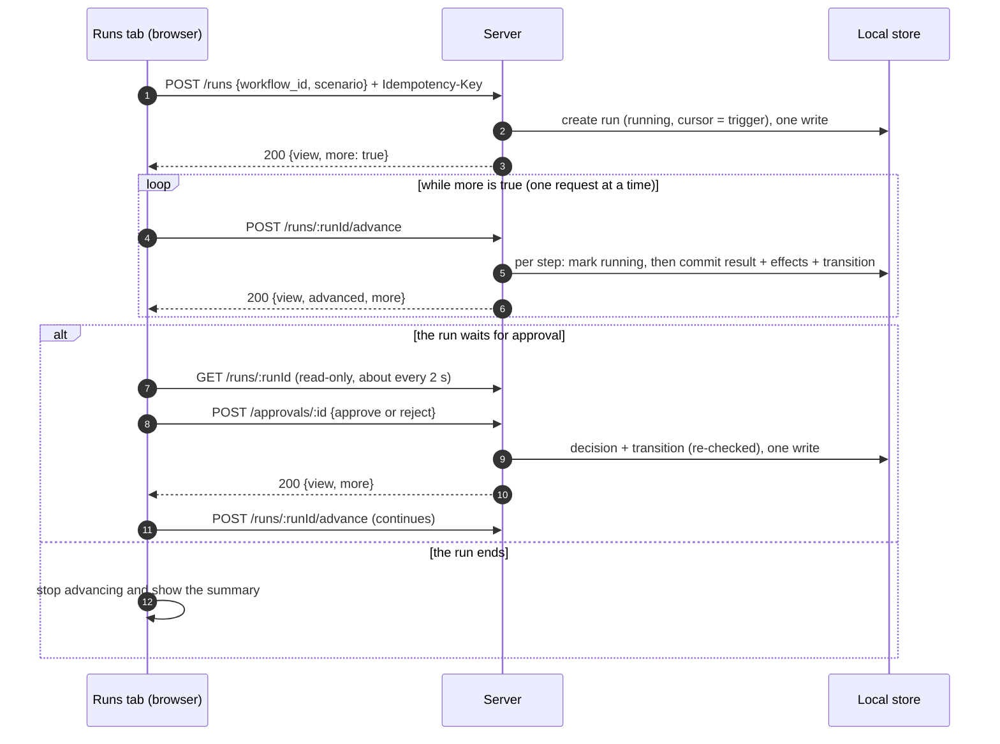
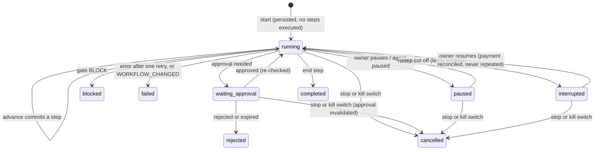

# M4 plan · Workflow execution and agent collaboration (test runs)

Status: **Direction and decisions approved 2026-11-06 (D1–D16 in principle, enumerated below for verification; D17 dropped; D18–D23 approved), with the owner's mandatory constraints C1–C7. **D9 and D11 clarified 2026-11-06** (run states verified against the repository; bounded server-side advancement with read-only GET, §5), and **control-signal concurrency clarified** (§5.6–5.7). Implementation awaits the owner's approval. No code has been written.**

Based on the committed M3.5 implementation (`99e8b43`), the M3 report, documents 02, 03, 04, 05 and 08, the decision log, and PRD FR-10 to FR-14, FR-20, FR-21 and AT-06 to AT-11.

## 1 · Objective

**M4 makes an approved workflow, and only an approved one, run end to end as a labelled test run on fictional demo data, while the owner watches the agents coordinate.** Every payment path goes through a deterministic security gate and, where required, the owner's approval. M4 never moves money, contacts anyone or touches a network: a payment ends as a **simulated outcome**, "Test run — no transaction".

**Done when** the acceptance criteria in §13 pass, including:
- a demo order runs end to end off-chain with every hand-off visible;
- each scenario produces its expected decision (FR-10 "expected vs actual");
- a duplicate start or approval never pays twice (AT-07);
- an over-limit payment is warned or blocked according to policy (AT-09, test-run form);
- the kill switch stops new actions and invalidates pending approvals (AT-11, in-app form).

## 2 · Constraints

### Mandatory constraints from the owner (2026-11-06)

| # | Constraint | How the plan enforces it |
|---|---|---|
| **C1** | All M4 execution uses **local fictional demo data**: no real orders, customer messages, supplier communications or external side effects | Each run works on a copy of the labelled demo data (`demo_snapshot`). Agents can only reach run-local data through the scoped data accessor. Nothing is written to the business profile or case file (tested) |
| **C2** | Tools that imply external actions (`send_order_confirmation`, `request_quote`, `notify_owner`, …) are **clearly labelled simulations** and make **no external requests** | The tool registry (§6) classifies every tool. `simulated_external` tools return `simulated: true` and a fixed label, for example "Demo confirmation (not sent)" or "Simulated quote from demo data (no supplier contacted)". A static test forbids network modules in the run code; `fetch` stays blocked in tests |
| **C3** | Finance may prepare payment requests and pass them through the gate; **even after approval, only a simulated payment outcome is recorded. No funds move** | `request_payment` only creates a payment request and a gate action. The executor is a system component that, once authorised, writes **one** test-run ledger row (`tx_status: "simulated"`, `tx_hash: null`). No code path exists that could pay |
| **C4** | **No wallet signing, NEAR transactions, contract calls or real payment execution** (M5) | No signer, key, RPC, NEAR library or contract client is imported in M4. A static test fails the build if `src/lib/runs` or `src/lib/security` references any of them |
| **C5** | Workflow **fingerprints bind approval to the exact workflow version**; any change invalidates execution under that approval | D18 (§3): the fingerprint is recorded at approval, checked at start, before every step and at payment |
| **C6** | **Existing M3 teams and workflows are preserved**; legacy workflows without fingerprints follow the **documented re-approval process** before they can run | D18: nothing is deleted, rewritten or auto-fingerprinted; legacy versions stay "approved" and show how to re-approve |
| **C7** | **Run recovery, idempotency, concurrency protection, security enforcement and audit records are non-negotiable**; they are never cut to meet the schedule | §15 lists them as never-cut. D21 is a target, and quality wins over the date |

### Carried forward

- No AI provider or NEAR AI calls, paid services, account creation, funding, deployment or real transactions.
- No changes to `.env`.
- No new dependencies (hashing uses `node:crypto`).
- Restaurant is the only runnable industry; every other industry stays Preview.
- Fictional demo data is never mixed into the business profile.
- No swarm, and the agent catalogue is not expanded.
- No existing security control is weakened.
- The design system is unchanged.

## 3 · Decisions (approved), with exact behaviour

Each decision lists the behaviour M4 must show and how it is verified.

| # | Decision | Exact behaviour | Verified by |
|---|---|---|---|
| **D1** | Deterministic **gate core** in M4, for test runs on demo data | `lib/security/gate.ts` exports a pure `evaluate(action, context) → { decision, reasons[], signals, policy_version }`. It applies rules 1–9 of doc 05 §3 in order (§7). The same inputs always give the same output. No I/O inside `evaluate` | Unit tests for every rule, reason code and the ordering |
| **D2** | Test runs **skip the on-chain signal rules** with an explicit stamp | Every test-run decision carries `mode: "test_run"` and `signals: { source: "demo_registry", chain_checks: "not_run_in_test_mode" }`. The UI says "Test-run decision on demo data. On-chain checks run from the next stage." The testnet rule (an unavailable signal → WARN `SIGNAL_SOURCE_UNAVAILABLE`, never ALLOW) is unchanged for M5 | Decision snapshot tests; doc 05 unchanged |
| **D3** | **Approval queue** and **in-app kill switch** in M4 (on-chain pause is M5) | A WARN or above-threshold action creates a `pending` approval; an ALLOW at or below the threshold creates one already approved (`auto_approved: true`); a BLOCK creates none. The kill switch is a business field. When switched on, the flag is persisted **at once** through the store write queue, without the business lock, so it lands even during a batch. A running batch then stops before its next step, a step in progress can't commit (compare-and-set at commit), and the payment executor refuses. Then, under the shared lock (or by the runner when it notices first), active runs become `cancelled` and pending approvals `invalidated` (§5.6). New runs are refused (`409 KILL_SWITCH_ACTIVE`) and the gate returns BLOCK `KILL_SWITCH_ACTIVE` | Route and runner tests (AT-11, in-app form), including the kill switch during a batch |
| **D4** | **Agent-level pause** | Agent status gains `paused`. A paused agent's step doesn't start: the run waits as `paused` and says why. A paused Finance Agent's payment request is BLOCK `AGENT_PAUSED`. Resuming the agent lets the run continue | Runner and gate tests |
| **D5** | **Demo data v2** | `scenario_data` gains recipes (rice, chicken and oil per plate), tuned stock and par levels, and each fictional supplier's `prior_payments` and `available_today`, plus a read-only demo daily limit of ₦500,000 (illustrative). The version is bumped. It stays labelled "Demo data — fictional", is never written to the profile or case file, and is copied per run | Data snapshot test; profile and case file untouched (tested) |
| **D6** | Five **scenarios**; the attack stays M6 | Standard order → ALLOW; Large catering order → WARN `ABOVE_APPROVAL_THRESHOLD`; New supplier → WARN `FIRST_INTERACTION`; Price spike → BLOCK `OVER_TX_LIMIT`; Quiet day → no reorder. Scenarios change **only demo inputs**, never rules or owner settings | One route test per scenario, expected = actual |
| **D7** | Simulated outcomes are **owner-only**, **never public**, and **never count as prior payments** | Ledger rows: `mode: "test_run"`, `unit: "ngn_illustrative"`, `tx_hash: null`, `tx_status: "simulated"`, labelled "Test run — no transaction". The gate's prior-payment check reads only the demo registry's fictional history, never test-run rows, so a FIRST_INTERACTION WARN stays a WARN on every run | Gate test: repeated runs don't change the decision |
| **D8** | A **Runs** tab and a **kill-switch control** in the workspace | Workspace tabs: Team · Workflows · **Runs**. The header shows the kill switch with its state and a confirm step | Browser checks |
| **D9** | Run statuses, **verified against the repository** (2026-11-06) | **The code has no run model at all**: no run type, collection, table or migration exists, so every run status is implemented for the first time in M4. **Against the approved design** (doc 03, table 5: `running`, `waiting_approval`, `completed`, `blocked`, `rejected`, `failed`, `interrupted`), only **`paused`** (owner or agent pause; distinct from `waiting_approval`) and **`cancelled`** (stop or kill switch; also an end result in PRD §workflow "End") are genuinely new; doc 03 is corrected. Agent **`paused`** already exists in doc 03 (agents table) but **not** in the code (`AgentStatus` is `proposed`/`approved`/`removed`), so it is a code addition only. No `pending` or `queued` status is added: a newly started run is `running` with no steps done. **Migrations: none for existing data** (§11.1): every addition is optional or a new collection, and no existing record is rewritten | State-machine tests; store compatibility test (the existing dev store loads unchanged) |
| **D10** | The **local development store** holds runs, decisions, approvals, ledger and events | New collections in `.data/dev-store.json`, mirroring tables 5–10. `security_decisions`, `ledger_entries` and `activity_events` are **append-only**: the repository has no update or delete for them | Repository test asserts no mutating methods exist |
| **D11** | **Bounded server-side advancement**, requested by the page; no background workers (lifecycle in §5) | **Start** only validates and persists the run; it executes no step. A dedicated **`POST …/runs/:runId/advance`** executes a **bounded batch** (at most 5 steps or about 1.5 s of step time, stopping earlier at a wait or an end) under the shared lock (D20) and returns the view and `more`. The page calls advance again while `more` is true, one request at a time. **GET is strictly read-only and never executes steps or persists transitions.** Each step's start, result and the resulting transition are persisted **before** the next operation. Approve, reject, resume, pause and stop only record decisions and transitions; **only advance executes steps**. The timeline reveal stagger (≈ 300 ms) is visual only; real timestamps are kept and there are no artificial delays | Runner and route tests: GET never mutates; batch bounds; concurrent advances serialised; persistence before each next step; interruption and recovery |
| **D12** | Run routes under **`/api/w/:id/…`** | All run, approval, kill-switch and agent-pause routes are business-scoped and go through `ownerRoute` (owner only, 404 otherwise, JSON plus same-origin on mutations). Doc 04 is corrected | Ownership and cross-origin route tests |
| **D13** | Approval expiry **15 minutes**; **one active run per business** | A pending approval expires 15 minutes after creation and is then treated as rejected. Starting a run while one is active (`running`, `waiting_approval`, `paused` or `interrupted`) → `409 RUN_IN_PROGRESS` | Expiry and concurrency tests |
| **D14** | **No new dependencies**; Playwright stays M7 | Hashing via `node:crypto`; canonical JSON implemented locally | `package.json` unchanged (diff review) |
| **D15** | **"What this workflow addresses"** in the run view and summary | Shows the business's confirmed or supported problems and causes, or stated needs, from the M3.5 case file, each with its basis (confirmed by you / supported by your answers / you asked for this), labelled "Your business information". Visually separate from the "Demo data — fictional" panel. Read-only: runs never write to the case file | Route test (read-only); browser check |
| **D16** | **Discovery-quality gate** at run start | A run may start only if the business has an **M3.5 case file** (`origin: "native"`), a **confirmed summary** (`profile_confirmed_at` set, stage `proposal`) and an **approved team**. Otherwise → `409 DISCOVERY_INCOMPLETE`, with "This discovery was captured before the consultant could check causes. Start a new discovery to use test runs." | Route tests for pre-M3.5 and incomplete businesses |
| ~~D17~~ | ~~Show cause-specific tasks without running them~~ | **Dropped**: M3.5 added no cause-specific tasks | — |
| **D18** | **Approval fingerprint** binds approval to the exact version (C5, C6) | At approval M4 stores `approval_fingerprint = sha256(canonical JSON of { workflow_id, version, steps document including settings })` with `fingerprint_alg: "sha256-canonical-json-v1"`. A run pins `workflow_id`, `workflow_version` and the fingerprint. The fingerprint is recomputed from the stored record **at start, before every step and at the payment step**; any mismatch → start refused `409 APPROVAL_FINGERPRINT_MISMATCH`, or an active run fails with `WORKFLOW_CHANGED` and does nothing further. Approving a new version while a run is active is refused (`409 RUN_IN_PROGRESS`). **Legacy approved versions without a fingerprint** stay `approved`, untouched and never auto-fingerprinted; they show "Approved before test runs existed". To run, the owner follows the **re-approval process**: *Rebuild as new draft* (the existing M3 action) → re-validated against the current team → *Approve* → the new version is fingerprinted and the legacy version becomes `superseded` (kept, never deleted). D16 still applies | Fingerprint tests: any field change (settings, step, edge, agent) is detected; legacy record unchanged; re-approval path test |
| **D19** | **Every tool call passes through the gate** (FR-14) | Agents call tools only through the tool broker, which asks the gate first. Ordinary tool calls are checked against rules 1–3 (kill switch or agent paused, policy present, authorised for this agent **and** this step); payment requests are checked against rules 1–9. A refusal fails the step with the gate's reason code, is logged, and is never retried | Broker tests for every agent; bypass test (no tool callable without the broker) |
| **D20** | **One shared lock** for discovery, workflows and runs | `lib/locks.ts`: one process-wide lock registry (on `globalThis`), keyed by business, FIFO. **Run operations wait** for it (bounded 5 s → `409 BUSY`, retryable): advance, start, approval decisions, finalising controls. **Discovery turns and workflow edits keep today's fail-fast behaviour** (`409 TURN_IN_PROGRESS` / `BUSY`) on the same lock. It is never weakened for control signals: the kill switch, pause and stop persist their request through the store write queue without it, and only their finalisation takes it (§5.6) | Concurrency tests: parallel advances; kill switch, pause and stop during a batch; approve versus stop; double approve; multi-tab simulation |
| **D21** | **Target schedule** Nov 7–8 | A target, **not a deadline that overrides quality**. If the target slips, only items on the cut list (§15) may be cut; never-cut items are finished even if M4 takes longer, and the timeline is re-planned openly | Daily check against §15 |
| **D22** | **Rule-based agents** in M4 | Agents are deterministic modules with templated reasoning. They are labelled "Rule-based agents (offline)" in the run view. No AI provider is called. Model-based reasoning (NEAR AI) needs a separate approval later | `fetch` blocked; static check that run code imports no AI client |
| **D23** | **Reduced teams** run their reduced workflows | The runner executes exactly the approved version's steps, for example Order Agent only. The demo uses the five-agent reference business. Without an Orchestrator, coordination is attributed to "EmployAI runner" | Runner tests on reduced templates |

## 4 · Who can run (start-time checks, by the server)

A start is refused unless **all** hold:

| Check | Refusal |
|---|---|
| Business belongs to the caller | `404` |
| Restaurant industry (`isRunnableIndustry`) | `409 PREVIEW_ONLY` |
| M3.5 discovery, summary confirmed (D16) | `409 DISCOVERY_INCOMPLETE` |
| Team approved | `409 TEAM_NOT_APPROVED` |
| Kill switch off (D3) | `409 KILL_SWITCH_ACTIVE` |
| The chosen workflow is the **current approved** version (not a draft or superseded) | `409 WORKFLOW_NOT_APPROVED` |
| It has a fingerprint (else: the re-approval process, D18) | `409 REAPPROVAL_REQUIRED` |
| Its fingerprint matches the stored document (D18) | `409 APPROVAL_FINGERPRINT_MISMATCH` |
| It re-validates against the current team (as approval does) | `409 WORKFLOW_INVALID` |
| No active run (D13) | `409 RUN_IN_PROGRESS` |

A repeated start with the same `Idempotency-Key` returns the original run instead (AT-07).

## 5 · Execution engine: bounded advancement (D11)

There are **no background workers**. A run moves forward only when the page asks the server to advance it, and every piece of progress is persisted before the next one starts.

### 5.1 Operations

| Operation | Executes steps? | Persists | Lock |
|---|---|---|---|
| `POST …/runs` (start) | **No** | The new run (status `running`, cursor at the trigger, demo snapshot, pinned version and fingerprint, idempotency key, `run.started` event) in **one** atomic store write | Shared business lock |
| `POST …/runs/:runId/advance` | **Yes**, one bounded batch | Each step's start, then its result together with its effects and the run transition, one atomic write at a time | Shared business lock for the whole batch |
| `POST …/approvals/:id` (approve / reject) | No | The decision and the run transition (`waiting_approval` → `running`, or → `rejected` through the workflow's `rejected` edge) | Shared business lock |
| `POST …/runs/:runId/{pause,resume,stop}` | No | The control request (one store write, **without** the business lock), then the transition | Request: store queue only, persisted at once even during a batch. Finalising: the business lock, waited for (≤ 5 s) (§5.6) |
| `POST …/kill-switch` | No | The flag (one store write, **without** the business lock), then cancellations and invalidations | Flag: store queue only, persisted at once even during a batch. Finalising: the business lock, waited for (≤ 5 s) (§5.6) |
| `GET …/runs`, `GET …/runs/:runId` | **No, never** | **Nothing** (strictly read-only) | None (reads a consistent snapshot) |

**Store writes.** The local store serialises every write and applies **field-level patches to the latest stored record**, never a stale whole-record copy. Status changes are **compare-and-set**. A flag written outside the business lock (kill switch, pause or stop request) therefore can't be lost or overwritten by a batch in progress (§5.6).

### 5.2 One advance call, step by step

1. **Acquire** the shared business lock (D20). A second advance for the same run waits, then continues from the state the first one left.
2. **Load** the run. If it is not `running` (waiting, paused, interrupted or ended), return `200 { view, advanced: 0, more: false }`. This is a safe no-op.
3. **Detect a crash** from an earlier call: if a step is recorded `running` and the run's lease has expired, mark that step and the run `interrupted`, record `run.interrupted`, and return (§5.4).
4. **Take the lease:** `lease_expires_at = now + 15 s`, persisted.
5. **Loop**, at most **5 steps** or about **1.5 s** of step time:
   - **Before the step,** do a **fresh read** of the business and the run (it waits for the store queue, so any control request already sent is visible), then check:
     - the kill switch;
     - the run's pause or stop request;
     - the step's agent is approved and not paused;
     - the workflow fingerprint (D18);
     - the run limits: ≤ 25 steps, and ≤ 60 s of execution time (time spent waiting for the owner doesn't count).

     Any failure persists the matching transition and ends the loop.
   - **Persist** the step as `running`, with its attempt number and start time.
   - **Execute** it through the tool broker and the gate, with a 5 s timeout. Agents work on a copy of the run snapshot, so nothing changes until the commit.
   - **Commit, in one atomic write that first re-checks the kill switch, the run's `control` and its status** (a kill switch or stop that arrived during the step refuses the commit and discards the step's local effects; a pause lets this step commit, then the run pauses before the next; §5.6). The write contains: the step's result (status, output, reasoning, tools, reads, writes, `simulated`, duration), its effects on the run snapshot, any decision, approval, authorisation use or ledger row it produced, the next cursor (exactly one outcome edge from the approved document), the run transition, and the activity events.
   - Stop early on `waiting_approval`, `paused` or an end state.
6. **Release** the lease (`lease_expires_at = null`), persisted, then release the lock.
7. **Return** `200 { view, advanced: n, more }`. `more` is true only if the run is still `running` and has steps left.

Deterministic steps take milliseconds, so the lock is held only briefly.

### 5.3 Request and response lifecycle (the page)

- **One request in flight.** The page never sends parallel advances. If several tabs do, the shared lock serialises them, and each call advances from the latest persisted state.
- **Errors.** On a network error or a `5xx`, the page retries advance after 1 s, 2 s, then 4 s. This is safe because a committed step is never executed again: the cursor has already moved on.
- **Leaving the page.** The run simply stays where it was last persisted; nothing runs in the background. When the owner reopens it, the page shows the state and continues advancing if the run is `running`. A run idle between advances is **not** interrupted: interruption means a step was cut off mid-execution (§5.4).
- **What GET shows without persisting:**
  - An approval past its expiry is *shown* as expired. The expiry is persisted (as `rejected`, through the workflow's `rejected` edge) by the next mutating call, such as advance or an approval decision.
  - A run with a stale lease is *shown* as "interrupted (detected)". `interrupted` is persisted by the next mutating call.

### 5.4 Interruption and recovery

| Situation | What is persisted | How it recovers |
|---|---|---|
| The server stops **between** steps | Every finished step is committed; the run stays `running` | Advance continues from the cursor. Nothing is lost or repeated |
| The server stops **during** a non-payment step | The step is `running` with no result; the lease expires | The next mutating call marks the step and run `interrupted`. The owner presses **Resume** (`running`), then advance runs the step again as a new attempt. This is safe because its effects were never committed |
| The server stops during the **payment** step | Using the authorisation and recording the simulated outcome happen in **one atomic write**: both exist or neither does | After Resume, the executor first looks for a ledger row with this `request_id`. If one exists, the step is marked succeeded with that outcome; if not, it proceeds once with the same unused authorisation, re-checked. **A payment outcome is never produced twice** |
| The server stops during **start** | Start is one atomic write | Retrying with the same `Idempotency-Key` returns the run if it was created, or creates it once |
| Duplicate start or approval (double click, retry) | The idempotency key (start); the already-decided approval | Same run returned; second decision `409 ALREADY_DECIDED`; no second outcome (AT-07) |
| The kill switch during a batch | The flag, at once | The batch stops at its next step boundary and the executor refuses; then active runs become `cancelled` and pending approvals `invalidated` |
| The workflow changed after start | — | Detected before the next step or at payment: `failed`, `WORKFLOW_CHANGED`; nothing further runs |
| A transient error in a non-payment step | — | One retry (`attempt: 2`) within the batch, then `failed` |
| A permission, gate or validation refusal | — | Fails at once, never retried |

### 5.5 States

There is no `pending` or `queued` state: a newly created run is `running` with no steps done. All nine states are new to the code (D9); `paused` and `cancelled` are also new to the design.

**Demo snapshot.** Each run copies the demo data at start, so every run is repeatable and stock changes stay inside the run.

### 5.6 Control signals while a batch is running (kill switch, pause, stop)

The shared business lock (D20) still protects run advancement unchanged. Control signals don't need it to take effect, because they rely on **two separate layers**:

| Layer | What it serialises | Held for |
|---|---|---|
| **Business lock** (D20) | Whole operations that must not interleave for one business: an advance batch, start, an approval decision, finalising a cancellation | The operation (a batch is ≤ 5 steps / ≈ 1.5 s) |
| **Store write queue** (exists today in `FileDevStore.mutate`) | Every individual write: read the **latest** file → apply one patch function → atomic replace | One write (milliseconds) |

An advance batch holds the business lock for the whole batch, but it **does not hold the store queue between its writes**. Each of its writes is a short queued mutation, so other writes can be queued between them.

**1 · How the kill switch is persisted while a batch holds the lock.** The kill-switch, pause and stop endpoints **do not take the business lock to record the request**. Each one:
1. Enqueues **one** store mutation (`kill_switch: true`, or the run's `control: "pause"` / `"stop"`, with the time and actor) together with its activity event. It lands between the batch's own writes, so it is persisted within milliseconds, not after the batch.
2. Then **waits** for the business lock (bounded at 5 s) to **finalise**: active runs become `cancelled` or `paused`, pending approvals become `invalidated`. Finalising is idempotent, and the runner does the same thing itself when it notices the request (point 3). If the wait times out, the endpoint still returns `200`: the request is already persisted and will be honoured at the next step boundary, and the response says so.

**2 · How concurrent writes can't overwrite each other.** Every write follows these rules, enforced by the repository and tested:
- **Patch the latest, never a stale copy.** Every write is a patch applied inside the store queue to the record as it is on disk at that moment. No operation writes back a whole record it read earlier.
- **Field ownership.**
  - `kill_switch` is written only by the kill-switch endpoint.
  - A run's `control` field is written only by the pause, stop and resume endpoints.
  - The runner never sets them. It may clear `control` only when honouring it, by compare-and-set: clear only if the value is still the one it acted on.
- **Compare-and-set transitions.** Each status change is applied only if the current stored status (and, where relevant, `control` and `kill_switch`) is what the writer expects. Otherwise that write changes nothing, and the caller re-reads and acts on the newer state. For example, an approval decision applies only if the approval is still `pending`, the run still `waiting_approval`, there is no stop request and the kill switch is off. A second decision gets `409 ALREADY_DECIDED`, and a decision after a stop gets `409 RUN_STOPPED`.
- **Shared store and locks.** The store instance and the lock registry are process-wide singletons (on `globalThis`), so every route handler in the server uses the same queue and the same locks.

**3 · Whether the runner reliably sees requests before its next step.** Yes, through two checks:
- **Before each step:** the runner does a fresh read of the business and the run. The read waits for the store queue to drain, so every write queued before it is visible, including a kill switch, pause or stop. If one is present, the step **never starts**.
- **At commit:** a signal can arrive **while** a step executes, between the pre-step read and the commit. So the step's commit mutation re-checks `kill_switch`, the run's `control` and its status **inside the same write**:
  - **kill switch or stop:** the commit is refused; the step's proposed effects are discarded, the step is recorded `cancelled`, and the run transitions to `cancelled`. Pending approvals are invalidated.
  - **pause:** the current non-payment step is allowed to finish and commit, then the run becomes `paused` before the next step.
  - **payment:** using the authorisation and recording the simulated outcome happen in one write that re-checks the kill switch, stop, a paused Finance Agent, the fingerprint and that the authorisation is still unused. If any check fails, nothing is recorded.

So a request takes effect **no later than the end of the current step**: steps take milliseconds, with a 5 s maximum. Any effects of a cancelled step are local and discarded (§5.7).

**4 · Several browser tabs and simultaneous requests.** The same mechanism applies, because every request from every tab goes through one process, one lock registry and one store queue:

| Situation | Result |
|---|---|
| Two tabs advance the same run | The lock serialises them. The second continues from the first one's persisted state, or no-ops. No step is executed twice |
| Kill switch in tab B during a batch in tab A | Persisted at once. A stops before its next step, or its commit is refused. B finalises when the lock frees |
| Pause in one tab, resume in another | Compare-and-set on `control` and status. Each request either applies to the current state or gets `409` with the current view |
| Approve in one tab, stop in another | Whichever is persisted first wins. The other is refused by compare-and-set (`409 RUN_STOPPED` or `409 ALREADY_DECIDED`). No payment outcome after a stop |
| Double click on approve or start | `409 ALREADY_DECIDED`; the same run for the same `Idempotency-Key` |
| Kill switch pressed twice | Idempotent: the second press records a no-op event |

**Waiting versus fail-fast.** Run operations wait for the lock (bounded at 5 s; then `409 BUSY`, retryable). Discovery turns and workflow edits keep today's fail-fast behaviour (`409 TURN_IN_PROGRESS` / `BUSY`) on the same shared lock, so existing behaviour and tests are unchanged.

**Limits, stated honestly.** The local store is single-process (as its header says): two server processes on the same `.data` file are unsupported. The Supabase version keeps the same contract with row-level compare-and-set (`UPDATE … WHERE status = …`) and transactions instead of the in-process queue.

### 5.7 Step handlers have no side effects outside the run

Confirmed for every M4 step and tool (C1, C2, C4). Step handlers are **deterministic functions**. Each one receives a copy of the run snapshot and its inputs, and **returns** a result and a set of proposed effects. **Only the runner applies effects**, in the step's single atomic commit (§5.2).

| Handler or tool | Effect | Outside the run? |
|---|---|---|
| `trigger`, `condition`, `end` | Read the snapshot, choose an edge | None |
| `read_*` tools | Read the run snapshot or approved records | None |
| `create_order`, `update_stock`, `flag_reorder`, `propose_purchase`, `delegate_task` | Proposed changes to the run snapshot or run records | None |
| `send_order_confirmation`, `request_quote`, `notify_owner` (simulated) | A labelled text in the step result ("not sent", "no supplier contacted", "shown in EmployAI") | **None: no request is made** |
| `security_check` | A gate decision record (append-only) | None |
| `approval` | An approval record; the run waits | None |
| `request_payment` | A payment request and a gate action | None; nothing is paid |
| `record_ledger`, and the payment executor | One owner-only test-run ledger row, `tx_hash: null`, "Test run — no transaction" | None: no signer, key, contract or network |

**Why retrying an interrupted non-payment step can't duplicate anything:**
- its proposed effects were never committed, because the commit is atomic: all or nothing;
- none of them is external: no message, request or payment exists to repeat;
- the retry is recorded as a new attempt (`attempt: 2`), so the audit trail shows both attempts honestly;
- payments are never retried; they are reconciled (§5.4).

**This is enforced, not assumed:**
- **A static test** fails if anything under `src/lib/runs` or `src/lib/security` imports or references a network or I/O facility other than the repository: `fetch`, `node:http`/`https`/`net`, `child_process`, a NEAR or contract client, a signer, or `fs` outside the store.
- **Handlers can't commit themselves:** they receive no repository object.
- **`fetch` stays blocked** in every test.

## 6 · Agents and tools

The approved team, unchanged. **No new agents and no swarm.** Agents run only their M3 template tasks.

**Hand-offs.** A `Task { run_id, step_id, requester, assignee, task_id, input }` is answered by a `Result { status, output, reasoning, tools_used, reads, writes, simulated }`. Both are zod-validated. The runner sets every agent identity; agents cannot set or change it.

**Tool registry.** Every tool is local, and is classified as one of:
- `read`: reads the run's demo snapshot or approved records;
- `run_local`: writes only to this run's snapshot or run records;
- `simulated_external`: stands in for an outside action, makes **no** external request, and is labelled as a simulation;
- `payment_request`: creates a request for the gate and **moves nothing**.

| Agent | Tool | Class | What it actually does in M4 | Label shown |
|---|---|---|---|---|
| Orchestrator | `delegate_task` | run_local | Records the Task hand-off | — |
| | `read_run_status` | read | Reads this run's state | — |
| | `notify_owner` | simulated_external | Adds the run summary inside EmployAI; no email, SMS or push | "Shown in EmployAI (no message sent)" |
| Order | `read_catalogue` | read | Reads the demo menu | — |
| | `create_order` | run_local | Records the demo order in the run snapshot | "Demo order" |
| | `send_order_confirmation` | simulated_external | Records the confirmation text only | "Demo confirmation (not sent)" |
| Inventory | `read_stock` | read | Reads demo stock | — |
| | `update_stock` | run_local | Updates stock in the run snapshot only | — |
| | `flag_reorder` | run_local | Records the reorder flag and quantity | — |
| Procurement | `read_suppliers` | read | Reads the demo supplier registry | — |
| | `request_quote` | simulated_external | Returns the demo supplier's fixed quote; no supplier is contacted | "Simulated quote from demo data (no supplier contacted)" |
| | `propose_purchase` | run_local | Records the purchase proposal | — |
| Finance | `read_budget` | read | Reads demo policy and the owner's settings | — |
| | `request_payment` | payment_request | Creates a PaymentRequest and an ActionRequest for the gate; **never pays** | "Payment request (test run)" |
| | `record_ledger` | run_local | Writes the owner-only test-run ledger row | "Test run — no transaction" |
| *System, not an agent* | `simulate_payment_outcome` | — | Uses an authorisation once and records the simulated outcome. No network, signer or contract | "Test run — no transaction" |

**Permissions:** an agent may use only tools in **both** its approved definition **and** the step's declared `tools`, `reads` and `writes`. The Orchestrator has no money tools. Finance has no transfer tool, and none can be added (agent edits are strict).

## 7 · Security gate and authorisation

**Rule order** (doc 05 §3, unchanged):

| # | Rule | Decision | M4 source |
|---|---|---|---|
| 1 | Kill switch on / agent paused | BLOCK `KILL_SWITCH_ACTIVE` / `AGENT_PAUSED` | Business and agent records |
| 2 | No valid policy | BLOCK `POLICY_MISSING` | Approved workflow settings + demo policy |
| 3 | Agent not approved, tool outside the agent or step, or channel not the treasury | BLOCK `NOT_AUTHORISED` | Approved definition and step |
| 4 | Recipient not in the demo registry | BLOCK `RECIPIENT_NOT_FOUND` | Demo registry |
| 5 | Blocklisted recipient | BLOCK `RECIPIENT_BLOCKLISTED` | Shared blocklist is M6; not triggered in M4 |
| 6 | Over the per-payment or daily limit | BLOCK `OVER_TX_LIMIT` / `OVER_DAILY_LIMIT` | `max_payment_ngn`; demo daily limit; today's test-run requests |
| 7 | Duplicate `request_id` | BLOCK `DUPLICATE_REQUEST` | Stored decisions |
| 8 | Not an approved recipient, first interaction, above the threshold, untrusted source | WARN (all reasons listed) | Demo registry; `approval_threshold_ngn` |
| 9 | Otherwise | ALLOW | — |

**Authorisation (never cut, C7).** The executor proceeds only with an authorisation that is:
- `approved` (automatically on ALLOW at or below the threshold, otherwise by the owner);
- not expired;
- not invalidated;
- **used once**, recorded atomically with `consumed_at`;
- matching an `action_hash` (sha256 of canonical JSON binding payee, amount, method and `request_id`).

At that moment it re-checks the kill switch, the hard rules and the workflow fingerprint. Even then it records **only a simulated outcome** (C3).

**Static and bypass checks:**
- no tool is callable outside the broker;
- no function that transfers, signs, calls a contract or makes a network request exists in the run or security code;
- test-run rows never have a `tx_hash`.

## 8 · Human oversight

- **Approval required** when the gate says WARN or the amount is above the threshold.
- **The approval card shows:** agent, action, payee "(demo)", channel "(treasury contract, test run)", amount with threshold and limit, every reason in plain words, Procurement's reasoning, and the expiry countdown.
  - **Approve** is re-checked against the kill switch, hard rules and fingerprint before it takes effect.
  - **Reject or expiry** takes the workflow's `rejected` edge.
- **Controls:** pause, resume or stop a run; pause or resume an agent; the business kill switch.
- **Review:**
  - the run timeline;
  - step details;
  - expected vs actual (FR-10);
  - "What this workflow addresses" (D15);
  - run history;
  - an **append-only activity record**: every consequential event has a timestamp, actor (`owner`, `agent:<key>` or `system`), business, type, subject, status and `correlation_id = run_id` (FR-21).

## 9 · Payments in M4

| | M4 | M5 (later, separate approval) |
|---|---|---|
| Payment request | Finance's `request_payment` creates `{ request_id, beneficiary (approved demo supplier), amount_ngn (illustrative), channel: treasury_contract/request_payment }` | Same, plus NEAR-denominated amounts and limits |
| Authorisation | Gate decision + approval, used once, hash-matched | Same record, used by the signer |
| Outcome | **Simulated only**: an owner-only ledger row, `tx_hash: null`, "Test run — no transaction" | Real testnet `request_payment`, explorer link |
| Signing, keys, contract, network | **None** | Provisioned by the owner |

## 10 · Demo data v2 and scenarios

"Mama Nkechi's Kitchen", labelled **Demo data · fictional** everywhere, with illustrative ₦ amounts and no conversion.

| Scenario | Demo inputs | Expected |
|---|---|---|
| Standard order | 10 plates of jollof rice | Reorder rice from Lagos Fresh Foods (demo, approved, paid before) at or below the threshold → **ALLOW** → simulated payment → completed |
| Large catering order | 60 plates | Above the threshold → **WARN** `ABOVE_APPROVAL_THRESHOLD` → approve (simulated payment) or reject (declined) |
| New supplier | Lagos Fresh Foods unavailable today | Mainland Grains (demo, approved, never paid) → **WARN** `FIRST_INTERACTION` |
| Price spike | Approved suppliers quote ~₦8,500/kg | Over `max_payment_ngn` → **BLOCK** `OVER_TX_LIMIT` → nothing requested |
| Quiet day | 2 plates of grilled chicken | No reorder → completed |

Exact figures are fixed by unit tests. The owner's settings change outcomes (lowering the threshold turns the standard order into a WARN).

## 11 · Data model (local store)

| Record | Fields (★ = addition to doc 03) |
|---|---|
| `workflows` | ★`approval_fingerprint`, ★`fingerprint_alg` (null on legacy approvals) |
| `businesses` | `kill_switch` (doc 03 column; **not in the code yet**), ★`kill_switch_changed_at` |
| `agents` | `status` value `paused` (in doc 03; **not in the code yet**: `AgentStatus` is `proposed`/`approved`/`removed`) |
| `workflow_runs` | `id`, `business_id`, `workflow_id`, ★`workflow_version`, ★`approval_fingerprint`, ★`mode: test_run`, ★`scenario`, `status`, `trigger`, `idempotency_key` (unique per business), ★`demo_snapshot`, ★`cursor` (next step id), ★`steps_done`, ★`exec_ms` (execution time, excluding waits), ★`lease_expires_at`, ★`control` (`pause` / `stop` request), ★`pause_reason` (`owner` / `agent_paused:<key>`), `started_at`, `ended_at`, `elapsed_ms`, `summary`, ★`expected` |
| `run_steps` | doc 03 fields + ★`requester`, ★`tools_used`, ★`reads`, ★`writes`, ★`simulated` |
| `security_decisions` 🔒 | doc 03 fields + ★`mode` |
| `approval_requests` | doc 03 fields + ★`run_id`, ★`decided_by`, ★`invalidated_reason` |
| `ledger_entries` 🔒 | doc 03 fields; M4 writes only `mode: test_run`, ★`unit: ngn_illustrative`, `tx_hash: null`, `tx_status: simulated`, ★`request_id` |
| `activity_events` 🔒 | doc 03 fields |

🔒 = append-only (no update or delete in the repository).

**Run statuses** (D9): `running`, `waiting_approval`, `paused` ★, `completed`, `blocked`, `rejected`, `failed`, `interrupted`, `cancelled` ★. All nine are new to the code; ★ marks the two that are new to the design (doc 03 table 5). No `pending` or `queued` state.

### 11.1 Migrations (verified against the current store, 2026-11-06)

The repository has **no database schema or migrations** (Supabase is not provisioned); persistence is the local development store (`DevState` version 2). **No existing record is rewritten.**

| Change | Kind | Existing data |
|---|---|---|
| New collections: `runs`, `run_steps`, `security_decisions`, `approval_requests`, `ledger_entries`, `activity_events` | Additive, optional in `DevState` (like `workflows?` today) | Absent means empty. Created on the first write that needs them. The store version stays 2 |
| `businesses.kill_switch`, `kill_switch_changed_at` | Optional fields | Absent means off. Existing businesses are not rewritten |
| `AgentStatus` gains `paused` | Type widened | Existing agents keep `proposed` / `approved` / `removed`; nothing changes |
| `workflows.approval_fingerprint`, `fingerprint_alg` | Optional fields, set only by **new** approvals | Absent means a **legacy approval** (D18): kept as it is, never back-filled, and re-approved through the documented process to run |

A test loads a copy of the current dev store with the new code and checks that every existing business, agent and workflow reads back unchanged and that the file is not rewritten by loading. The only writes come from runs, approvals, the kill switch or agent pause, made by the owner.

## 12 · API (all through `ownerRoute`)

| Method & path | Body | Result |
|---|---|---|
| `POST /api/w/:id/runs` | `{ workflow_id, scenario }` + `Idempotency-Key` | Creates and persists the run; **executes no step**. `200 { view, more: true }`, or a `409` from §4. A repeated key returns the same run |
| `POST /api/w/:id/runs/:runId/advance` | `{}` | **The only operation that executes steps**: one bounded batch (≤ 5 steps / ≈ 1.5 s), under the shared lock. `200 { view, advanced, more }`. A run that isn't `running` returns `advanced: 0, more: false` (a safe no-op) |
| `GET /api/w/:id/runs` | — | Run history. **Read-only** |
| `GET /api/w/:id/runs/:runId` | — | Run view. **Read-only**: never executes steps or persists transitions (expiry and stale leases are shown, then persisted by the next mutating call) |
| `POST /api/w/:id/runs/:runId/{pause,resume,stop}` | `{}` | Records the request and transition; executes no step. `200 { view, more }`; `409` on an invalid transition |
| `POST /api/w/:id/approvals/:approvalId` | `{ decision: "approve" \| "reject" }` | Records the decision, re-checked; executes no step. `200 { view, more }`; `409` if expired, invalidated or already decided |
| `POST /api/w/:id/kill-switch` | `{ active: boolean }` | `200 { view }` |
| `PATCH /api/w/:id/team/:agentKey` | adds `{ status: "paused" \| "approved" }` | Agent pause and resume |

## 13 · Acceptance criteria

| # | Criterion |
|---|---|
| AC-1 | Only the current **approved, fingerprinted** version runs; drafts, superseded versions, Preview businesses, pre-M3.5 or incomplete discoveries, unapproved teams and the kill switch are refused by the server (§4) |
| AC-2 | A run is pinned to its version and fingerprint; any change to the stored workflow is detected at start, before every step and at payment (C5) |
| AC-3 | Legacy approved workflows are preserved unchanged and need the documented re-approval to run (C6) |
| AC-4 | The approved version is re-validated against the current team at start |
| AC-5 | Each of the five scenarios ends with its expected decision and result (expected = actual) |
| AC-6 | Every hand-off records requester, assignee, task, status, result, reasoning, tools and data, with the identity set by the runner |
| AC-7 | Each agent is refused any tool or data outside its definition and step; the Orchestrator has no money tools; Finance has no transfer capability |
| AC-8 | Every tool call passes the gate (rules 1–3); payment requests pass rules 1–9 with reason codes |
| AC-9 | Rule order holds: the kill switch beats everything, BLOCK beats WARN, equal to the threshold is ALLOW and one naira over is WARN |
| AC-10 | Payment requests check the payee (approved, known), per-payment and daily limits, and duplicates |
| AC-11 | A payment outcome needs an authorisation used once with a matching action hash; a changed payee or amount is refused |
| AC-12 | WARN or above-threshold waits for the owner; approve (re-checked), reject and expiry behave correctly; a double approval is refused |
| AC-13 | A duplicate start or approval never produces a second payment outcome (AT-07) |
| AC-14 | The kill switch refuses new runs, cancels active runs and invalidates pending approvals; a paused agent's steps don't run, and a paused Finance Agent is BLOCKed (AT-11, in-app form) |
| AC-15 | **Only advance executes steps**, in bounded batches; **GET never mutates**; each step's start, result and transition are persisted before the next operation; the kill switch, pause and stop are **persisted at once even during a batch** and take effect **no later than the end of the current step** (a kill switch or stop refuses that step's commit); concurrent writes never overwrite each other (latest-state patches, field ownership, compare-and-set); concurrent advance, start and approve requests are serialised (D11, D20, §5.6) |
| AC-16 | A step cut off mid-execution leaves the run `interrupted`; after Resume a non-payment step runs again as a new attempt, and a payment is reconciled by `request_id`, never repeated; existing store data loads unchanged with no migration rewrite (§11.1) |
| AC-17 | **No external side effects**: simulated tools are labelled; no network module, signer, NEAR or contract code in run or security code; `fetch` never called (C1, C2, C4) |
| AC-18 | **Simulated payments only**: every money row is "Test run — no transaction", owner-only, `tx_hash: null`, and never counted as a prior payment (C3, D7) |
| AC-19 | Runs never write to the business profile or case file; demo data never appears in them |
| AC-20 | The run view shows what the workflow addresses, with its basis, separate from the demo data |
| AC-21 | The activity record is append-only and complete for every consequential event (FR-21) |
| AC-22 | Reduced teams run their reduced workflows; quality bar: all existing tests pass, ownership and same-origin checks, desktop and mobile in both themes, WCAG AA, no overflow, `tsc`, `next build`, `git diff --check`, and an M4 report |

## 14 · Tests (planned)

- **Unit:**
  - the gate (every rule, ordering, boundaries, duplicates, prior payments);
  - fingerprints (every kind of change; legacy records);
  - authorisation (use once, expiry, hash mismatch, invalidation);
  - the runner state machine and recovery;
  - advancement: batch bounds, persistence before the next step, no-op on non-running runs, a crash at every step boundary and mid-step (simulated by an expired lease);
  - the broker and data scopes for each agent;
  - simulated tools (labels, no I/O);
  - scenarios;
  - append-only repository;
  - the shared lock.
- **Routes:**
  - each scenario;
  - every refusal in §4;
  - approval paths;
  - idempotency;
  - kill switch and agent pause;
  - ownership (404) and cross-origin (403);
  - the read-only case file;
  - **GET is read-only**: the store file is byte-identical before and after every GET, including on runs with expired approvals or stale leases;
  - concurrent advances on the same run (serialised; no step executed twice);
  - the kill switch, pause and stop arriving **during** a batch, both before a step and while a step executes (commit refused or paused at the boundary), with the flag persisted before the batch ends;
  - no lost updates: interleaved batch writes and control writes, with every field checked afterwards;
  - approve versus stop, double approve and double kill switch, as from two tabs;
  - handlers can't commit or reach any I/O (static test plus a handler-contract test);
  - existing dev store loads unchanged (§11.1).
- **Static:**
  - no network, signer, NEAR or contract references in run and security code;
  - no tool callable without the broker.
- **Browser:**
  - every scenario from Run to summary;
  - the approval card, pause, stop and kill switch;
  - desktop and mobile, both themes;
  - contrast, overflow and reduced motion.

## 15 · Implementation phases

Each phase is tested before the next starts. **Target: Nov 7–8 (D21), not a deadline that overrides quality.**

| Phase | Delivers | Never cut (C7) |
|---|---|---|
| **1 · Foundations** | Store collections and append-only repository; shared lock; kill switch and agent pause fields; approval fingerprint and the legacy re-approval path; start-time eligibility (§4) | Append-only audit; shared lock; fingerprints |
| **2 · Gate and authorisation** | `evaluate` with all rules and reason codes; approval records; use-once authorisation with action hash; expiry and invalidation | All of it |
| **3 · Runner, agents and tools** | Bounded `advance` (§5.2), the nine statuses, lease and interruption detection, recovery, retries and reconciliation; tool registry with simulations; broker and scopes; the five rule-based agents; demo data v2 and scenarios | Recovery, idempotency, broker, simulations-only |
| **4 · Routes and controls** | Start (create only), **advance**, read-only GETs, pause/resume/stop, approval, kill-switch and agent-pause routes; idempotency keys; run view model | Idempotency; owner checks; GET read-only |
| **5 · Runs tab** | Scenario picker; the advance loop (one request at a time, retry with back-off, stop on wait or end); live timeline, approval card, controls, expected vs actual, "What this workflow addresses", run history, kill-switch control | Approval card and kill switch |
| **6 · Verification and docs** | Full test suite, static checks, browser checks, docs 02/03/04/05/08 corrections, decision log, M4 report | All checks |

**Cut list** (only if the target slips, in this order, never silently):
1. the timeline reveal animation;
2. run-history UI polish;
3. the agent-pause **UI** (the rule and route stay).

Everything in the "never cut" column is finished even if M4 takes longer.

## 16 · Boundaries

| In M4 | M5 | M6 / later |
|---|---|---|
| Runner, statuses, recovery, idempotency, shared lock | Treasury contract, testnet keys and accounts (owner-provisioned) | Shared blocklist, report API |
| Rule-based agents, broker, labelled simulations | On-chain signals (RPC, age, activity, `code_hash`) | `npm run demo:attack`, `POST /api/security/evaluate` |
| Gate rules 1–3, 4 (demo registry), 6–9; approvals; use-once authorisation | Signer wrapper and real `request_payment` | Security-track evidence |
| In-app kill switch, run and agent pause | On-chain pause; NEAR-denominated limits | M7 polish, Playwright (needs approval) |
| Simulated, owner-only outcomes | Testnet ledger, public ledger page, explorer links | — |

## 17 · Risks

| Risk | Mitigation |
|---|---|
| The target slips | Phase order; cut list limited to presentation; never-cut items finished first |
| The store grows with run records | Acceptable for the prototype; Supabase is still unapproved |
| Overclaiming | "Rule-based agents (offline)", "Test run — no transaction" and "Demo data · fictional" everywhere; no on-chain claims |
| A real owner's team is smaller than five | D23; the demo uses the five-agent reference business |

## 18 · Documentation updates during M4

Corrections only:
- 02: runner and gate in M4;
- 03: new fields and statuses;
- 04: run, approval, kill-switch and agent-pause routes;
- 05: test-run gate, every tool call gated, simulated outcomes never build trust;
- 08: M4 status;
- the decision log;
- the M4 report.
