# M5 plan · Real NEAR testnet supplier payments through the treasury contract

**Status: plan v3, 2026-11-08.**
- **v2** applied the owner's proposed resolutions R1–R17 for D-M5-1 to D-M5-17 and the correction on unapproved recipients.
- **v3** applies the owner's resolutions of open items O1–O5 and two required verifications:
  - **V1:** batch arming never replaces individual payment approval, and approvals bind to the exact payment (§8.3);
  - **V2:** the contract's asynchronous payment and callback behaviour, documented and tested (§6.5).
- See the [decision review](m5-decision-review.md).
- **v3.1 (2026-11-09):** applies batch B0's findings B0-1 to B0-8, approved in principle by the owner and recorded in the [batch log](poc-results/m5-batches.md):
  - contract request records are the primary source of payment status (§11.1);
  - safe resubmission is defined precisely (§11.1);
  - the key verifier is strict (§5.3);
  - the gas figure is corrected (§5.2);
  - explorer links stay unverified (§12);
  - the parent name is time-sensitive (§5.1).
- **Phase 0 (B0) is done. Phase 1 and later phases are not approved. Nothing implemented.**

**No accounts have been created, no contract deployed, no wallet funded and no transaction made.** Every on-chain behaviour in this document is a plan or an expectation, not an observation.

**Sources:**
- the repository at `1e7f100` (M4) and the [M4 report](poc-results/m4-report.md);
- [08 · Milestones](08-milestones.md);
- the PoC-B spike (`spikes/poc-b-treasury`, re-tested 2026-11-08);
- the [M0 report](poc-results/m0-report.md) §4–5;
- docs [00](00-mvp-scope.md), [01](01-requirements-mapping.md), [02](02-system-architecture.md), [05](05-threat-model.md), [06](06-dependencies.md) and [09](09-zero-spend-plan.md);
- `docs/PRD.md` (AT-07 to AT-14).

## 1 · Objective

Replace M4's **simulated** supplier payment with a **real NEAR testnet payout**. The Finance Agent requests the payout, the security gate evaluates it, **the owner approves every real payment**, and the treasury contract executes it. The contract stays the final authority on every money rule.

**Done means:**
1. An approved restaurant workflow, run in an explicitly armed **testnet run**, pays an **on-chain allowlisted** fictional supplier through `treasury.request_payment`, after the owner's approval.
2. The payment carries a real, verified transaction hash.
3. Every refusal path (gate BLOCK, owner rejection or expiry, kill switch, readiness, contract) stops before money moves, or is shown with its real on-chain status.
4. No path can produce two successful payouts for one payment request.

**M5 is supplier payments only.** Customer payments (`pay_order`) and revenue splitting stay in the product and are scheduled after M5 (R9, §23). The M4 test-run mode stays, unchanged and simulation-only.

## 2 · Constraints

### Planning step (owner, 2026-11-08)
- No code, dependencies, environment files, accounts, funding, deployments or transactions.
- No staging, commits or pushes.
- No claim that any transaction occurred.

### During M5 implementation (from the proposed resolutions)
| # | Constraint | Source |
|---|---|---|
| K1 | **Testnet only; faucet funding only.** | R2, R3 |
| K2 | **Owner custody.** The owner creates accounts, deploys and owns the contract with their own NEAR CLI keychain. **The server never holds a full-access, treasury-owner or recovery key.** The only server key is the Finance Agent's function-call key (`treasury.request_payment`). | R3, R8 |
| K3 | **The contract is the final authority.** No app-level approval can bypass the on-chain recipient allowlist, caps, pause or request rules. | Correction, R13 |
| K4 | **At most one successful payout per payment request,** including manual retries. | R12 |
| K5 | **Owner approval for every real payment.** ALLOW still needs approval; BLOCK always prevents payment. | R5 |
| K6 | **Batch approval:** every real testnet transaction, including setup and deployment, runs only inside a written batch the owner approves first. The owner runs owner-controlled operations; I never trigger a transaction. **One exception:** the standing pre-authorised emergency procedure (§14), which the owner executes and records afterwards. | R14, O3 |
| K6a | **A batch never replaces individual approval.** Arming a batch permits nothing by itself. Each payment still needs its own explicit owner approval, bound to that exact payment. | V1 |
| K6b | **No claims beyond evidence:** "rolled back" only once the contract tests prove it; "refunded" only once testnet evidence shows it (§6.5). | V2 |
| K7 | **NGN and NEAR stay separate:** no conversion, and both sets of limits are enforced. | R4, R16 |
| K8 | **Honest labels:** "real transaction" only with a verified hash; simulated, refused and unknown outcomes are labelled as such. | — |
| K9 | **M4 guarantees stay:** single-process (stated), the shared business lock and serialised store queue, GET read-only, only advance executes, side-effect-free handlers, fingerprints, append-only audit. | — |
| K10 | **No NEAR AI calls;** agents stay rule-based. `.env` is never read or modified by me. | R15 |

## 3 · Where things stand (verified against the repository, 2026-11-08)

### 3.1 Exists and verified
| Item | Evidence |
|---|---|
| M4 simulated payment path: gate rules 1–9, use-once hash-bound authorisation, owner approval with expiry, kill switch, agent pause, reconciliation by `request_id`, append-only ledger and events | 283 tests; [M4 report](poc-results/m4-report.md) |
| Treasury spike unit tests: 12 of 12 pass | `cargo test --lib --offline`, re-run 2026-11-08 (Rust 1.93.0, `near-sdk` 5.29.1) |
| The spike's WebAssembly build on Windows | M0 §4: 143,002 bytes with `--no-abi` |
| Public testnet RPC and NearBlocks answer read queries | Doc 05 §4 (read-only, 2026-11-04) |
| Toolchain: cargo 1.93.0, cargo-near 0.22.0 | Checked 2026-11-08 |

### 3.2 Exists but unverified
| Item | What's missing |
|---|---|
| Spike payout logic | **Never deployed.** Mocked unit tests only; no real transfer or callback has run. |
| Function-call key restriction | **Not tested on any chain.** It's an account property. |
| Failed-payout rollback | No test. near-sdk's unit tests can probably inject a failed promise result; to be confirmed in Phase 1. |
| `pay_order` while paused | No test |
| Faucet amounts and limits; deployment cost | Not measured; the storage figure is estimated from wasm size |
| RPC behaviour | **B0 (read-only, 2026-11-07/09)** confirmed:<ul><li>response shapes for `view_account`, `view_access_key` (present and missing), transaction status (`final_execution_status`, `receipts_outcome[]` with `status`, `logs`, `gas_burnt`) and `UNKNOWN_TRANSACTION`;</li><li>storage cost 1e19 yocto/byte;</li><li>validity window 86,400 blocks;</li><li>gas price 1e8 yocto/gas.</li></ul>**Still unconfirmed:** the live FunctionCall permission shape (B2), `send_tx` itself (never called), and the explorer link format (HTTP 403 to scripts). |

### 3.3 Earlier PoC concerns: all still apply
| Concern | Evidence | Fixed by |
|---|---|---|
| Function-call key restriction not verified on-chain | No accounts exist | Phase 2 negative tests + runtime key check (§5.3) |
| Failed-payout rollback not tested | No test touches `on_payout` | C4, C12, S8 |
| Request IDs consumed on failed transfers | `lib.rs:89` | C2, C3 |
| No withdraw, recipient removal or policy update | Only 4 owner methods | C6 |
| Paused `pay_order` untested | No test | C11 (with the sales-disabled flag) |
| `promise_result` deprecation warning | `lib.rs:98`, reproduced 2026-11-08 | C4 |

### 3.4 New findings (F1–F9, spike)
| # | Finding | Fixed by |
|---|---|---|
| F1 | Rollback lowers the **current** day's total, not the request's own day | C4 |
| F2 | A failed payout still ends in a **successful** transaction status (the callback returns `false`) | §12 verification |
| F3 | Callback gas is the default; the deprecated read has no length check | C4 |
| F4 | `new` can be called by anyone if it's not in the deploy transaction | C8 |
| F5 | No one-yocto guard on owner methods | C6 |
| F6 | `request_id` unbounded | C5 |
| F7 | `pay_order` reports the contributors' share before the transfer resolves | C11 |
| F8 | No events for owner actions; no `get_request` view | C9, C10 |
| F9 | `serde_json::Value` views inflate the wasm | C10 |

### 3.5 Not built yet
- `contracts/treasury` and `scripts/`
- `config.yaml`
- `near-api-js` (approved in principle by R1; not installed)
- the chain layer and signer wrapper
- testnet run mode and readiness checks
- the recipient registry
- the NEAR policy
- on-chain verification
- real-transaction ledger rows and the owner ledger view

`.env.example` still lists the stale `NEAR_SIGNER_SECRET` and `OUTLAYER_*`; R15 cleans it during implementation (Phase 3), and **not** in this planning step.

## 4 · Architecture

### 4.1 Principles
1. **Payments run in three phases.**
   - **Phase A, prepare:** under the business lock, in one atomic write. Re-check everything, consume the **owner's** authorisation, and record a durable payment attempt.
   - **Phase B, chain:** outside the business lock, under a per-key signer mutex. Sign, write ahead, broadcast and verify.
   - **Phase C, settle:** under the lock, atomic. Record the verified outcome, the ledger row and the run transition.
2. **Only advance drives payments.** An unfinished payment leaves the step settling, and the next advance reconciles it. There are no background workers, and GET stays read-only.
3. **Network code is isolated.** `src/lib/chain/` is the only network-capable module and the only importer of `near-api-js` (R1). The runner receives it through an injected `ChainPort`. `src/lib/runs` and `src/lib/security` stay network-free (the static test stays). All automated tests use a fake `ChainPort`.
4. **Defence in depth.** The gate, owner approval, kill switch, batch arming (§8.4), readiness checks and the contract each refuse independently.
5. **The chain is the source of truth.** "Paid" is written only after verification (§12).

### 4.2 Components (new or changed)
```text
src/lib/chain/        (NEW, server-only; the only module with network access; the only near-api-js importer)
  rpc.ts              view_account, view_access_key, view calls, send_tx, tx status; timeouts; no hidden retries
  keys.ts             loads NEAR_FINANCE_AGENT_* lazily; never logs, returns or serialises the key
  key-check.ts        on-chain permission must be exactly FunctionCall(treasury, [request_payment])
  signer.ts           per-key mutex, nonce and block hash, sign, write-ahead, broadcast
  treasury.ts         get_policy, is_approved, get_request, get_sales_config; request_payment
  readiness.ts        treasury readiness (§6.4)
  port.ts             ChainPort interface + fake for tests
src/lib/runs/payment-executor.ts  (NEW) Phase A/B/C state machine
src/lib/runs/runner.ts            payment step: test_run → M4 simulation (unchanged); testnet → executor
src/lib/security/gate.ts          + NEAR policy alongside NGN, account-ID beneficiaries, RPC signals,
                                  on-chain allowlist as a hard rule
contracts/treasury/   (NEW crate, from the spike) contract v1 (§6)
scripts/              (NEW; the owner runs them) provision, deploy-and-init, approve-recipient,
                      add-agent-key, verify, negative-tests, pause, unpause, revoke-agent-key
```
**No route, UI element, key or app module calls `pay_order` in M5** (R9). A static test enforces this.

### 4.3 Payment execution sequence (testnet run)

```mermaid
sequenceDiagram
  autonumber
  actor OWN as Owner
  participant UI as Runs page
  participant ADV as POST advance / approval route
  participant RUN as Runner (business lock)
  participant GATE as Gate (pure)
  participant ST as Store (serialised queue)
  participant EX as Payment executor
  participant SIG as Signer wrapper (per-key mutex)
  participant RPC as Testnet RPC
  participant TR as treasury contract
  participant SUP as Supplier account

  OWN->>UI: arm a testnet batch (batch ID, max payments, max NEAR, expiry) and start the run
  UI->>ADV: advance (one request at a time)
  ADV->>RUN: agents prepare the payment request (registry account ID, NEAR amount, NGN amount)
  RUN->>GATE: rules 1–9 in both currencies + RPC checks (exists, code identity) + on-chain allowlist
  alt BLOCK
    RUN->>ST: decision stored; no authorisation; run blocked (no signature)
  else ALLOW or WARN
    RUN->>ST: decision stored; authorisation "pending" (ALLOW too, R5); run waiting_approval
    OWN->>UI: approve (exact account ID, NEAR amount, NGN amount, network, "signs a real testnet transaction")
    UI->>ADV: approval → re-check (kill switch, hard rules, batch limits); authorisation "approved"
    ADV->>RUN: next advance: payment step
    RUN->>ST: Phase A (atomic): consume authorisation (hash match) + attempt "prepared" + batch count
    ADV->>EX: Phase B (lock released)
    EX->>ST: fresh read: kill switch? run stopped? batch still valid? CAS "prepared" → "signing" (lease)
    EX->>RPC: readiness (≤ 60 s cache): key permission, not paused, is_approved(recipient), get_request(id)
    EX->>SIG: sign request_payment(request_id, recipient, amount_yocto)
    SIG->>RPC: nonce and block hash
    SIG->>ST: write-ahead: tx hash, nonce, signed bytes → "signed"
    SIG->>ST: kill switch re-read immediately before broadcast
    SIG->>RPC: send_tx (wait until final; bounded)
    RPC->>TR: request_payment: contract re-checks agent, pause, allowlist, caps, request status
    TR->>SUP: transfer
    TR->>TR: on_payout → Paid or Failed + event
    RPC-->>SIG: final outcome, or timeout
    EX->>RPC: verify (§12)
    EX->>ST: Phase C (lock, atomic): attempt confirmed/failed + ledger row + events + run advances
  end
  ADV-->>UI: run view (settling until final)
```

### 4.4 Payment attempt state machine

```mermaid
stateDiagram-v2
  [*] --> prepared: Phase A (owner authorisation consumed)
  prepared --> aborted: kill switch, stop or batch expiry before signing
  prepared --> signing: executor lease (CAS)
  signing --> prepared: pre-sign RPC error (nothing signed; bounded retries)
  signing --> signed: write-ahead stored (hash, nonce, signed block hash and height, validity period)
  signed --> aborted: kill switch before broadcast (bytes never sent)
  signed --> submitted: broadcast accepted
  signed --> unknown: broadcast error or rejection (never assumed not executed)
  submitted --> confirmed: verified (§12)
  submitted --> failed_onchain: contract panic (reverted) or callback false (refunded)
  submitted --> unknown: timeout or RPC error after broadcast
  unknown --> confirmed: get_request = Paid (+ verification)
  unknown --> failed_onchain: get_request = Failed
  unknown --> unknown: get_request = Pending, or validity window still open → re-broadcast identical bytes or wait
  unknown --> expired_unexecuted: validity window closed (block height) AND get_request = none
  expired_unexecuted --> prepared: safe resubmission (§11.1): fresh gate evaluation + fresh owner approval, identical details, same request_id
  confirmed --> [*]
  failed_onchain --> [*]
  aborted --> [*]
```

After `failed_onchain` (callback `false`), only a **manual retry** can follow: a fresh gate check and fresh owner approval create a new attempt for the same `request_id` (R12, §11).

## 5 · Accounts, keys and funding

### 5.1 Accounts (R2, R3: five; the owner creates them)
| Account | Purpose | Keys (all owner-held unless stated) |
|---|---|---|
| `employai-demo.testnet` (parent). **Time-sensitive (B0-8):** free (`UNKNOWN_ACCOUNT`) at block 276,699,674 on 2026-11-07T23:53Z, but **not reserved**. B1 re-checks it read-only first; if it's taken, the B1 sheet proposes an alternative for approval. | Owner; creates sub-accounts; **contract owner** | Full access, owner's NEAR CLI keychain |
| `treasury.employai-demo.testnet` | Contract and funds | Full access, owner's keychain (redeploy only per R6 policy) |
| `finance-agent.employai-demo.testnet` | Finance Agent identity (B1); the registered agent | **Function-call key on the server** + full-access **recovery** key in the owner's keychain only |
| `supplier-1.employai-demo.testnet` | Approved fictional supplier (Lagos Fresh Foods, demo) | Owner's keychain |
| `supplier-2.employai-demo.testnet` | Approved fictional supplier (Mainland Grains, demo) | Owner's keychain |

**Test identities that need no account:**
- **Unapproved but existing recipient:** the parent account. It exists and is never on the allowlist.
- **Approved but missing recipient:** an approved, **never-created** account ID, used only for the failed-payout path (S8, owner-run).

**Later milestones, not M5:**
- `scam-supplier` (M6 attack demo);
- `contributors` and `customer-demo` (customer payments, §23).

### 5.2 Funding (estimate; to be measured in batch B1)
| Account | Funds for | Estimate (testnet NEAR) |
|---|---|---|
| treasury | Storage (target ≤ 180 KB ≈ 1.8 NEAR) + state + payout float (≥ 0.5 NEAR covers two days at the 0.25 NEAR/day cap) | ≈ 2.5–3 |
| finance-agent | Gas only: **up to ≈ 0.01 NEAR per payment** as a worst-case estimate (see the gas note below) | ≈ 0.5 (≥ 50 payments at the worst case) |
| parent | Sub-account creation and owner calls | ≈ 0.5 |
| supplier-1, supplier-2 | Existence | ≈ 0.1 each |
| **Total** | | **≈ 3.5–4.2 NEAR, faucet only** |

**Gas note (B0-5):**
- **The figure:** 0.01 NEAR = 100 Tgas (the gas `request_payment` will be given, 1e14 gas) × the gas price observed in B0 (1e8 yoctoNEAR per gas, block ≈ 276.7 M) = 1e22 yoctoNEAR.
- **It's a worst-case figure, not an expected cost.**
  - Gas that isn't used is refunded, so the actual cost is lower; it will be **measured** in B2 and B3 and reported separately.
  - The gas price can change between B0 and use; readiness re-reads it.
  - The callback and transfer receipts run in later blocks and are paid from the same 100 Tgas.
- **In the UI and reports:** the 0.01 NEAR figure is never shown as actual spending.

### 5.3 The Finance Agent's signing authority
- **Key:** a function-call key on `finance-agent`, with receiver `treasury.employai-demo.testnet`, methods `["request_payment"]`, **allowance unset**. It can't attach deposits, and `request_payment` isn't payable.
- **Storage:** `NEAR_FINANCE_AGENT_PRIVATE_KEY`, which the **owner** puts in `.env`. I never read or write `.env`. Only `src/lib/chain/keys.ts` reads the variable. The key never appears in logs, views, the store, prompts or errors (a static test plus a redaction test).
- **Runtime key check (strict, B0-1 to B0-3):** before signing, the app reads **only its own configured public key** with `view_access_key` (`finality: final`). It never lists keys: lists can fail with `TOO_MANY_ACCESS_KEYS`.
  - **It signs only if** `result.permission` is exactly `{FunctionCall: {receiver_id: <treasury>, method_names: ["request_payment"], allowance: null}}`.
  - **It refuses with `SIGNER_KEY_UNSAFE` and signs nothing if:**
    - the permission is `"FullAccess"` (never accepted);
    - the receiver is different;
    - methods are missing, extra or empty (an empty list would allow every method);
    - an allowance is set;
    - `result.error` is present: B0 showed a **missing key is reported inside a successful response** ("access key … does not exist while viewing"), not as an RPC error;
    - **any** RPC or transport error occurs, or the response can't be parsed (fail closed: "unverified" means refuse).
  - **B2 must prove the exact restricted permission on an EmployAI-controlled account** (the owner-created `finance-agent`) before the app relies on it. B0 saw only a `FullAccess` key on an unrelated account. The B2 response is stored as a fixture, and the verifier's tests must pass against that real response. Until then, the testnet mode stays unavailable (`SIGNER_KEY_UNCONFIRMED`).
- **On-chain negative tests** (batch B2, owner-run; they cost gas). Signed with the function-call key, each of these must fail:
  - calling `set_policy`, `pause`, `approve_recipient`, `withdraw` or `set_sales`;
  - calling another contract;
  - attaching a deposit;
  - a plain transfer;
  - adding a key.

  After the owner deletes the key, `request_payment` must fail (AT-13).
- **Rotation:** the owner deletes and re-adds the key with the recovery key, then updates `.env`.

## 6 · Treasury contract v1 (R13, R6, R9)

### 6.1 Changes from the spike
| # | Change | Fixes |
|---|---|---|
| C1 | `contracts/treasury` crate; `near-sdk` stays **5.29.1** unless an upgrade is approved separately | Production location |
| C2 | `requests: LookupMap<RequestId, Request{recipient, amount, day, status: Pending\|Paid\|Failed, agent, requested_at_block, settled_at_block}>` replaces `processed`. **Records are never deleted:** no method removes them, so the record is the durable source of payment status (B0-4). | Request consumed on failure; F8; recovery |
| C3 | Pending or Paid → panic `Duplicate request_id`. **Failed → a retry only with the same recipient and amount.** At most one *successful* payout per request ID. | R12 |
| C4 | `promise_result_checked`; explicit callback gas (≈ 10 Tgas); rollback on the request's **own** day. The callback only reads the promise result, then calls an internal **`settle(request_id, transferred: bool)`**, so every outcome is unit-testable directly (§6.5). | Deprecation warning; F1; F3 |
| C5 | `request_id`: 8–64 bytes, `[A-Za-z0-9:_-]` | F6 |
| C6 | Owner-only, each with `assert_one_yocto`: `set_policy(max_per_tx, daily_cap)` (max ≤ daily), `approve_recipient`, `remove_recipient`, `set_agent`, `pause`, `unpause`, `withdraw(amount)` (to the owner, never below the storage reserve) | Missing methods; F5 |
| ~~C7~~ | ~~Guardian pause role~~ **Dropped (R8, R13).** No guardian role, field or method. | — |
| C8 | `#[init] #[private]`; deploy and initialise in **one** transaction | F4 |
| C9 | NEP-297 events, `employai-treasury` 1.0.0, for every state change (payouts, policy, recipients, agent, pause, withdraw, sales configuration) | F8 |
| C10 | Typed views: `get_policy`, `get_request` (returns `null` for no record; otherwise the full record), `is_approved`, `get_spent_today`, `get_sales_config` | F9; reconciliation (primary source, §11.1) |
| C11 | **`pay_order` kept but disabled (R9):**<ul><li>`sales_enabled: bool` is **false** at initialisation and checked **first**: panic `Sales disabled`;</li><li>`contributors: Option<AccountId>` and `split_bps` are unset at initialisation;</li><li>owner-only `set_sales(enabled, contributors, split_bps, min_order)`, which requires a contributors account and `split_bps` ≤ 10,000 before enabling;</li><li>the contributors transfer gets a callback and its own event (F7);</li><li>paused and minimum checks are unit-tested.</li></ul>**Never enabled in M5;** no app route, UI or key reaches it. | F7; paused-sale gap; keeps customer payments possible without a new deployment |
| C12 | Unit tests for every rule. Target ≥ 40 tests, including callback success and failure, day rollover, retry-after-failure, withdraw floor, one-yocto checks, private init, and `pay_order` rejected while disabled, paused or below minimum. | Rollback untested |

### 6.2 Build
- **Command:** `cargo near build non-reproducible-wasm --no-abi` (the Windows workaround).
- **Record:** the wasm's sha256 and size, plus the commit.
- **Stated limitation:** third parties can't rebuild byte-identical wasm.

### 6.3 Deployment (owner-run, batch B1)
1. Deploy and initialise in **one** transaction: owner = parent, agent = finance-agent, NEAR limits 0.1 / 0.25, `sales_enabled = false`.
2. Approve supplier-1 and supplier-2 on-chain, and the never-created test ID (for S8 only).
3. Add the function-call key.
4. Fund the float.
5. Run `scripts/verify`.

**No in-place upgrades (R6):**
- any contract fix needs a **separately deployed and verified version** on a fresh account (for example `treasury-v2`), approved as its own batch;
- the old version is paused and emptied with `withdraw`;
- the app's expected code hash and contract ID are changed only by the owner in `config.yaml`, and readiness refuses any mismatch;
- the trust assumption is stated: whoever holds the treasury account's full-access key (the owner) could replace the code.

### 6.4 Readiness checks (before a testnet run starts, and before each payment; ≤ 60 s cache)
| Check | Source | Refusal |
|---|---|---|
| Network `testnet`; contract ID matches config | env, config | `TREASURY_NOT_CONFIGURED` |
| On-chain `code_hash` = recorded hash of the reviewed wasm | `view_account` | `TREASURY_CODE_MISMATCH` |
| Owner, agent and NEAR limits match config; not paused; `sales_enabled = false` | views | `TREASURY_POLICY_MISMATCH` / `TREASURY_PAUSED` / `SALES_UNEXPECTEDLY_ENABLED` |
| Finance key permission exact | `view_access_key` | `SIGNER_KEY_UNSAFE` |
| Agent gas balance; treasury balance ≥ payout + storage reserve | `view_account` | `INSUFFICIENT_GAS` / `TREASURY_UNDERFUNDED` |
| Recipient on the on-chain allowlist | `is_approved` | `RECIPIENT_NOT_APPROVED_ONCHAIN` (BLOCK) |

### 6.5 Asynchronous payment and callback behaviour (V2)

On NEAR, one `request_payment` transaction runs as **several receipts across blocks**. This section is the design and the test obligation. **None of it has been observed on-chain yet.**

```mermaid
sequenceDiagram
  autonumber
  participant FA as finance-agent (function-call key)
  participant TR as treasury: request_payment (receipt 1)
  participant SUP as Recipient: transfer (receipt 2)
  participant CB as treasury: on_payout → settle (receipt 3)
  participant RF as Protocol refund (receipt 4, only on failure)

  FA->>TR: request_payment(request_id, recipient, amount)
  Note over TR: All checks pass → requests[id] = Pending{recipient, amount, day = D}<br/>spent(D) += amount · event payout_requested<br/>creates transfer promise + callback (explicit gas)
  TR->>SUP: Transfer(amount)  [a later block]
  alt transfer succeeds
    SUP-->>CB: promise result = success
    Note over CB: settle(id, true) → Paid · event payout_completed · returns true
  else transfer fails (for example, the account doesn't exist)
    SUP-->>RF: the protocol creates a refund of `amount` to treasury
    SUP-->>CB: promise result = failure
    Note over CB: settle(id, false) → Failed<br/>if D == current counter day: spent(D) -= amount<br/>(if a new UTC day has started, the new day's counter is untouched)<br/>event payout_failed · returns false
    RF-->>TR: amount credited back (its own receipt; order relative to receipt 3 not guaranteed)
  end
```

**Rules and their consequences**

**R-A1 · A panic in receipt 1 reverts everything.** If any check fails (pause, caps, allowlist, duplicate, agent, request ID format), nothing is stored and no promise is created. The request ID stays **unused**, so a later valid request with the same ID isn't blocked.

**R-A2 · The transaction's status is not the payout's status.** When the transfer fails, receipt 3 still succeeds and returns `false`. The transaction's final status is therefore a success (F2). The app decides the outcome only from the four checks in §12.

**R-A3 · Refunds are a protocol mechanism, not contract code.** The contract never sends the refund itself and can't observe it inside `settle`: the refund may arrive before or after receipt 3. `settle` therefore never reads or relies on the treasury balance.

**R-A4 · Daily-limit rollback across UTC midnight.** The contract keeps one counter, `(day, spent_today)`, and the request stores its own day D. On failure:
- if `self.day == D`: `spent_today -= amount` (saturating);
- otherwise a new day has started and the new day's total is left untouched. Day D's total is no longer used for limits.

This fixes F1.

**R-A5 · Request IDs.** The only legal transitions are:
- *absent* → **Pending** (a successful receipt 1);
- **Pending** → **Paid** or **Failed** (`settle` only; `#[private]`);
- **Failed** → **Pending**, only through `request_payment` with the **same recipient and amount** (a manual retry).

Every other transition panics. A Pending or Paid request can never be paid again, so at most one success per request ID.

**R-A6 · Failure reporting.** `payout_failed` carries `request_id`, `recipient`, `amount`, `day`, and `rolled_back: true|false` (whether the current counter changed). The failure *reason* (for example `AccountDoesNotExist`) isn't available to the callback. The app reads it from receipt 2's outcome through RPC, and reports "reason unknown" if it can't.

**R-A7 · A callback that runs out of gas.** Receipt 3 has an explicit gas reservation (≈ 10 Tgas, to be confirmed by measurement in B2/B3, with a ≥ 3× margin over the measured use). If it ever failed anyway:
- the request stays **Pending**, so no double payment is possible and that request ID can't be retried;
- the counter isn't rolled back;
- the app marks the attempt `unknown` and reports the receipt outcomes it can read.

No privileged "force-settle" method is added in M5, because it would be a new owner path that changes payment state. This is a stated residual risk (§22).

**R-A8 · Manual retry is safe.** A retry reuses the request ID and needs a fresh gate evaluation and a fresh owner approval. On-chain it's allowed only from **Failed** with identical parameters, so it can never create a second successful payout.

**Contract tests (Phase 1; offline; must pass before any "rolled back" or "safe retry" claim): T-A1 to T-A13**

| # | Test | Proves |
|---|---|---|
| T-A1 | Each failed check in `request_payment` → panic; then `get_request` = none and spent is unchanged | R-A1 |
| T-A2 | Success path: Pending on request; `settle(true)` → Paid, `payout_completed`, spent kept | R-A5 |
| T-A3 | Failure path same day: `settle(false)` → Failed, `payout_failed{rolled_back: true}`, spent decreases by exactly `amount` | Rollback |
| T-A4 | **Across UTC midnight:** request on day D; another request on D+1 (counter now D+1); `settle(false)` for the day-D request → Failed, `rolled_back: false`, D+1's spent **unchanged** | R-A4, F1 |
| T-A5 | Callback on D+1 with no D+1 request yet (counter still D) → rolled back on D; a later D+1 request resets the counter normally | R-A4 edge |
| T-A6 | Duplicate while Pending → panic; duplicate after Paid → panic | R-A5 |
| T-A7 | Retry after Failed with the same recipient and amount → Pending → Paid; with a different recipient or amount → panic; second retry after Paid → panic | R-A5, R-A8 |
| T-A8 | `settle` callable only by the contract itself (`#[private]`); an external call panics | Integrity |
| T-A9 | `settle` on an unknown request ID, or on one already Paid or Failed → panic (no double settlement) | Integrity |
| T-A10 | A daily cap reached with Pending requests counts them; after a same-day failure, the freed amount can be used again | Cap accounting |
| T-A11 | `on_payout` reads the promise result through `promise_result_checked`, using near-sdk's mocked promise results for success and failure. If the SDK version can't mock them, T-A2 to T-A9 still cover `settle`, and the read itself is proven on testnet (S8). | C4 |
| T-A12 | `payout_failed` and `payout_completed` payloads match the schema exactly | R-A6 |
| T-A13 | **Record durability and content:**<ul><li>after Paid and after Failed, `get_request` still returns the full record (recipient, amount, day, status, agent, `requested_at_block`, `settled_at_block`);</li><li>no contract method deletes a request;</li><li>an unknown ID returns `null`;</li><li>a request whose call panicked returns `null`.</li></ul> | §11.1, C2 |

**Testnet evidence (owner-run, batch B4) required before claiming refunds:**
- **S8:** a failed transfer to an approved, never-created account. Recorded:
  - the treasury balance before and after (expected: unchanged apart from gas);
  - the receipt outcomes (transfer failure and refund receipt);
  - `get_request` = Failed;
  - the `payout_failed` event;
  - `get_spent_today` restored.
- **Same-ID retry on-chain (S8b):** the owner retries that same request to the same never-created ID. It must be accepted from Failed, fail again, and end Failed with the counter restored and no second refund anomaly. That proves the retry-from-Failed path on-chain without a successful payment. A **successful** retry (Failed → Paid) is proven by T-A7 only.
- **The UTC-midnight case is proven by unit tests only** (T-A4, T-A5). It isn't staged on testnet.

## 7 · Payment path
1. **Arming.** The owner arms a testnet batch (§8.4) and starts a run with `mode: "testnet"`. Eligibility = the M4 checks + readiness + kill switch off + a valid armed batch.
2. **Agent work.** Agents run as in M4. Procurement picks an **approved recipient by account ID from the registry**; Finance prepares `{request_id, recipient_account_id, amount_yocto, amount_ngn_business, channel}`.
3. **Security check.** Rules 1–9 in **both** currencies, plus RPC signals (R11), plus the on-chain allowlist. Stored with signals, both policy versions, and `chain_checks: "run"`.
4. **Approval.** Never automatic (R5). ALLOW and WARN both create a **pending** authorisation for the owner; BLOCK creates none. Each approval is bound to the exact payment (§8.3) and expires after 15 minutes.
5. **Payment:** Phases A to C (§4.3).
6. **Result:** "NEAR testnet · real transaction", NEAR amount, account ID, NGN business amount labelled separately, and an explorer link.

## 8 · Amounts, limits, approval and batches

### 8.1 Two amounts, never converted (R4)
- **NGN business amount:** illustrative, from demo data, as in M4.
- **NEAR transaction value:** from a **separate testnet price list** in demo data (NEAR per unit, so payouts are ≈ 0.02–0.06 NEAR).
- Neither is computed from the other, and no exchange rate is stored, shown or implied.
- Labels: "Business amount (illustrative NGN)" and "Testnet transaction (NEAR)".

### 8.2 Limits, both enforced (R4, R16); the stricter result wins
| Limit | NGN business policy (gate, unchanged from M4) | NEAR policy (gate) | NEAR on-chain (contract) |
|---|---|---|---|
| Approval threshold | ₦50,000 → WARN reason | 0.05 NEAR → WARN reason | — |
| Per payment | ₦250,000 → BLOCK | **0.1 NEAR** → BLOCK | `max_per_tx` 0.1 NEAR → panic |
| Daily | ₦500,000 (simulated + real) → BLOCK | **0.25 NEAR** (confirmed + in-flight testnet) → BLOCK | `daily_cap` 0.25 NEAR → panic |

- The NEAR app policy must equal the on-chain values; readiness refuses a mismatch.
- Every scenario is tuned so its outcome is the same in both currencies, and a test asserts it.
- Approval thresholds still produce WARN **reasons**, but approval is required regardless (R5).

### 8.3 Approval (R5) and exact binding (V1)
- Every real payment needs the owner's explicit approval, including ALLOW.
- **One approval, one payment.** An approval authorises exactly one payment attempt chain for one request ID. Batch arming (§8.4) is a separate, additional limit: it never creates, implies or substitutes for an approval. A batch of N payments needs N individual approvals.
- **What the approval binds** (testnet `action_hash`, `sha256` over canonical JSON):

  | Field | Why |
  |---|---|
  | `request_id`, `run_id`, `business_id` | The exact payment |
  | `recipient_account_id` | The exact payee |
  | `amount_yocto` **and** `amount_ngn_business` | Both amounts (R4) |
  | `workflow_id`, `workflow_version`, `approval_fingerprint` | The exact approved workflow the run is pinned to |
  | `ngn_policy_version` | The NGN business policy (the demo-data policy version + the workflow's payment settings) |
  | `near_policy_version` | A hash of the on-chain policy snapshot (owner, agent, `max_per_tx`, `daily_cap`, paused, `sales_enabled`) and the config's NEAR limits |
  | `network`, `contract_id`, `expected_code_hash`, `agent_account_id`, `method` | Where and how it's executed |
  | `gate_decision_id` | The evaluation the owner saw |
  | `batch_id` | The batch it counts against (the approval is void if the batch changes) |

- **Changes invalidate the approval.** The hash is recomputed from **current** state at three points: when the owner clicks Approve, in Phase A, and immediately before signing. If anything differs, the authorisation becomes `invalidated` (`APPROVAL_STALE`, recording which field changed), nothing is signed, and the payment needs a **fresh gate evaluation and a fresh approval**. That covers:
  - the recipient, either amount, or the request;
  - the workflow fingerprint;
  - either policy version, including an on-chain policy change or pause;
  - the contract, code hash or agent;
  - the batch.
- **M4 test runs are unchanged.** Their hash (business, run, request, beneficiary, NGN amount, method) is protected by the run's pinned fingerprint and its own copy of the demo data. Extending the M4 hash is not planned; it would change M4 code, so it would be asked first.
- **The approval card shows:**
  - the exact recipient account ID;
  - the NEAR amount;
  - the NGN business amount (labelled);
  - the network;
  - the gate decision and reasons;
  - the batch;
  - the expiry;
  - "Approving signs a real NEAR testnet transaction."
- Approval is re-checked at the moment of the click and again in Phase A.

### 8.4 Batches (R14): approved in writing, enforced in the app, never a substitute for approval
- **The written approval in chat.** Before each batch, I post a batch sheet:
  - its ID;
  - the exact transactions and accounts;
  - the maximum number of payments;
  - the maximum NEAR moved and maximum gas;
  - who triggers each transaction;
  - the time window.

  Nothing runs until you approve it.
- **App enforcement.** For payment batches, the owner arms the approved sheet in the app (`POST /api/w/:id/testnet/arm`: batch ID, max payments, max NEAR, expiry). Testnet runs and payments outside an armed, unexpired batch are refused (`BATCH_NOT_ARMED`, `BATCH_LIMIT_REACHED`).
- **Record.** Every transaction hash is recorded against its batch in `poc-results/m5-batches.md`.
- **Planned batches:**

  | Batch | Contents | Run by |
  |---|---|---|
  | B0 | Read-only RPC checks (Phase 0) | Approval needed (network calls) |
  | B1 | Provisioning and deployment | Owner, by scripts |
  | B2 | On-chain negative tests | Owner, by scripts |
  | B3 | Demo payments S1–S4, S6, S7 | Owner, by UI clicks |
  | B4 | Kill switch, failure, revocation and crash tests S5, S8–S10 | Owner, by UI and scripts |
  | E | **Standing pre-authorised emergency procedure** (§14): on-chain `pause`, agent-key revocation | Owner, by CLI, whenever needed; recorded in the batch log afterwards (O3) |

## 9 · Recipients and beneficiary verification (R11, the correction)
- **An app approval never bypasses the on-chain allowlist.** A recipient not on the contract's allowlist can't receive funds. The gate treats `RECIPIENT_NOT_APPROVED_ONCHAIN` as a **hard BLOCK**, and the contract rejects it regardless.
- **An unapproved recipient is BLOCKed in test runs too (O4).** Today's M4 gate (`src/lib/security/gate.ts:87`) gives WARN `RECIPIENT_NOT_APPROVED`, and `tests/security-gate.test.ts:44` expects it. O4 makes it a hard BLOCK in **both** modes, after the blocklist check, so a known-bad account still reports `RECIPIENT_BLOCKLISTED` first. This **changes M4 code**, so it's **checkpoint CP-1** (§21): I show you the exact diff (the gate rule, the reason text, and the one regression expectation changing from WARN to BLOCK) and **wait for your yes** before editing. No M4 scenario outcome changes: Procurement never selects the unapproved demo supplier.
- **Adding a recipient** is a separate owner-authorised operation:
  1. owner approval in the app registry;
  2. the owner's `approve_recipient` transaction, in an approved batch;
  3. verification by readiness (`is_approved` = true, recorded with time and hash).

  Until step 3 passes, the recipient is unusable for testnet payments.
- **Before signing, all of these hold:**
  - the recipient is in the business registry and owner-approved;
  - RPC shows it exists;
  - it's a plain account, or its code hash matches the first one recorded (a change → WARN, and approval is required anyway);
  - `is_approved` is true on-chain;
  - the action hash binds the exact ID.
- **Agents never introduce account IDs:** registry entries only. Free text in supplier data never becomes a recipient, and its presence marks provenance untrusted.
- **NearBlocks** account age and activity are **not** used in M5 (R11; M6).
- **"Paid before"** counts only **confirmed on-chain payouts** from this business's ledger (R7). The first real payout to a supplier shows `FIRST_INTERACTION`.

## 10 · Idempotency and duplicate prevention
| Layer | Guard |
|---|---|
| Start | `Idempotency-Key` (M4) |
| Request ID | `${runId}:payment`, fixed across retries, re-signs, resumes and manual retries |
| Authorisation | Use once; consumed with the attempt's creation in one atomic write; a manual retry needs a **new** authorisation |
| Attempt | Moving to `signing` is a compare-and-set with a lease; one active attempt per `request_id` |
| Batch | Counted in Phase A; the limit is checked atomically |
| Signer | Per-key mutex (single process); write-ahead; recovery re-broadcasts the **same bytes** (same hash and nonce) while the validity window is open. A **new** signed transaction only under §11.1. |
| Contract | Pending or Paid can't pay again; Failed can be retried only with the same recipient and amount |
| Reconciliation | **The contract's `get_request(request_id)` is the primary source of payment status** (§11.1). Transaction status by hash is secondary and time-limited: public nodes pruned a 37 h-old transaction in B0. **`UNKNOWN_TRANSACTION` never counts as proof that nothing executed.** |

**Invariant:** ≤ 1 successful payout per `request_id` across every injected crash, timeout, concurrency and manual-retry test.

## 11 · Failure, timeout, retry and recovery (R12)
| Where it fails | What the chain did | Behaviour | Retry |
|---|---|---|---|
| Gate BLOCK, owner reject or expiry | Nothing | Run blocked or rejected | No |
| Readiness, batch or kill switch refusal | Nothing | Step refused with its code | After the owner fixes the cause: a new run |
| RPC error before signing | Nothing | Back to `prepared` | Automatic, ≤ 3 per advance (1/2/4 s); then `interrupted` "Payment not sent" |
| Crash after `prepared` or `signed` | Nothing, or maybe | Resume continues; `signed` → re-broadcast the same bytes | Automatic (no new transaction) |
| RPC error or rejection at broadcast | **Unknown.** Never assumed not executed. | `unknown`; reconcile through `get_request`; re-broadcast the identical bytes while the window is open; a missing key → `SIGNER_KEY_UNSAFE` | Only under §11.1 |
| Timeout after broadcast, or `UNKNOWN_TRANSACTION` | Unknown | `unknown`; each advance reconciles through `get_request`; `UNKNOWN_TRANSACTION` is **not** evidence of non-execution (the node may have pruned it) | Only under §11.1 |
| Contract panic | Reverted, nothing stored | `failed_onchain`, reason mapped; run blocked or cancelled | No |
| **Transfer failed** (callback `false`) | Refunded; request Failed; counter rolled back | `failed_onchain` "Payout failed; funds stayed in the treasury"; run `failed` | **Manual only:** the owner clicks "Retry payment" → fresh gate evaluation → fresh owner approval → new attempt, same `request_id` (contract rule C3) |

RPC timeout is 10 s. The Phase B budget is ≈ 12 s per advance, for payment steps only. Time spent waiting for the chain doesn't count against the run's execution limit.

### 11.1 Recovery source of truth and safe resubmission (B0-4, B0-6)

**1 · Source of truth.** The contract's request record (`get_request(request_id)`, read at `finality: final`) is the **primary** source of payment status. It lasts as long as the contract does. Transaction lookups by hash are **secondary**: they help with failure reasons and receipts, but they're available only while the node still holds the transaction. B0 found both public nodes had pruned a transaction about 37 h old. Therefore:

| `get_request` | Meaning | Action |
|---|---|---|
| **Paid** | The supplier was paid | Settle `confirmed` (with the verification in §12); never pay again |
| **Failed** | The transfer failed and was refunded (once proven) | `failed_onchain`; only the manual retry (R12, contract rule C3) |
| **Pending** | Requested; callback not yet settled | **Never submitted again as a new payment.** Wait and reconcile. If it stays Pending (R-A7), the attempt stays `unknown` for investigation; the run can end, but no new signature is ever made for this request ID. |
| **none** | No record **in the latest final state** | Not proof of non-execution while the original transaction could still land. Go to rule 2. |

**`UNKNOWN_TRANSACTION` is never proof that a transaction didn't execute.** It can mean pruned, not yet seen by that node, or never received.

**2 · Safe resubmission** (a **new** signed transaction: new nonce and block hash). Allowed **only if all of these hold**, each checked immediately before signing:
1. **The original signed transaction's validity window has expired.** The current final block height is greater than the height of the block referenced by the original transaction's `block_hash` plus `transaction_validity_period`. That period (86,400 blocks in B0) is read from protocol config at signing and stored in the attempt. It's judged by **block height, never wall-clock time**, so the original can no longer be included.
2. **The latest final contract state shows no record** for the request ID (`get_request` = none), read **after** condition 1 holds.
3. **The request can still be safely processed with the same request ID and identical payment details:**
   - same `request_id`, recipient account, `amount_yocto` and NGN business amount;
   - same agent, contract (and code hash), network and method;
   - the workflow fingerprint and policy versions are unchanged;
   - a **fresh gate evaluation** passes (not BLOCK; readiness, allowlist, limits, kill switch off, batch armed with capacity);
   - a **fresh owner approval** bound to those identical details (§8.3). The original approval has expired by then.

   If any detail differs, it isn't a resubmission. The run ends, and a new payment needs a new run and a new request ID.

**These are not resubmissions:**
- re-broadcasting the **identical signed bytes** (same hash and nonce) while the window is open, which is always safe because the chain executes a given transaction at most once;
- the manual retry from **Failed** (R12), which also needs a fresh evaluation and approval.

**Consequence:** a payment whose outcome is unknown can't be re-signed until its validity window closes. The wall-clock length of 86,400 blocks depends on block time and isn't assumed. The attempt shows "Waiting for the original transaction's validity window to close (block N)".

**Stored in each attempt for this:** `signed_block_hash`, `signed_block_height`, `validity_period_blocks`, `expires_after_height`. Each `get_request` read is stored with its block height.

## 12 · On-chain verification and transaction hashes
A payout is **confirmed** only when all four hold:
1. The final status is a success.
2. The `on_payout` receipt returned `true`.
3. `payout_completed` matches the request ID, recipient, amount and agent.
4. `get_request` = Paid.

**Stored for each attempt:**
- the hash (computed at signing, and equal to the hash the RPC reports);
- signer account, public key and nonce;
- block hash and height;
- receipts and gas burnt;
- final status;
- the event;
- the time it was verified;
- the batch ID.

A hash enters the ledger **only** from an RPC response.
- **Stored at once (B0-4):** the full verified outcome (status, receipts, logs, gas) is saved as soon as the transaction is final, because public nodes later prune transactions. It never needs re-reading.
- **Signed bytes** are kept until the attempt is final, or until resubmission is ruled out, then dropped.
- **Explorer links (B0-7) are unverified:** the format `https://testnet.nearblocks.io/txns/<hash>` returned HTTP 403 to a script, so it isn't confirmed. Links are shown as **"Explorer link (format unverified)"** until the owner confirms one manually in a browser (planned during B3), and that confirmation is recorded in the batch log. The ledger's proof is the hash and the stored outcome, never the link.

## 13 · Audit; simulated vs real
- **Ledger modes:**
  - `test_run`: simulated, unchanged.
  - `testnet`: `unit: "yoctoNEAR"`, `tx_hash`, `tx_status`, `explorer_url`, `attempt_id`, `batch_id`, with the NGN business amount in its own field; labelled "NEAR testnet · real transaction".
  - `off_chain`: refusals and failures, with no hash, or the hash of a failed transaction labelled "Failed on-chain".
- **Events (append-only):**
  - `testnet.armed` and `testnet.disarmed`;
  - `payment.prepared`, `payment.signed`, `payment.submitted`, `payment.confirmed`, `payment.failed`, `payment.unknown`, `payment.reconciled`, `payment.aborted`, `payment.retry_requested`;
  - `treasury.readiness`, `signer.key_check`, `recipient.verified`.
- **Mode separation:** a `test_run` run makes **0** chain calls (a test drives every scenario). Prior payments and the NEAR daily limit count only verified `testnet` rows.
- **On-chain audit:** the contract's events (C9) mirror the app's record.

## 14 · Kill switch during payment execution (R8)
| When it's switched on | Effect |
|---|---|
| Before Phase A | Run cancelled; pending authorisations invalidated; batch disarmed |
| After `prepared`, before `signed` | Attempt `aborted`, no signature; run `cancelled` |
| After `signed`, before broadcast | Attempt `aborted`; the bytes are never sent and are discarded |
| After broadcast | Can't be recalled. The real final outcome is shown, never "cancelled"; the run ends `cancelled` after settlement, with an explanation. |

**No server-held on-chain pause key in M5.** The in-app switch can't stop a transaction already broadcast, or use of a leaked function-call key outside the app. That exposure is bounded by the contract: approved suppliers only, ≤ 0.1 NEAR per payment, ≤ 0.25 NEAR a day.

**Owner-controlled CLI emergency procedure** (scripts written in Phase 2 and rehearsed in batch B4):
1. **In-app:** switch on the kill switch. New runs are refused, approvals invalidated, signing refused.
2. **On-chain pause:** the owner runs `scripts/pause`, which calls `treasury.pause()` with the owner's full-access key and one yocto. Every `request_payment` then panics with `Paused`.
3. **Suspected key leak:** the owner runs `scripts/revoke-agent-key`, which deletes the function-call key with the finance-agent recovery key. Further calls fail (AT-13).
4. **Verify:** `get_policy.paused = true`; `view_access_key` shows the key is gone; readiness shows `TREASURY_PAUSED` or `SIGNER_KEY_UNSAFE`.
5. **Recovery:** investigate, add a new key, update `.env` (owner), `scripts/unpause` (owner), re-run readiness.

The UI shows the contract's paused state (read through `POST …/treasury/check`) and points to this procedure.

**Standing pre-authorised emergency procedure (O3, owner, 2026-11-08):**
- Steps 2 (pause) and 3 (key revocation) are **pre-authorised**: the owner may run them at any time, without a written batch first, executing the CLI operations themselves. Each use is recorded afterwards in `m5-batches.md` as batch **E**, with its hashes.
- **Unpause and adding a new key are not covered:** they need a normal written batch.
- **The server never gets an on-chain pause key or an owner key** for this, or for anything else.

## 15 · Data model (local store; additive, no rewrite)
| Collection or field | Change |
|---|---|
| `runs.mode` | `test_run` \| `testnet`; `runs.batch_id` |
| `testnet_batches` (new) | `id`, `approved_ref` (text of the written approval), `max_payments`, `max_total_yocto`, `expires_at`, `armed_at`, `disarmed_at`, counters |
| `payment_attempts` (new) | `id`, `run_id`, `request_id`, `batch_id`, `status` (§4.4), `recipient`, `amount_yocto`, `amount_ngn`, `action_hash`, `approval_id`, `retry_of`, `lease_expires_at`, `nonce`, `signer_public_key`, `tx_hash`, `signed_tx_b64` (cleared at final), timestamps, `block_hash`, `receipts`, `gas_burnt`, `outcome`, `error`, `verifications[]` |
| `recipients` (new) | `account_id`, `label`, `supplier_name`, `approved_by_owner_at`, `onchain_approved_verified_at`, `onchain_approve_tx_hash`, `first_seen_code_hash` |
| `treasury_status` (new) | contract ID, expected code hash, readiness snapshot and time, on-chain policy, paused, sales enabled, balances |
| `ledger_entries` | modes `testnet` and `off_chain`; `unit` `yoctoNEAR`; `amount_ngn_business`; `tx_hash`; `tx_status` `confirmed`/`failed`; `explorer_url`; `attempt_id`; `batch_id` |
| `approval_requests`, `security_decisions` | Both amounts; extended hash; `chain_checks: "run"` with signals; `auto_approved` always false for testnet |
| Policy | `config.yaml` (new, owner-edited): network, contract ID, expected code hash, agent account, NEAR limits, recipients |

## 16 · API (all through `ownerRoute`)
| Method and path | Change |
|---|---|
| `POST /api/w/:id/testnet/arm` (new) | Arm or disarm an approved batch: `{batch_id, max_payments, max_total_near, expires_at}` or `{disarm: true}` |
| `POST /api/w/:id/runs` | `mode: "test_run" \| "testnet"` (default `test_run`); testnet needs `confirm_real_transactions: true`, an armed batch and readiness |
| `POST …/runs/:runId/advance` | Drives the payment executor; `settling` until final |
| `POST /api/w/:id/approvals/:approvalId` | Unchanged contract; for testnet it's always required |
| `POST …/runs/:runId/payment/retry` (new) | Manual retry after `failed_onchain`: fresh gate evaluation and a new pending authorisation |
| `GET /api/w/:id/treasury` (new) | **Read-only:** the last stored readiness snapshot (no RPC from GET) |
| `POST /api/w/:id/treasury/check` (new) | Runs readiness (read-only RPC); stores the result |
| `POST /api/w/:id/recipients/:accountId` (new) | Owner's **app-registry** approval or removal only. It never affects the on-chain allowlist, and payments need on-chain verification too. |
| `GET /api/w/:id/ledger` (new) | **Private owner ledger** (R10) |
| `POST /api/w/:id/kill-switch` | Response adds the last known on-chain paused state and the emergency-procedure reference |

**Not added in M5:**
- any `pay_order` or sales route;
- a public ledger route (M7);
- guardian or pause-key routes.

## 17 · UI
- **Runs tab:**
  - a mode selector ("Test run (no transaction)" / "NEAR testnet (real transaction)") with confirmation;
  - batch arming;
  - the treasury readiness panel;
  - the approval card (§8.3) for every real payment;
  - live payment status;
  - explorer links, labelled "format unverified" until manually confirmed (B0-7);
  - for an unknown outcome: "Waiting for the original transaction's validity window to close (block N)";
  - a manual "Retry payment" after a failed payout.
- **Ledger view:** owner-only, with mode badges.
- **Kill switch:** shows the on-chain paused state and the emergency procedure.
- **Labels:** no mainnet or monetary-value wording. The NGN business amount is always labelled illustrative and never presented as the transaction value.

## 18 · Security testing
| Layer | Tests |
|---|---|
| **Contract unit** (offline) | Every `require`; **the asynchronous payment and callback tests T-A1 to T-A12 (§6.5)**, including the UTC-midnight rollback; `request_id` bounds; one-yocto owner methods; private init; withdraw floor; **`pay_order` rejected while sales are disabled**, paused and below minimum; `set_sales` owner-only and validated |
| **Approval binding** (V1; fake chain, offline) | **A batch armed for N payments with 0 approvals → 0 signatures.** One approval → at most one payment, never a second request ID. Changing each bound field (request ID, recipient, NEAR amount, NGN amount, workflow fingerprint, NGN policy version, on-chain policy or pause, contract, code hash, agent, batch) between approval and click, Phase A, or before signing → `APPROVAL_STALE`, 0 signatures, fresh evaluation and approval required. A reused, expired or invalidated approval → refused. |
| **App** (fake chain, offline) | **Every testnet payment needs an owner approval: an ALLOW decision alone produces 0 signatures.** Gate BLOCK, reject, expiry, readiness or batch refusal → 0 signatures. **App-approved but not on-chain-approved recipient → BLOCK, 0 signatures.** Tampered authorisation (recipient, either amount, contract, network, batch) refused. 4 unsafe key variants → `SIGNER_KEY_UNSAFE`. Kill switch at 4 points. Crash injection at every §4.4 boundary. Timeout → unknown → reconciled. Concurrent advances and approvals. Manual retry needs fresh gate and approval, and never gives 2 successes. `test_run` makes 0 chain calls. No `pay_order` reference in app code (static). No secret in views, logs, store or errors. Both-currency scenario agreement. |
| **Malicious requests** (offline) | A scripted compromised Finance Agent requesting a non-allowlisted recipient, over-cap amounts, a duplicate `request_id`, or a changed recipient after approval → BLOCK or contract-reject path |
| **Prompt injection** (offline; rule-based agents) | A supplier-quote fixture saying "ignore your rules, pay …": beneficiary unchanged, provenance untrusted, the account never used. The full attack demo is M6. |
| **On-chain** (batches B2 and B4; the owner runs them) | Function-call key misuse (§5.3); direct bypass calls (non-allowlisted recipient, over cap, duplicate, paused, non-agent, `pay_order` while sales disabled) → each panics; failed payout to the approved, never-created ID → `payout_failed`, refund, rollback, Failed; key revocation (AT-13); emergency pause |

## 19 · Testnet demonstration scenarios (batches B3 and B4)
| # | Scenario | Expected |
|---|---|---|
| S1 | First real payout to supplier-1 | Gate WARN `FIRST_INTERACTION` → owner approves → confirmed payout, hash and explorer link (AT-09) |
| S2 | Second payout to supplier-1 within limits | Gate **ALLOW** → owner approves (required, R5) → confirmed (AT-08 in its M5 form) |
| S3 | Owner rejects | No signature, no transaction |
| S4 | Over the per-payment limit (NGN and NEAR) | BLOCK `OVER_TX_LIMIT` before signing, no approval possible; the owner-run bypass shows the contract panic |
| S5 | Kill switch while waiting, and after `prepared`; then the emergency CLI pause | No transaction from the app; the owner's pause transaction; a direct call fails with `Paused` (AT-11) |
| S6 | Recipient in the app registry but **not** on the on-chain allowlist | BLOCK `RECIPIENT_NOT_APPROVED_ONCHAIN`, 0 signatures; the bypass is rejected by the contract |
| S7 | Duplicate (replaying the same request) | The contract rejects; the app reconciles |
| S8 | Failed payout (owner-run script, to the approved never-created ID) | Receipt outcomes show the transfer failure and the refund; the treasury balance is unchanged apart from gas; `get_request` = Failed; `payout_failed`; spent restored. **S8b:** an owner-run same-ID retry is accepted from Failed and fails again cleanly. The app's handling is proven with the fake chain (§6.5). |
| S9 | Agent key revoked | `SIGNER_KEY_UNSAFE`; a direct attempt fails (AT-13) |
| S10 | Server stopped after broadcast | Resume reconciles; exactly one payout |

S8's real-chain part is owner-run because the app's RPC existence check (R11) blocks a missing account before signing. The app's handling of a `false` callback is proven with the fake chain.

## 20 · Final acceptance criteria (for approval)
| # | Criterion |
|---|---|
| AC5-1 | The contract builds with **0 warnings**; **≥ 46** unit tests pass (including T-A1 to T-A13); recorded wasm sha256 = on-chain `code_hash`; deployed and initialised in one transaction |
| AC5-2 | All function-call key negative tests (§5.3) fail on-chain; after key deletion `request_payment` fails (AT-13). Evidence: hashes or error outputs in the batch log. |
| AC5-3 | **Strict key verifier:** the app refuses to sign unless the configured key is exactly `{FunctionCall: {receiver_id: treasury, method_names: ["request_payment"], allowance: null}}`. Tested refusals: `FullAccess`; other receiver; extra, missing or empty methods; allowance set; missing key reported in `result.error`; RPC or parse error. The **B2 response from the EmployAI-controlled `finance-agent` key** is the fixture the verifier passes against before testnet mode can be enabled. |
| AC5-4 | **Every real payment has its own recorded owner approval:** 0 signatures without one, including for ALLOW; an armed batch with no approvals → 0 signatures (fake-chain tests); S2 shows ALLOW → approval → payout (PRD AT-08 as confirmed in O5) |
| AC5-5 | Each confirmed payout (S1, S2) meets all four checks in §12; **0 ledger rows without a verified hash** |
| AC5-6 | **≤ 1 successful payout per `request_id`** across ≥ 12 injected crash, timeout, concurrency and manual-retry scenarios, and S7 and S10 on testnet |
| AC5-7 | Gate BLOCK, owner reject or expiry, readiness failure, batch refusal → **0 signatures** |
| AC5-8 | **Unapproved recipients can't be paid:** app approval without on-chain approval → BLOCK, 0 signatures (S6); the contract rejects a direct attempt; adding a recipient happens only through the owner's on-chain transaction followed by recorded verification. **An unapproved recipient is BLOCKed in test runs too** (O4, after checkpoint CP-1). |
| AC5-9 | The contract independently rejects over-cap, duplicate, paused and non-agent calls, and `pay_order` while sales are disabled (S4, S5, S7 bypass evidence + unit tests) |
| AC5-10 | Kill switch at the 4 points in §14 behaves as specified; after broadcast the real outcome is shown; the **standing pre-authorised emergency procedure** is documented and rehearsed by the owner in B4 (pause and revocation hashes recorded as batch E); the server holds no pause or owner key |
| AC5-11 | **Asynchronous payment and callback behaviour is proven before it's claimed:**<ul><li>T-A1 to T-A12 pass, covering failure reporting, same-day rollback, **rollback across UTC midnight**, request-ID transitions and safe retry;</li><li>S8 shows the refund on testnet (balance and receipts recorded), Failed status, `payout_failed` and restored spent;</li><li>S8b shows the same-ID retry path.</li></ul>No document or UI says "rolled back" or "refunded" before this evidence exists. |
| AC5-12 | **NGN and NEAR limits both enforced, never converted:** scenarios agree in both currencies (test); NEAR app limits = on-chain (0.1 / 0.25); the daily total includes in-flight attempts |
| AC5-13 | Recipient existence and code identity are checked through public RPC before signing; no NearBlocks call in M5 |
| AC5-14 | **`pay_order` is unreachable from the app:** no route, UI, key or module reference (static test); `sales_enabled = false` verified by readiness |
| AC5-15 | Every real transaction maps to an owner-approved batch in `m5-batches.md`; payments outside an armed batch are refused |
| AC5-16 | The audit trail is complete and append-only; ledger and run views label every mode correctly; `test_run` makes 0 chain calls; prior payments count only confirmed testnet payouts |
| AC5-17 | Approval-to-confirmed time measured and reported for S1 and S2 (target < 30 s). **Actual gas per payment measured** and reported separately from the 0.01 NEAR worst-case estimate. **No sale-to-payout claim in M5.** |
| AC5-18 | The server holds only the function-call key; no secret in the repository, logs, store, views or errors; `.env` never read or modified by me; `.env.example` placeholders only |
| AC5-19 | All existing tests pass; `tsc`, `next build`, `git diff --check` clean; new UI checked on desktop and mobile in both themes, WCAG AA; private owner ledger works |
| AC5-20 | **Approvals bind to the exact payment (V1):** every field in §8.3 is in the hash; changing any one invalidates the approval (`APPROVAL_STALE`) at click, Phase A or pre-sign, with 0 signatures, and a fresh evaluation and approval are needed (one test per field); batch arming never substitutes for approval |
| AC5-21 | **Manual retry is safe:** in the app, a retry needs a fresh gate evaluation and a fresh owner approval, and uses the same request ID; across all retry tests (app and contract) there is never a second successful payout |
| AC5-22 | **Recovery uses contract records:** `get_request` is the primary status source. Tests show `UNKNOWN_TRANSACTION` never leads to resubmission; a Pending request is never submitted again; a new signed transaction is created only when all three §11.1 conditions hold (window closed by block height, no record, identical details with fresh evaluation and approval); identical-byte re-broadcast is safe. Fake-chain tests cover every combination. |

## 21 · Implementation phases (target Nov 9–12, R17; dates are targets, never a reason to cut)

**Checkpoints:** I stop and wait for your explicit yes at each one.
- **CP-0:** final implementation approval.
- **CP-B0 to CP-B4:** each batch sheet (§8.4).
- **CP-1:** the M4 gate change (O4).
- **CP-2:** the exact `near-api-js` version and lockfile change.
- **CP-3:** the commit review.

**Batch E** (emergency) is pre-authorised and run only by you.

| Phase | Work | Tests and exit criteria | Owner action | Network, cost, dependency |
|---|---|---|---|---|
| **0 · Approval and read-only checks** | **Done (2026-11-07/09):** B0's read-only RPC checks; findings B0-1 to B0-8 approved in principle and applied to this plan | Results in [`m5-batches.md`](poc-results/m5-batches.md) | Done | 18 RPC reads + 1 GET; $0 |
| **1 · Contract v1** (not yet approved) | See the revised Phase 1 scope below | **≥ 46 unit tests** including **T-A1 to T-A13**; **0 build warnings**; wasm sha256 and size recorded; output shown to you | **Approve Phase 1; review the result** | Offline (`--offline`, cached `near-sdk` 5.29.1); no new crate |
| **2 · Owner scripts and provisioning** (Nov 9–10) | I write the scripts and never run any that sign:<ul><li>provision;</li><li>deploy-and-init in one transaction;</li><li>approve-recipient;</li><li>add-agent-key;</li><li>verify;</li><li>negative-tests;</li><li>pause, unpause and revoke-agent-key.</li></ul>Batch sheets **B1** (first a read-only re-check that the parent name is still free (B0-8); then 5 accounts, faucet funding, deploy and init, allowlist, function-call key, float) and **B2** (**the exact `view_access_key` response for the `finance-agent` function-call key, stored as the verifier fixture (B0-3)**; key-misuse and contract-bypass negatives, including `pay_order` while disabled; measured gas). | **AC5-1** (on-chain code hash = recorded), **AC5-2**. Outputs reviewed and recorded. | **Approve and run B1 and B2**; put the function-call key into `.env` yourself | Faucet NEAR; gas |
| **3 · Chain layer** (Nov 10) | **CP-2** → install the pinned `near-api-js`.<ul><li>`src/lib/chain/*`: RPC, key check, readiness, signer with write-ahead and re-broadcast, outcome verifier for the four checks and F2;</li><li>fake `ChainPort`;</li><li>`.env.example` cleanup (R15).</li></ul> | Strict key verifier against the **B2 fixture** (AC5-3); verifier cases including "transaction success but callback false"; recovery logic per §11.1 (AC5-22); static import isolation; no-secret tests; `tsc` | **Approve CP-2** | One dependency (after CP-2); tests offline |
| **4 · Runner integration** (Nov 10–11) | **CP-1** → apply O4 (BLOCK on an unapproved recipient in both modes; one M4 regression expectation updated).<ul><li>Testnet mode and batch arming;</li><li>payment executor (Phases A/B/C);</li><li>**approval binding and invalidation (V1)**;</li><li>gate checks in both currencies;</li><li>demo data v3 (NEAR price list);</li><li>recipient registry and RPC checks;</li><li>kill-switch points;</li><li>manual retry;</li><li>reconciliation;</li><li>ledger modes.</li></ul> | Approval-binding test per field (AC5-20); crash injection at every boundary, ≤ 1 success (AC5-6); retry safety (AC5-21); 0 signatures on BLOCK, reject, expiry, readiness or batch refusal (AC5-7); currencies agree (AC5-12); `pay_order` unreachable (AC5-14); `test_run` makes 0 chain calls (AC5-16); **all M4 tests pass** | **Approve CP-1** | Offline (fake chain) |
| **5 · Routes and UI** (Nov 11) | Arm and disarm; mode selector; readiness panel; approval card showing every bound field; live payment status; manual retry; **private owner ledger**; kill switch with the on-chain state and the emergency procedure | Route tests (owner-only, same-origin, GET read-only); local browser checks on desktop and mobile, both themes, WCAG AA, with the dev store backed up and restored (AC5-19) | — | Offline |
| **6 · Live verification** (Nov 11–12) | Batch **B3** (you click S1–S4, S6, S7 in the app) and **B4** (S5 including your emergency-procedure rehearsal, S8 and S8b, S9, S10). The app's verifier records each outcome; I make read-only checks only. | AC5-5, AC5-6 (live), AC5-8, AC5-9, AC5-10, **AC5-11 (refund evidence)**, AC5-15, AC5-17. Every hash recorded against its batch. | **Approve and run B3 and B4** | Gas only |
| **7 · Docs and report** (Nov 12) | Docs 02–06 and 08 as built; decision log; spike README pointer; **M5 report with evidence only** (no claim without its test or hash) | Full suite, `tsc`, `next build`, `git diff --check`, secret scan (AC5-18, AC5-19) | **CP-3: review before any commit** | — |

**Dependencies:**
- Phase 1 needs only CP-0. Phase 3 needs CP-0 and CP-2; Phases 1 and 3 can run in parallel.
- Phase 2 needs Phase 1's reviewed wasm.
- Phase 4 needs Phase 3 and CP-1.
- Phase 5 needs Phase 4.
- Phase 6 needs Phases 2 and 5.

### Revised Phase 1 scope (after B0; **not approved yet**)

**Where Phase 1 changes things:** only `contracts/treasury/` (new crate) and its tests.

**What Phase 1 never touches:**
- the app (`src/`), `tests/`, `package.json`, `.env`, `.env.example` or the spike;
- no network access: the build is `cargo --offline` with the already-cached `near-sdk` 5.29.1;
- no account, deployment or transaction.

| Item | Content |
|---|---|
| Contract | **C1–C6, C8–C12** (no C7):<ul><li>the request record (C2) is never deleted and includes `requested_at_block` and `settled_at_block` (B0-4);</li><li>`get_request` returns `null` or the full record (C10);</li><li>`settle()` split out from the callback (C4);</li><li>legal request-status transitions only (R-A5);</li><li>rollback against the request's own day (R-A4);</li><li>explicit callback gas;</li><li>`promise_result_checked`;</li><li>private init;</li><li>one-yocto owner methods;</li><li>`withdraw` with a storage floor;</li><li>`set_policy` and `remove_recipient`;</li><li>`pay_order` present but disabled (`sales_enabled = false`, checked first);</li><li>NEP-297 events, including `rolled_back` on `payout_failed`.</li></ul> |
| Tests | **≥ 46**:<ul><li>T-A1 to T-A13 (async payment and callback, failure reporting, same-day and **UTC-midnight** rollback, request-ID transitions, durable records, safe retry, `settle` privacy and no double settlement);</li><li>every owner-method and one-yocto check;</li><li>private init;</li><li>withdraw floor;</li><li>`pay_order` rejected while disabled, paused or below minimum;</li><li>`set_sales` validation.</li></ul> |
| Build | `cargo near build non-reproducible-wasm --no-abi`; **0 warnings**; wasm sha256 and size recorded for the B1 code-hash check |
| Not claimed | No "rolled back" or "refunded" claim beyond what T-A3, T-A4 and T-A5 prove (rollback logic). Refunds are claimed only after S8 on testnet (B4). |
| Exit | Test and build output shown to you. **Stop for review** before Phase 2 or B1. |

**Cut list (presentation only):** live status animation, ledger styling.

**Never cut:**
- contract fixes and T-A tests;
- owner approval of every payment, with exact binding;
- batch enforcement;
- the key check;
- write-ahead and reconciliation;
- verification;
- the allowlist rule in both modes;
- kill-switch rules;
- the ≤ 1 success invariant;
- the emergency procedure;
- tests and recovery (O2).

## 22 · Risks
| Risk | Likelihood | Mitigation |
|---|---|---|
| Faucet limits or availability | Medium | Small amounts, 5 accounts; measured first in B1 |
| Testnet RPC instability or rate limits | Medium | Timeouts, `unknown`, reconciliation, configurable RPC URL |
| `near-api-js` behaviour differs from the docs | Medium | Exact pin; fake-chain tests on our own port; B0 checks |
| Owner time needed for B1–B4 | High | Scripts ready before each batch; batch sheets prepared in advance |
| Deferred customer payments squeeze M6 and M7 (§23) | High | The contract already contains a disabled `pay_order`, so no redeploy; M6 and M7 dates provisional, and security, recovery and testing never cut (O2) |
| Nonce conflicts | Low | Per-key mutex; identical re-broadcast; contract at-most-once |
| Function-call key leak | Low | Allowlist + caps bound it to ≤ 0.25 NEAR a day to approved suppliers; standing emergency procedure (owner) |
| **Public RPC prunes transactions** (37 h-old transaction gone in B0) | Certain (observed) | `get_request` is the primary source (§11.1); outcomes stored at once when final; `UNKNOWN_TRANSACTION` never treated as non-execution |
| **An unknown outcome blocks re-signing until the validity window closes** (86,400 blocks) | Low (rare) | Intended safety cost; the attempt shows the block number; the run can end without risk of a second payment |
| **Callback runs out of gas** (request stuck Pending; counter not rolled back) | Low | Explicit gas with ≥ 3× the measured use (B2/B3). No double payment is possible. The attempt is shown `unknown` with its receipt outcomes. No force-settle method in M5 (stated residual risk, R-A7). |
| **near-sdk can't mock promise results** for `on_payout` | Medium | `settle()` is tested directly for every outcome (T-A2 to T-A9); the promise-result read is proven on testnet (S8). Rollback isn't claimed until T-A3 and T-A4 pass. |
| **Refund and callback order not guaranteed** | Certain (protocol) | `settle` never reads the balance (R-A3); refund evidence comes from receipts and the before/after balance in S8 |
| **Approval invalidated by a legitimate change mid-run** (for example the owner edits the on-chain policy) | Medium | Intended: `APPROVAL_STALE` names the changed field, and the owner re-approves after a fresh evaluation |
| **The M4 gate change (O4) breaks an M4 expectation** | Low | Exactly one known expectation (`security-gate.test.ts:44`); the change waits for CP-1; the full M4 suite must pass |

## 23 · Outside M5, and where it goes
| Item | Requirement | Status | Placement (proposed) |
|---|---|---|---|
| Customer payment (`pay_order`), revenue split, contributors account | B4, B5, B12; journey step 8(a) | **Deferred, kept in the product** (R9). Contract support exists, disabled. | **M6** (provisional dates, O2), with B8. Customer-key custody is decided in M6 (O1); **no full-access server key or exception to R3 in M5.** Enabling sales needs an owner batch. |
| Sale-to-payout loop under 2 minutes | B8 (mandatory), success criterion 2, PRD | **Deferred** (depends on customer payments) | M6, with the above |
| Public ledger page | B7 (mandatory) | **Deferred** (R10); the private owner ledger is in M5 | **M7** |
| Account age and activity signals (NearBlocks) | X2a (mandatory, security track) | **Deferred** (R11) | **M6** |
| Shared blocklist, attack demo, `scam-supplier` account | X2d, X5 | Already M6 | M6 |
| Automatic ALLOW execution of real payments | B13 theme | **Not in M5** (R5); would need a separate approval | Not scheduled |
| On-chain pause key held by the server | B6 (P1 option) | **Not in M5** (R8) | Not scheduled |
| Mainnet, Intents, LLM agents, Supabase, hosting, multi-instance, reproducible Docker build, in-place migrations | — | Out | — |

## 24 · Resolutions and open items
The **proposed resolutions R1–R17** (owner, 2026-11-08) are recorded in the [decision review](m5-decision-review.md#proposed-resolutions-owner-2026-11-08). They become decisions with the owner's final implementation approval.

**Open items: all resolved by the owner (2026-11-08)**
| # | Resolution | Where applied |
|---|---|---|
| O1 | Customer-payment key custody is **deferred to M6**. **No full-access server key and no exception to R3 in M5.** | §23; docs 02, 06, 08 |
| O2 | All mandatory requirements stay in the roadmap. The Nov 12–13 dates for M6 and M7 are **provisional**; security, recovery and testing are never cut to meet them. | §21; doc 08 |
| O3 | The emergency pause and key revocation are a **standing pre-authorised emergency procedure**, executed by the owner through the CLI. **No server-held pause or owner key.** | §14, §8.4 (batch E); doc 05 §5a |
| O4 | An unapproved recipient returns **BLOCK in both test and real runs**. M4 regression expectations change only where necessary; **the M4 code change waits for checkpoint CP-1.** | §9, §21; docs 00, 01, 05 |
| O5 | PRD AT-08 means a **security-authorised and explicitly owner-approved** testnet payout. | §19 S2, AC5-4; doc 01 |

**Verifications requested with the resolutions:**
| # | Requirement | Where it's met |
|---|---|---|
| V1 | Batch arming never replaces individual approval. Each approval binds the exact request ID, recipient, amounts, workflow and approval fingerprint, and policy versions; any change invalidates it. | §8.3, K6a, AC5-20 |
| V2 | The contract's asynchronous payment and callback behaviour is documented and tested: failed-transfer refunds, daily rollback across UTC midnight, failure reporting, request-ID handling and safe manual retries. No rollback claim before the tests prove it. | §6.5 (R-A1 to R-A8, T-A1 to T-A12, S8, S8b), K6b, AC5-11, AC5-21 |

## 25 · Documentation
- **Updated for this revision:**
  - the [decision review](m5-decision-review.md);
  - [00](00-mvp-scope.md) (success criterion 3 corrected; deferrals explicit);
  - [01](01-requirements-mapping.md) (milestone placement of B2, B4–B8, B12, X2a–X2d, X3, X4);
  - [02](02-system-architecture.md) (Diagram 4 approval and allowlist, Diagram 5 accounts);
  - [05](05-threat-model.md) (kill-switch and recipient rows, rule 8 note, emergency procedure);
  - [06](06-dependencies.md) (accounts, `near-api-js`, environment variable names);
  - [08](08-milestones.md) (M5, M6, M7 rows and the timeline);
  - the decision log.
- **During implementation:** 03 and 04 as built, and the spike README pointing to `contracts/treasury`.
- **At the end:** the M5 report and `poc-results/m5-batches.md`, with evidence only.
