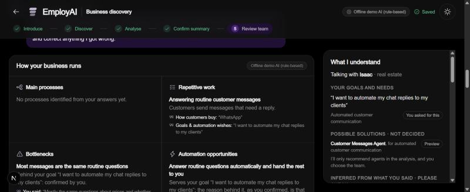
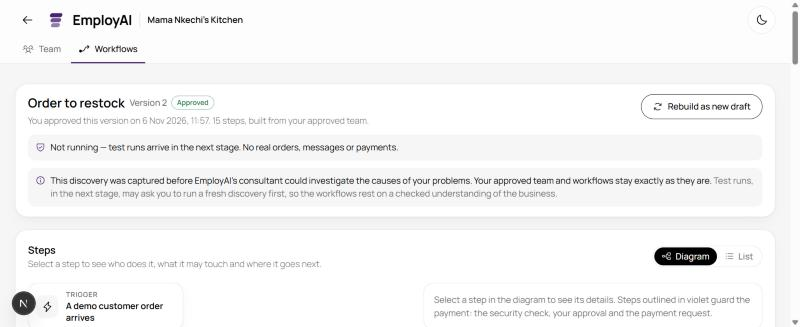
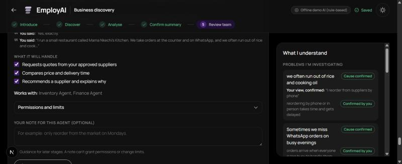
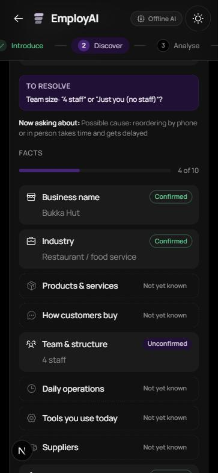
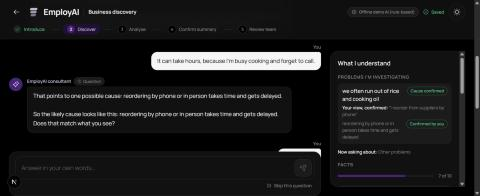

# M3.5 report · Discovery intelligence

Date: **2026-11-06**. Approved scope: the [M3.5 proposal](../m3.5-proposal.md): phases P1–P4 and **P6 (understanding first)**, acceptance criteria **AC-1 to AC-22**, decisions Q1–Q12, and the owner's safeguards S1–S11 (see the [decision log](../README.md#decision-log-owner-decisions)).

The goal: **a consultant that understands what the owner says before asking anything, and then investigates only what matters.**

Constraints honoured:

- **Offline only.** No NEAR AI or other AI provider calls, no network (`fetch` is stubbed in every test), no paid services, no accounts, no funding, no deployment, no transactions.
- `.env` untouched (`AI_PROVIDER=mock`). No new dependencies.
- **No commit and no push.** Everything is in the working tree for your review.
- Within the 3-day timebox: P1–P4 and P6 were both done on Nov 6, ahead of the Nov 7–9 window. Scope beyond the approved revision was not expanded.
- M4 not started. Decisions D1–D17 remain separate and unapproved.

The report has three parts. **Part 0** covers the pre-commit audit and its three fixes. **Part 1** covers the revision (P6), with results for all 22 criteria. **Part 2** is the first-pass report (P1–P4), kept for the record. Where parts differ, the earlier-numbered part is current.

# Part 0 · Pre-commit audit and fixes

A read-only audit before commit found three issues. All three are fixed within the audited scope, and every probe example is now a regression test (`tests/discovery-audit.test.ts`, 37 tests).

| # | Issue found | Fix | Result after the fix |
|---|---|---|---|
| 1 | **Over-eager evidence.** A passing word could support a cause nobody asked about. "I also use Instagram" supported "orders get buried across channels", which added the Orchestrator and Customer Messages Agent to the team. Neutral statements ("We open late on Sundays", "I do the books manually in a notebook") opened problem investigations. | An answer supports the cause being asked about, or any cause when the question is the open one about what's driving a goal or problem. Any other cause needs a **direct statement of that cause** (reviewed patterns beside the question sets, `statesCause` in `playbooks.ts`). A pain word opens a problem only with a stated negative outcome, or as the answer to "what would you most like help with". | None of the six incidental answers supports another cause; direct statements still do ("Orders get lost across WhatsApp and Instagram"). None of the seven neutral statements opens a problem; stated burdens still do. The mixed message ends with the **Order Agent alone**. |
| 2 | **Summary confirmation and inferences out of step.** Confirming the summary set the inferred fields to confirmed, but the case file and panel still said "Inferred · please check". | Inferences the owner approved in the summary are recorded as confirmed with `settled_by: "summary_review"`, still labelled as inferences. They never become owner-stated facts. An inferred field the owner corrects is recorded as a rejected inference. Typical industry knowledge and causes are never confirmed by the summary. Confirmation from the owner's own answers is recorded as `owner_words`. | The case file, panel ("Inferred; you approved it in the summary.") and profile agree. Typical knowledge stays *inferred*, and no cause is confirmed. |
| 3 | **Industry regression.** The new industries were checked before the original ones, so a passing word set the industry: "…serves lunch to construction workers" → Construction (which would make the restaurant demo non-runnable), "next to a school" → Education, "farm-fresh food" → Agriculture, "above a garage" → Automotive. | The original industry order is restored. Only "real estate / estate / letting agency", "travel / visa agency" and "digital agency" are matched anywhere, because they must beat the generic "agency". The other new industries count only from wording that names the business ("I'm into…", "I run a…", "we're a…", "our…", or a short answer). This applies to both the consultant and the original extractor. | All four examples (and "I run a restaurant next to a school") read as restaurant or salon. Real estate, travel agency, digital agency, hotel, tailoring and construction are still recognised when they name the business. |

**Probes repeated after the fixes:** all the incidental examples now give no supported cause and no problem. The Instagram case reaches a team of `order` only. After summary confirmation, the channel and products inferences read `confirmed` (summary review) and typical topics read `inferred`. The industry examples are all correct.

**Transcripts:** regenerated. Only the mixed-message conversation changed: the Instagram mention no longer supports a cause, and the conversation now continues to readiness with the Order Agent as the only possible solution. Isaac, Ada, the reference restaurant and the unfamiliar business are unchanged.

**Checks after the fixes:**
- **Tests:** 10 files, **184 tests**, all pass. That is 147 before the audit plus 37 audit regressions; no existing test changed.
- **Build and diff:** `tsc` clean, `next build` compiles, `git diff --check` clean.
- **Migration:** reverses exactly for all 43 stored businesses, and the store file hash is unchanged.
- **M3 work untouched:** the 12 approved teams and the approved workflow (Order to restock, version 2).
- **Environment and providers:** `.env` untouched; no AI calls.

# Part 1 · Understanding first (P6)

## What changed

| Area | What it does now | Where |
|---|---|---|
| **One-pass reading** | Every message is read whole: the owner's name, the business in their own words, the industry (16 now, including real estate, hospitality, travel, IT, events, fashion, automotive, farming, construction and education), goals, problems and stated causes, channels, team and tools, and the **needs** these signal. | `src/lib/rules/interpret.ts`, `src/lib/discovery/needs.ts`, `src/lib/rules/extract.ts` |
| **Case file additions** | `owner` (name, business phrase, "clients" or "customers"), `needs` (*stated* / *implied* / *rejected*), `inferences`, `solutions` (*considering* / *dropped*), `gap_answers`, `unrecognised`. All are optional, so earlier case files and migrated profiles stay valid. | `src/lib/discovery/casefile.ts` |
| **Two kinds of inference (S10)** | *Implied by your words*, for example "chat replies" means clients message you (platform unknown), or real estate means the business deals in property. These may fill a field, always as unconfirmed. *Typical for your industry*, for example the usual real-estate enquiry topics: shown only as typical, never written into a field, never presented as a fact. Never inferred: platforms, quantities, team size, prices or names. | `reasoning.ts` (`derive`) |
| **Possible solutions** | Each need, and each supported or confirmed cause, names an agent as *being considered*. It is dropped if the owner rejects it, and is only recommended in the analysis. | `reasoning.ts` (`derive`) |
| **Materiality** | Questions come from **gaps that change a solution**, each weighted: the platform for a messages agent (high), what clients ask (medium), what you sell for an order agent (medium), your suppliers for reorders (medium). A goal leads to **the problem behind it**, via the new cross-industry client-enquiries question set. Nothing stated or reasonably inferable is asked. | `needs.ts` (`GAPS`), `playbooks.ts` (`enquiries`), `reasoning.ts` (`planNext`) |
| **Ready by need** | Ready when the industry is known, there is a goal or problem, every problem is resolved, the high and medium gaps are settled and no contradiction is open. Products are no longer compulsory when the business makes them clear (Q11). | `casefile.ts` (`caseReadiness`, `openGaps`) |
| **Natural replies (S11)** | The first reply shows what was understood in the owner's words, names a possible solution tentatively, then asks the one question that matters. Later replies acknowledge only what's new; summaries aren't repeated. | `reasoning.ts` (`composeReply`) |
| **Kept, not lost (S9)** | A sentence the reader doesn't understand is kept verbatim, acknowledged ("I've kept a note of it as you said it"), and clarified later if questions remain. An unknown business is kept in the owner's words as its industry, and an unrecognised problem keeps its whole sentence. | `interpret.ts`, `reasoning.ts` |
| **Panel** | New sections: *Talking with Isaac · real estate*, **Your goals and needs**, **Possible solutions · not decided** (with Preview tags), **Inferred from what you said · please check**, **Typical for your industry · not known about yours**, **Kept as you said it**. The fields footer reads "Not discussed yet… I'll only ask about these if they'd change what I suggest." | `ContextPanel.tsx`, `understanding.ts` |
| **Analysis** | A goal-led problem's confirmed cause becomes the bottleneck. Opportunities "serve your goal … the reason behind it, as you confirmed, is…". Message problems that are really orders go to the Order Agent. A stated need whose reason stays unknown is still offered honestly ("You asked for this… what's behind it is still unknown"). | `src/lib/rules/analysis.ts` |

## Results against all 22 acceptance criteria

Unless noted, the evidence is from automated tests (`tests/discovery-reasoning.test.ts` and `tests/discovery-understanding.test.ts`).

| AC | Criterion | Result | Evidence |
|---|---|---|---|
| AC-1 | Causal statements kept | **Pass** | Unchanged from the first pass (Part 2). Reference: "…and you think it's because you reorder from suppliers by phone. I'll treat that as your view for now, not a conclusion." |
| AC-2 | No misfiling | **Pass** | All the first-pass regressions still pass. |
| AC-3 | Contradictions raised, corrections recorded | **Pass** | Unchanged. Tunde's "Actually it's just me now" is recorded as a correction, with history. |
| AC-4 | One question per turn, **chosen by materiality** *(revised)* | **Pass** | One "?" per question on every turn. Each question has a purpose key (`gap:`, `opening:`, `hyp:`, `confirm:`, `contra:`, `clarify:`…). Isaac's first question is the high-weight gap `gap:customer_messaging:channel`. |
| AC-5 | No repetition; **nothing stated or inferable asked** *(revised)* | **Pass** | Forbidden-question lists for Isaac (industry, what he sells, the menu, his name, team), Ada (industry, how customers order, platform) and the reference (business type, name, channels). None is asked. Found in the browser check and fixed: the "what do clients ask" question is skipped when the owner already said it. |
| AC-6 | Limits 3 / 12 | **Pass** | Unchanged. Isaac 3, Ada 4, reference 8 questions. |
| AC-7 | Facts, views, unknowns separate; owner-only confirmation | **Pass** | Unchanged, and extended: inferences never become facts unless the owner's own words confirm them. |
| AC-8 | Restaurant diagnosis; **the problem behind a goal** *(revised)* | **Pass** | Five restaurant question sets as before. Isaac's goal is investigated with the client-enquiries set: "What's making you want this…?", then a cause he confirms. If he can't say why, it stays *unknown*, and his request is offered as "Automated customer communication, as you asked", saying the reason is unknown. |
| AC-9 | Honest fallback | **Pass** | Unchanged. The drone owner's quoting problem gets "I don't recognise that kind of problem yet…" and closes as unknown. |
| AC-10 | Explains its reasoning; reflects only what was recorded | **Pass** | Unchanged. Gap questions carry their reason when useful ("An order agent needs to know what it's taking orders for"). |
| AC-11 | Ready **by need**; ≤ 5 questions for goal-led introductions *(revised)* | **Pass** | Isaac 3, Ada 4, consultancy ≤ 5, each ending "I think I have a clear enough picture". Isaac is never asked what he sells (shown as an unconfirmed inference); Ada is, because an order agent needs it. The reference restaurant is ready in 8 without the budget. |
| AC-12 | Grounded analysis | **Pass** | Unchanged, plus goal-led bottlenecks are the confirmed cause, not the goal. |
| AC-13 | Agents traceable to a **stated need or a confirmed cause** *(revised)* | **Pass** | Reference: Orchestrator + Order, Inventory, Procurement, Finance (unchanged). Isaac: only the Customer Messages Agent (Preview), "Serves your goal … the reason behind it, as you confirmed, is that most messages are the same routine questions"; confirmed in the browser team step (1 agent, Preview). Ada: only the Order Agent, traced to her problem and confirmed cause. An introduction with no goal or problem justifies no agent. |
| AC-14 | Compatible; migration safe and reversible | **Pass** | Dry run over the 43 stored businesses with the new code: 43 of 43 reverse exactly, fields unchanged, only *stated* claims, no confirmed cause. Store file hash identical before and after. |
| AC-15 | Offline; live adapter unchanged | **Pass** | `fetch` blocked in every test. The live JSON schema test still pins the M2 shape; the new fields exist only in the offline schema. |
| AC-16 | Quality bar | **Pass** | Injection test kept. `tsc`, `next build` and `git diff --check` pass, plus a whitespace scan of new files. Browser: Isaac end to end (conversation, panel, analysis, team); WCAG AA in both themes (lowest 4.94:1); no horizontal overflow at 1278 px or 375 px. Screenshots below. |
| AC-17 | **One-pass understanding** | **Pass** | Isaac: name, industry, goal, need, possible solution, all cited to message 1, and "Isaac" not taken as a business name. Ada: name, "a bakery in Abuja", WhatsApp, problem, implied need. Reference: name, industry, channels, supplier routine, problem and the owner's cause. Salon and retail: industry and problem. Consultancy: industry, goal and need. Mixed (Tunde): name, business name, team, problem, goal with no duplicate problem, then a correction and a new channel in one reply. |
| AC-18 | **Shows what it understood before asking** | **Pass** | "Hi Isaac! You're in real estate, and you'd like to automate your chat replies to your clients. I'm thinking of a customer messages agent that…" then one question. Later replies never repeat the opening summary ("Got it: your clients reach you on WhatsApp."). |
| AC-19 | **Inference kept separate**, two kinds | **Pass** | Isaac's channel and products are *assumed* (unconfirmed); the typical topics have no field and no value. No inference names a platform, number, staff or agents. "Mostly WhatsApp" confirms the channel inference; "No, mostly about payment plans and mortgages" rejects the typical one and keeps his words. |
| AC-20 | **Needs and possible solutions** | **Pass** | Isaac: *Automated customer communication* → Customer Messages Agent, *considering*, Preview. "I don't want a bot replying to my clients" → need rejected, solution dropped, "Understood, I won't suggest a customer messages agent." |
| AC-21 | **Updates on every message** | **Pass** | "Mostly WhatsApp, and a lot of messages come in late at night" answers the platform and supports *after hours* at once. "Actually, what I really want is to stop losing leads at night" replaces the goal ("I'll work from that instead"). |
| AC-22 | **Unfamiliar input kept, not lost** | **Pass** | "Drone mapping for farms and construction sites" is kept as the industry, not misread as construction or farming. "Our clients ask about pricing all the time" is kept verbatim, acknowledged and later clarified, with the answer stored. "Our biggest headache is the generator" is kept. An unrecognised problem keeps its whole sentence. |

## Tests

`npx vitest run` (before the audit; now 184, see Part 0): **9 files, 147 tests, all pass**. That is 74 from M1–M3, 39 from the first M3.5 pass (`discovery-reasoning.test.ts`), and **34 new** (`discovery-understanding.test.ts`). `tsc` is clean, `next build` compiles, and `git diff --check` is clean.

Existing tests changed in this revision:
- `discovery-reasoning`: one wording ("how your customers reach you" instead of "how customers buy").
- `discovery-reasoning`: the purpose-key pattern now includes `gap`, `opening` and `clarify`.
- `tests/helpers/reference.ts`: answers the new question kinds.

No M1–M3 assertion changed in this revision.

**Found during the browser checks and demo, fixed, and now tested:**
- Ada's bakery was reflected as "restaurants": city names had been wrongly treated as non-businesses.
- The salon sentence was echoed back whole.
- "Drone mapping … construction sites" was read as construction.
- "I also use Instagram" was missed.
- Two causes supported at once produced an ambiguous confirmation question.
- Tunde's order goal created a duplicate problem.
- "What I really want is…" wasn't read as a goal.
- The topics question was asked after the owner had already answered it.
- An unrecognised problem was cut to a fragment.

## The conversations

Full transcripts for Isaac, Ada, the reference restaurant, the mixed message and the unfamiliar business, with **the case file after each message**, are in [m3.5-conversations.md](m3.5-conversations.md). Isaac in brief:

> **Owner:** Hello, I'm Isaac and I'm into real estate. I want to automate my chat replies to my clients.
>
> **Consultant:** Hi Isaac! You're in real estate, and you'd like to automate your chat replies to your clients. I'm thinking of a customer messages agent that answers the questions your clients ask most and passes anything unusual to you. In real estate those are usually about property availability, prices and viewing arrangements, but I'll check that rather than assume it. Which platform do most of your clients message you on?
>
> *Case file:*
> - Isaac · real estate (confirmed)
> - goal (stated)
> - need: automated customer communication (asked for)
> - Customer Messages Agent (considering)
> - inferred: clients reach you by message, platform unknown; the business deals in property
> - typical for real estate: enquiry topics
>
> **Owner:** Mostly WhatsApp.
>
> **Consultant:** Got it: your clients reach you on WhatsApp. What's making you want this: replies taking too long, messages arriving when you can't answer, or the same questions coming up again and again?
>
> **Owner:** Mostly the same questions about prices and whether a property is still available, and a lot of them come in late at night.
>
> **Consultant:** That points to two possible causes: most messages are the same routine questions; and messages arrive when no one is free to reply. Let's take them one at a time. So the likely cause looks like this: most messages are the same routine questions. Does that match what you see?
>
> **Owner:** Yes, exactly.
>
> **Consultant:** Thanks. I'll record that as the cause, confirmed by you… I think I have a clear enough picture to analyse the business. Behind “I want to automate my chat replies to my clients”: most messages are the same routine questions, as you confirmed. Worth looking at in the analysis: a customer messages agent. Nothing is decided until you review the team.

## Migration and compatibility (revision)

- **New fields are additive.** P6 adds only optional case-file sections. A profile created before M3.5 still migrates additively, and removing `case_file` restores it exactly.
- **Dry run over the real store:** 43 of 43 businesses reverse exactly, keep their field values and statuses, hold only *stated* claims and no confirmed causes, and are flagged as pre-M3.5. The approved M3 workflow (`d8c07761…`, version 2) and the 12 approved teams are untouched.
- **Browser check left nothing behind.** It created one temporary business, which was removed by restoring a backup; the store hash matches the original.

## Screenshots (revision)

| | |
|---|---|
|  | Isaac: the analysis (the confirmed cause as bottleneck, opportunities serving his goal) beside the panel: *Talking with Isaac · real estate*, **Your goals and needs**, **Possible solutions · not decided** with Preview. |

## Remaining limitations (revision)

1. **Live AI mode doesn't investigate yet.** P5 remains unapproved; live mode gets the code-enforced rules only.
2. **The offline reader has a bounded vocabulary.** It covers 16 industries and common phrasings. Anything else is kept verbatim and clarified (S9) rather than understood. A live model (P5) would fill the same interpretation schema.
3. **Evidence for causes not asked about needs a direct statement** (fixed in the audit, Part 0). The reviewed "direct statement" patterns are deliberately narrow, so some genuine side remarks won't count until the consultant asks about that cause itself. This errs on the side of asking.
4. **Typical topics exist for 10 industries.** Elsewhere the consultant simply asks what clients ask about.
5. **Non-restaurant agents remain Preview,** as approved. Only the restaurant is runnable.
6. **One "possible solution" per capability.** The Inventory and Procurement Agents still share one reason when one cause justifies both.

# Part 2 · First pass (P1–P4), kept for the record

## What was built

| Phase | What changed | Where |
|---|---|---|
| **P1 · No misfiling** | A reply is filed under the pending question only when it actually answers it. Otherwise it is filed under its real meaning (a goal, a team size, a problem), or kept unclassified and the question is rephrased once. Single-value facts (business name, industry, team size) are never silently overwritten: a different value opens a contradiction; "Actually…" is a correction. | `src/lib/rules/interpret.ts`, `src/lib/discovery/reasoning.ts` (`applyInterpretation`) |
| **P2 · Case file** | Each business profile gains an optional `case_file`: facts (with history), the owner's claims (symptoms, stated causes, goals; *stated*, not verified), problems with possible causes, a question agenda (each question has a purpose and an ask count), contradictions, and the question budget. The ten profile fields are now a **view** derived from it, so every existing consumer works unchanged. | `src/lib/discovery/casefile.ts`, `interpretation.ts`, `understanding.ts` |
| **P3 · Playbooks** | Five restaurant playbooks (overbuying, running out, missed orders, slow service, low profit), each with 4–5 possible causes, one diagnostic question per cause, a rephrase, evidence patterns and the fix. Retail reuses three; salon has a light no-show playbook; anything else gets the honest fallback. The **code** decides the next question (`planNext`); a cause is *confirmed* only by the owner's "yes" to a confirmation question. | `src/lib/discovery/playbooks.ts`, `reasoning.ts` (`planNext`, `composeReply`) |
| **P4 · Grounded analysis and agents** | Bottlenecks are cause chains. Opportunities exist only for confirmed or supported causes; an unknown cause gives "Measure first…". Each item carries its basis (*confirmed*, *supported*, *assumed*), set by code. Every specialist agent's reason names the problem and the cause it addresses. The Orchestrator is proposed only when two or more specialists need coordinating. | `src/lib/rules/analysis.ts` (`caseAnalysis`), `src/lib/discovery/analysis.ts` (`caseBasis`) |
| **Interface** | The "What I understand" panel shows **Problems I'm investigating** (each with the owner's view and whether it is verified, possible causes with *Checking / Supported / Ruled out / Confirmed by you*, and what remains uncertain), **To resolve** (open contradictions), **Corrected**, **Now asking about**, then the facts. Analysis, summary and team cards label a supported cause "Supported by your answers, not confirmed". | `ContextPanel.tsx`, `AnalysisCard.tsx`, `SummaryReview.tsx`, `TeamProposal.tsx` |
| **Pre-M3.5 notice** | Businesses discovered before M3.5 keep their approved team and workflows exactly as they are. The Team and Workflows tabs say so, and that test runs (next stage) may ask for a fresh discovery. | `DiscoveryNotice.tsx`, `WorkflowWorkspace.tsx`, `TeamOverview.tsx` |

The live provider path is untouched: the JSON schema sent to a model (`DiscoveryTurnSchema`) has exactly the M2 shape, and live facts go through the same code-enforced merge. The offline provider uses an extended schema (`OfflineTurnSchema`).

## Results against the 16 acceptance criteria

| AC | Criterion | Result | Evidence |
|---|---|---|---|
| AC-1 | Causal statements kept | **Pass** | "Our restaurant keeps losing money because we buy too much stock" → symptom *losing money* + the owner's stated cause *we buy too much stock*, both cited to the message, both *stated*; the reply says "I'll treat that as your view for now, not a conclusion"; the panel shows "Your view, not yet verified". |
| AC-2 | No misfiling; the diagnosis examples are regression tests | **Pass** | 10 tests: "I want to make more profit" → goal (the channels question stays open and is rephrased once); "We have 4 staff" → team size, not a goal; "Actually it's just me" → team correction, not a supplier; the stated cause is no longer dropped; "Every few months someone leaves" isn't filed as products; a genuine answer still is. Plus 3 found during the browser checks and demo (below). |
| AC-3 | Contradictions raised, corrections recorded | **Pass** | "4 staff" then "just me" → one clarifying question; "4 staff" kept and marked unconfirmed until answered; resolution recorded. "Actually…" → correction with history, shown under **Corrected**. A contradiction found while another question is pending is acknowledged in the reply. |
| AC-4 | One question per turn, each with a purpose | **Pass** | Asserted on every turn of three scripted conversations: exactly one "?" in a question, none in a summary; every question has an agenda key (`fact:`, `hyp:`, `confirm:`, `contra:`, `other_problems`, `describe:`). |
| AC-5 | No repetition; one rephrase; skip / "I don't know" | **Pass** | No agenda item is asked more than twice, and no wording repeats. "Skip" and "I don't know" mark the item declined and it is never asked again. |
| AC-6 | Limits: 3 per problem, 12 overall | **Pass** | Asserted across scripted runs. Reference conversation: 10 questions. |
| AC-7 | Facts, views, unknowns separate; owner-only confirmation | **Pass** | A supported cause stays *supported* until the owner answers the confirmation question. A "yes" to any other question confirms nothing. Confirming the summary confirms reviewed facts, never possible causes. |
| AC-8 | Five restaurant playbooks reach a cause or an explicit unknown | **Pass** | One scripted conversation per playbook reaches an owner-confirmed cause within 3 probes; the "I don't know" runs end as *unknown* with "Measure first…". |
| AC-9 | Honest fallback | **Pass** | "My staff keep quitting" → "I don't recognise that kind of problem yet, so I won't guess at its causes. Could you describe what happens, and how often?" → closed as unknown; no causes invented. |
| AC-10 | Explains its reasoning; reflects only what was recorded | **Pass** | Each first probe carries a one-sentence reason (the playbook's, or "Let me check your explanation first…"). Acknowledgements list exactly the facts filed that turn ("Noted: how customers buy …; team size …"), so a wrong filing would be visible to the owner. |
| AC-11 | Knows when to move on | **Pass** | Ready when essentials are known or declined, every problem is resolved (confirmed, supported or unknown), no contradiction is open and no question is pending; or at the budget, with the unknowns listed. It says "clear enough picture" only when that is true; otherwise "That's as far as I can get by asking… The analysis will only build on what you've told me." "Analyse my business" stays available. |
| AC-12 | Grounded analysis | **Pass** | Bottlenecks read "Cause, confirmed by you: …". Opportunity basis is *confirmed* / *supported* / *assumed*. An unknown cause yields only "Measure first: record when each item runs out and when it was reordered". |
| AC-13 | Grounded agents; reference conversation → 5 agents | **Pass** | Reference conversation → Orchestrator + Order, Inventory, Procurement and Finance Agents, each specialist reason starting "Addresses “…”, caused, as you confirmed, by: …", basis *confirmed*, evidence the owner's own messages. Facts alone (WhatsApp, suppliers) justify no agent. Confirmed in the browser (team proposal page, 5 of 5). |
| AC-14 | Compatible; existing conversations migrate; existing tests pass | **Pass** (4 existing tests updated, see below) | The ten fields stay available everywhere. Migration tests (reversible, idempotent, statuses kept). Dry run over the 43 businesses in the local store (below). |
| AC-15 | Offline and in scope | **Pass** | `fetch` stub in every test; no provider selected except `mock`; the live schema test pins the M2 shape; restaurant the only runnable scenario; other industries Preview (workflow route tests). |
| AC-16 | Quality bar | **Pass** | Prompt-injection route test kept and passing. `tsc`, `next build`, `git diff --check` and a trailing-whitespace scan of new files pass. Desktop and mobile (375 px), dark and light: no horizontal page overflow; WCAG AA contrast measured on every panel element in both themes (lowest 4.94:1). Screenshots below. |

## Tests

`npx vitest run`: **8 files, 113 tests, all pass.** That is the 74 M1–M3 tests plus **39 new** M3.5 tests in `tests/discovery-reasoning.test.ts`, organised by acceptance criterion. The tests use `tests/helpers/converse.ts`, which drives a conversation exactly as the service does, and `tests/helpers/reference.ts`, which holds the reference restaurant conversation, answered by question purpose.

`npx tsc --noEmit`: clean. `npx next build`: compiled successfully, 10 pages. `git diff --check`: clean.

### Regression tests for the misfiling examples

| Example (from the diagnosis) | M2 behaviour | M3.5 |
|---|---|---|
| "Our restaurant keeps losing money because we buy too much stock." | Kept "losing money"; dropped the cause | Symptom + the owner's stated cause, both cited; investigated |
| "I want to make more profit." to *how do customers buy?* | Stored as a sales channel | Goal; the channel question is rephrased once |
| "We have 4 staff." to *goals* | Stored as a goal | Team size |
| "Actually it's just me." to *suppliers* | Stored as a supplier | Team-size correction, history kept |
| "Every few months someone leaves after a few weeks." to *products* | Stored as products | Not filed there |

**Found and fixed during the browser checks and demo, each now a regression test:**

- "We have 4 staff and customers order at the counter and on WhatsApp." The team field took the whole sentence, and only one of the two facts was acknowledged. Now: team "4 staff", channels recorded, both acknowledged.
- "Jollof rice, fried rice and grilled chicken." given to the *goals* question was filed as a goal. Now a reply is filed as a goal or a problem only if it reads like one. Otherwise: "I'm not sure how that fits yet", and the question is asked again.
- "Me, my sister and two cooks." was recorded as team size "2 staff". Now: "4 people including you".
- A contradiction found while another question was being rephrased wasn't mentioned in the reply. Now: "I've noted “Just you (no staff)”, which differs from the “4 staff” you mentioned earlier. I'll check which is right before the summary."

Also polished: the first reply no longer restates the owner's explanation twice, and a confirmation question no longer repeats the cause named in the same reply.

### Existing tests that were changed, and why

| Test | Change | Why |
|---|---|---|
| `discovery-domain` · first turn | Expects a question about the stated problem (`question_field` null, reply cites the owner's explanation), not "products" | The M3.5 first question investigates the problem the owner raised. This is the behaviour change M3.5 was approved for. |
| `routes` · restaurant journey helper | Answers by the question's purpose (`referenceAnswer`); the question limit is ≤ 12 (was ≤ 6); the clock advances 7 s per answer | The M2 helper matched field labels in the question text, which can't answer questions about causes. The 12-question limit is Q7. The unchanged 10-turns-a-minute rate limit applies at human typing speed. |
| `routes` · resume after restart | The menu sent in reply to the goals question is no longer expected to be stored as a goal | The old assertion encoded the M2 misfiling M3.5 removes. Resume itself is still asserted (messages, open question). |
| `workflow-routes` · team helper | Answers by question purpose (restaurant: the reference conversation; salon: a purpose-based answer function); human-pace clock | Same reason as the route helper. Team, workflow and approval assertions are unchanged. |

No security, ownership, injection or workflow-validation assertion was weakened. The product rate limit is unchanged.

## Demonstration: the consultant now

The demos below come from the offline engine (`tests/helpers/converse.ts`). The reference conversation was also replayed in the browser with the same replies, up to the 5-agent team proposal.

### Your original example

> **Owner:** I run a small restaurant called Mama Nkechi's Kitchen in Lagos. Our restaurant keeps losing money because we buy too much stock.
>
> **Consultant:** Thanks for telling me about Mama Nkechi's Kitchen. I've noted that your restaurant keeps losing money, and that you think it's because you buy too much stock. I'll treat that as your view for now, not a conclusion. Buying too much has several possible causes, and each needs a different fix, so I'd like to check before suggesting anything. When stock goes unused, what usually happens to it: does it spoil or expire before you can use it, or does it just pile up?
>
> **Owner:** Tomatoes and peppers go bad a lot.
>
> **Consultant:** That points to one possible cause: stock spoils or expires before it's used. Is that the main reason, in your experience?
>
> **Owner:** Yes, that's right.
>
> **Consultant:** Thanks. I'll record that as the cause, confirmed by you: stock spoils or expires before it's used. What's on the menu: your main dishes or products?
>
> **Owner:** We have 4 staff and customers order at the counter and on WhatsApp.
>
> **Consultant:** Noted: how customers buy “WhatsApp, In person”; team size “4 staff”. Let me ask it another way: what are the main things customers buy from you?
>
> **Owner:** I want to make more profit.
>
> **Consultant:** Understood, your goal is “I want to make more profit”. Is anything else costing you time or money at the moment, for example orders, payments or staff?
>
> **Owner:** It's just me, I do everything.
>
> **Consultant:** I want to get this right, because it changes how much an AI team should take on. Earlier you mentioned “4 staff”, and now “Just you (no staff)”. Which is right?
>
> **Owner:** It's just me now.
>
> **Consultant:** Got it: team size is “Just you (no staff)”. Who supplies your key ingredients, and how do you reorder from them today?

### The reference restaurant conversation (10 questions, 3 causes confirmed)

> **Owner:** I run a small restaurant called Mama Nkechi's Kitchen. We take orders at the counter and on WhatsApp, and we often run out of rice and cooking oil because I reorder from suppliers by phone.
>
> **Consultant:** Thanks for telling me about Mama Nkechi's Kitchen. I've noted that you often run out of rice and cooking oil, and that you think it's because you reorder from suppliers by phone. I'll treat that as your view for now, not a conclusion. Let me check your explanation first, along with other possible causes. When stock runs low, how long does it take from noticing to actually placing the order, and what gets in the way?
>
> **Owner:** It can take hours, because I'm busy cooking and forget to call.
>
> **Consultant:** That points to one possible cause: reordering by phone or in person takes time and gets delayed. Is that the main reason, in your experience?
>
> **Owner:** Yes, exactly.
>
> **Consultant:** Thanks. I'll record that as the cause, confirmed by you: reordering by phone or in person takes time and gets delayed. What's on the menu: your main dishes or products?
>
> *(menu and goal answered)*
>
> **Consultant:** … Is anything else costing you time or money at the moment, for example orders, payments or staff?
>
> **Owner:** Sometimes we miss WhatsApp orders on busy evenings, and I lose track of supplier payments because I pay cash.
>
> **Consultant:** I've noted the problem: sometimes you miss WhatsApp orders on busy evenings. I've noted that you lose track of supplier payments, and that you think it's because you pay cash. I'll treat that as your view for now, not a conclusion. Orders go missing for different reasons, so I'd like to see where they slip through. Do orders get missed mostly at busy times, when everyone is cooking or serving?
>
> *(busy times confirmed; then spending tracking: "Not really, I pay cash and the receipts get lost", confirmed)*
>
> **Owner:** Me, my sister and two cooks.
>
> **Consultant:** Noted: team size “4 people including you”. I think I have a clear enough picture to analyse the business. “we often run out of rice and cooking oil”: the cause, confirmed by you, is that reordering by phone or in person takes time and gets delayed. “Sometimes we miss WhatsApp orders on busy evenings”: the cause, confirmed by you, is that orders arrive when everyone is too busy to handle them. “I lose track of supplier payments”: the cause, confirmed by you, is that spending and supplier payments aren't tracked. Choose “Analyse my business” when you're ready, or add anything else first.

The proposed team:

| Agent | Why (from the proposal) |
|---|---|
| Business Orchestrator | One coordinator passes work between the specialists working on these problems and asks you when a decision is needed. |
| Order Agent | Addresses “Sometimes we miss WhatsApp orders on busy evenings”, caused, as you confirmed, by: orders arrive when everyone is too busy to handle them. |
| Inventory Agent | Addresses “we often run out of rice and cooking oil”, caused, as you confirmed, by: reordering by phone or in person takes time and gets delayed. |
| Procurement Agent | Addresses the same problem and cause (preparing supplier orders). |
| Finance Agent | Addresses “I lose track of supplier payments”, caused, as you confirmed, by: spending and supplier payments aren't tracked. |

### When it can't find the cause (limits without invented certainty)

An owner who answers "I don't know" to everything after "we keep running out of ingredients":

- Three cause questions are asked, each acknowledged with "No problem, I'll treat that as unknown."
- The consultant then says: "I can't pin down the cause from what we've covered, so I'll mark it as unknown rather than guess. The cause of “we keep running out of ingredients” is still unknown. Measure first: record when each item runs out and when it was reordered."
- It ends with "That's as far as I can get by asking, so I'll stop here rather than guess…" and lists what is still unknown.
- The analysis contains **only** the measure-first item (basis *assumed*). The team is just the Inventory Agent, there to measure.

## Migration and backward compatibility

- **Additive.** A stored business has no `case_file` until its next consultant turn. The turn builds one from the stored fields (`origin: "migrated"`), and nothing else in the stored profile changes.
- **Reversible.** `revertCaseFileMigration` removes the case file and gives back the original profile exactly (deep-equal, tested).
- **No silent upgrades.** Assumed facts stay assumed. The stored challenge and goal become the owner's *stated* claims, not causes. No hypothesis is confirmed. The panel marks the problems "your own descriptions, not diagnosed".
- **Original messages preserved.** Messages are never rewritten.
- **Dry run over the real local store** (read-only; file hash identical before and after):

| | Result |
|---|---|
| Businesses migrated in memory | 43 of 43 |
| Exact reversal | 43 of 43 |
| Ten-field values and statuses unchanged by migration | 43 of 43 |
| Readiness unchanged (M2 rule vs case-file rule) | 43 of 43 |
| Claims all *stated*, no confirmed cause | 43 of 43 |
| Businesses with an approved team / with workflows | 12 / 1 (`d8c07761…`, Order to restock v2, approved) |

- **Approved M3 work is never deleted or invalidated.** Migration only touches `profile.case_file`. Agents and workflows are separate records, and none were changed. In the browser, the approved workflow (version 2) and team still show as approved, with the pre-M3.5 notice. Viewing them left the store byte-identical. The three temporary businesses created for the browser checks were removed by restoring the backup; the restored store's hash matches the original.

## Screenshots

| | |
|---|---|
|  | The approved workflow keeps its version and status; the notice explains that test runs may ask for a fresh discovery. Light theme. |
|  | Reference conversation: team proposal beside the panel, each problem with "Cause confirmed" and "Confirmed by you". Dark theme. |
|  | 375 px: **To resolve** (open team-size contradiction), **Now asking about**, then the facts. No horizontal overflow. |
|  | Mid-conversation: a supported cause awaiting the owner's confirmation. |

## Remaining limitations

1. **Live AI mode doesn't investigate yet.** The NEAR AI path (unapproved, unused) keeps the M2 request and gains only the code-enforced fact rules. Investigation with a live model is P5, which needs your separate approval.
2. **The offline interpreter is pattern-based English.** Phrasings outside its patterns are kept unclassified ("I'm not sure how that fits yet") and the question is asked again. That is honest, but a real owner will sometimes need to rephrase.
3. **The owner's view stays "not yet verified"** when a different, more specific cause in the same family is confirmed. For example, *buying too much* explained by confirmed *spoilage*. This is accurate but could be worded more helpfully.
4. **Contradictions are detected only for business name, industry and team size.** "4 staff" and "5 people including you" can describe the same team but would be asked about.
5. **Retail and salon playbooks are light; other industries use the honest fallback** and remain Preview. Only the restaurant is runnable.
6. **Q4, cause-specific catalogue tasks, was allowed but not needed.** Agents cite the cause in their reasons, and their tasks are the M3 catalogue tasks. The Inventory and Procurement Agents share one reason because one cause justifies both.
7. **Pre-M3.5 businesses:** whether M4 test runs *require* a fresh discovery is an M4 decision. The interface says they *may*.
8. Inherited from M2: `SUP_RE` matches "scam-supplier"-style words as suppliers.
9. The panel heading stays "Problems I'm investigating" after every problem is resolved (cosmetic).

## Files

New: `src/lib/discovery/{casefile,interpretation,playbooks,reasoning,understanding}.ts`, `src/lib/rules/interpret.ts`, `src/components/workspace/DiscoveryNotice.tsx`, `tests/discovery-reasoning.test.ts`, `tests/helpers/{converse,reference}.ts`, this report and its screenshots.

Changed: discovery `profile`, `merge`, `service`, `store`, `view`, `view-types`, `analysis`; `rules/{analysis,consultant,extract}.ts`; `catalogue/propose.ts`; workflows `view`, `view-types`; onboarding `AnalysisCard`, `ContextPanel`, `DiscoveryWorkspace`, `SummaryReview`, `TeamProposal`; workspace `TeamOverview`, `WorkflowWorkspace`; tests `discovery-domain`, `routes`, `workflow-routes`; docs `03`, `08`, `README`, `m3.5-proposal`.

Not to be committed: `.claude/launch.json` and the root screenshot PNG.
